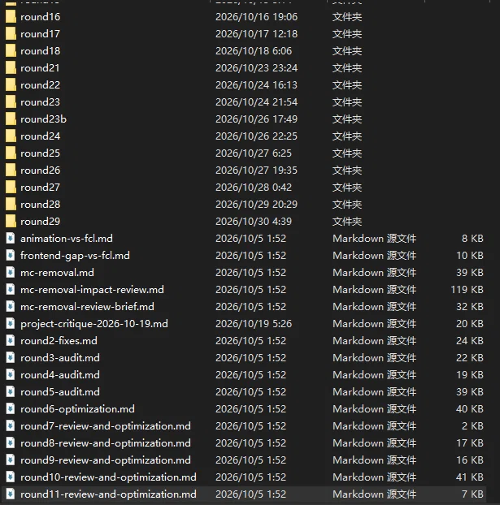

# 来自分享的对话（DeepSeek 分享对话完整转录）

| 项目 | 内容 |
|---|---|
| 来源链接 | https://chat.deepseek.com/share/yn99k1mum4qp5fqwj8 |
| 模型 / 模式 | default / DEEP_SEARCH（深度搜索，开启思考与联网） |
| 消息数 | 28 条（用户 14 轮提问，AI 14 轮回答） |
| 抓取方式 | 通过 WAF 校验后用浏览器抓取官方分享接口 `/api/v0/share/content` 原始数据 |
| 抓取时间 | 2026/11/1 01:35:32 |

> 说明：每轮回答的「已思考 / 检索过程」折叠在 detail 块中，包含联网搜索关键词、打开的网页与思考摘要；正文为回答原文，未作改写。

---

## 用户 · 第 1 轮

**附件：`image.png`**（615×622，87.8 KB）



请你上网搜索，给我一个适用于任何harness和模型的提示词，要求拼尽全力使用多agent来找出这个项目的bug
并且产出md在当前项目文件夹的docs\reports文件夹内标好序号这是第几次代码优化和审计具体情况看图片，没有docs\reports文件夹就自己创建
明确主agent不能亲自下场做任何事，只得派agent去完成，主agent（对话）只负责调度多agent
多agent分为几个波次，第一波摸清项目是什么，技术栈是什么，用户实际体验到的流程是什么
然后依次往后设计波数
最后必须要有锐评波次和修复波和验收波，到后面每个agent都应该只针对一个问题
token不是约束，充分探索、充分辩论、充分验证，期间如有agent因任何问题报错，都必须全量重跑，不要有任何缩水和将任务推给主线程，主线程只负责调度agent和整理信息向用户提交信息
主Agent负责汇总冲突并输出最优解
我不要求你现在就给我提示词，现在请和我交流一下如何做好这个提示词

## DeepSeek · 第 1 轮回答

<details>
<summary>已思考 / 检索过程（17 步，点击展开）</summary>

用户需要设计一个多Agent提示词架构，核心是主Agent只做调度、多波次分阶段审计、强制锐评和修复验收，还要自动识别轮次编号。我先并行搜索几个关键方向：多Agent编排的最佳实践、调度与子Agent状态管理、以及审计报告命名规则。

**联网搜索**：搜索到 28 个网页

- `LLM 多Agent 协作 编排架构 最佳实践 2025 2026`
- `Multi-Agent Orchestration Supervisor 架构 提示词 设计`
- `多智能体 代码审计 调度 提示词 框架 子Agent 状态管理`
- `多Agent 代码审计 报告 轮次 编号 命名 规范 项目 docs reports`

搜索结果回来了，有几篇看起来很有用。AgentOS的论文提到了分层多Agent编排和对抗性质量控制，Manager-Executor模型强调了层级化的任务分解，阿里云的文章总结了Supervisor、Pipeline、Swarm三种模式。DeepAudit和SendraAI是专门做代码审计的多Agent系统，提到了Orchestrator系统提示词和对抗性审计。Claude Code的动态工作流文档也涉及大规模编排子代理。这些材料覆盖了架构模式、审计专用框架和调度机制。我需要打开这些页面，深入提取关于Supervisor职责、Worker角色划分、对抗性审计提示词设计、以及动态工作流编排的具体细节。

**打开网页**：[AgentOS: A Hierarchical Multi-Agent Orchestration Framework with Epistemic Routing, Three-Tier Memory, and Adversarial Q](https://ieeexplore.ieee.org/document/11723665#1)

**打开网页**：[Manager-Executor: Collaboration Model Based on Hierarchy Multi-LLMs to Enhance the Efficiency of LLM Tasks](https://ieeexplore.ieee.org/document/11424841#1)

**打开网页**：[多智能体系统的三种编排模式：Supervisor、Pipeline 与 Swarm](https://developer.aliyun.com/article/1716725#1)

**打开网页**：[降SpringAI阿里第12掌-时乘六龙-分身多Agent](https://cloud.tencent.cn/developer/article/2752093#3)

**打开网页**：[The End of the Monolithic Prompt: Designing Multi-Agent Swarms with Amazon Bedrock | AWS Builder Center - 选择您的 Cookie 首选](https://builder.aws.com/content/3KUYhRy9MUqFiCTAoZOY2zlIhtN/the-end-of-the-monolithic-prompt-designing-multi-agent-swarms-with-amazon-bedrock#1)

**打开网页**：[sendra-ai - SendraAI 🛡️⚡](https://pypi.org/project/sendra-ai/0.1.0/#files#1)

**打开网页**：[]()

**打开网页**：[]()

打开的页面提供了不少关键信息。AgentOS的对抗性三审机制（Skeptic、Devil's Advocate、Synthesis arbitrator）和DAG任务规划，很适合用来设计“锐评波次”和任务分解。SendraAI的架构图展示了Orchestrator→并行专家→Lead Synthesizer的fan-out/fan-in模式，以及仲裁与综合的职责，这可以作为多Agent波次编排的参考。Claude Code的动态工作流文档提到可以让独立代理对彼此的发现进行对抗性审查，这正好满足用户“充分辩论”的要求。阿里云的文章明确了Supervisor的职责是分解、分配、综合，且不执行具体任务，这与用户“主agent不能亲自下场”的要求完全吻合。Manager-Executor模型强调了Manager负责全局规划，Executor轻量执行。现在需要进一步搜索更具体的提示词工程技巧、失败重跑机制和文件命名实践，以补充架构设计中的操作细节。

**联网搜索**：搜索到 24 个网页

- `多Agent 提示词 工程 角色定义 调度 协议 代码审计 2025 2026`
- `子Agent 失败 重跑 状态机 多智能体 编排 可靠性`
- `对抗性审查 代码审计 多Agent 提示词 设计 辩论`
- `代码审计 轮次 编号 自动 识别 文件名 规范 md 项目 文档`

**打开网页**：[]()

**打开网页**：[]()

**打开网页**：[]()

搜索结果提供了几个关键的设计参考：AgentOS的对抗性三审和DAG规划、SendraAI的fan-out/fan-in仲裁架构、阿里云总结的Supervisor模式以及Claude Code动态工作流中“独立代理对抗性审查”的实践。用户的要求很具体：主Agent只做调度、多波次分阶段审计、强制锐评和修复验收、自动识别轮次编号并输出到docs/reports。这个提示词架构的设计重点在于：如何用Supervisor模式严格隔离主Agent的“手”与“眼”，如何设计波次间的状态契约和门控，以及如何将“锐评”和“修复验收”制度化为不可跳过的阶段。回答可以围绕这几个核心机制来组织，先阐明主Agent的纯调度定位，再逐波说明分工与产出契约，最后收束到编号规则和冲突仲裁逻辑上。

</details>

要让这个提示词达到你要求的“任何harness和模型都能稳定执行”的程度，关键不在于堆砌角色数量，而在于把**主Agent的“无手”纪律、波次之间的状态契约、以及强制锐评/修复/验收的门控**写成不可协商的硬约束。下面是我建议的架构设计思路，先和你对齐，再落笔。

---

#### 一、主Agent的定义：从“监督者”收紧为“调度器 + 仲裁庭”

你要求主Agent不能亲自下场做任何事。这在多Agent架构里对应的是**严格的Supervisor模式**，但比常规Supervisor更窄：主Agent甚至不负责“理解代码”或“阅读报告内容”，它只持有三样东西：

1. **任务队列**：当前波次该派谁、派几个、每个子Agent的单一职责是什么；
2. **状态账本**：每个子Agent返回的`status`（成功/部分/失败）、产出文件路径、发现的问题ID；
3. **冲突裁决权**：当两个子Agent对同一问题给出矛盾结论时，主Agent不自己判断谁对，而是**再派一个仲裁Agent**带着双方证据去裁决。

主Agent的系统提示词里必须有一条禁令：**“你不得使用任何代码读取、文件写入、搜索或分析工具。你唯一允许执行的动作是`spawn_agent`和`read_agent_result`。任何需要‘看一眼’才能做的决定，都必须转化为一个子Agent任务。”**

这样做的收益不只是分工，而是**上下文隔离**。主Agent的上下文窗口里永远只有结构化的任务描述和结果摘要，不会被具体代码、堆栈或报告全文污染，从而避免长链路审计中的上下文漂移和“越权判断”[reference:0]。

---

#### 二、波次设计的核心：不是线性流水线，而是“契约驱动的扇出-扇入”

你提到的第一波“摸清项目是什么、技术栈是什么、用户实际体验流程是什么”，适合用**并行扇出**而不是串行。如果三个问题由同一个Agent顺序回答，它会倾向于用最先看到的证据解释后面的问题；拆成三个独立Agent并行，各自只对一个问题负责，返回后再由主Agent（或一个轻量汇总Agent）对齐冲突。

每一波的设计建议遵循同一个模式：

**派出N个单一职责Agent → 每个Agent返回结构化结果（含confidence和evidence）→ 主Agent检查退出条件 → 满足才进入下一波，不满足则重派或升级。**

关键是**每个子Agent的任务描述里必须有明确的退出条件**，而不是“去分析一下”。例如第一波的技术栈Agent，退出条件不是“写一段技术栈描述”，而是“返回：语言及版本、框架及版本、构建工具、测试框架、入口文件路径；任一字段无法确认则标记UNKNOWN并说明搜索/读取了哪些文件仍无法确认”[reference:1]。这样主Agent不需要理解技术栈本身，只需要检查字段是否齐全、UNKNOWN是否被合理标注。

---

#### 三、波次序列：从“理解”到“锐评”到“修复”到“验收”的强制门控

基于你的要求，我倾向于设计**五个不可跳过的波次**，每一波有硬性产出，没有产出不允许进入下一波：

**波次一：项目认知（并行，至少3个Agent）**
- Agent 1-A：项目身份——用途、领域、入口、运行方式；
- Agent 1-B：技术栈与依赖——语言/框架/构建/测试/关键依赖版本；
- Agent 1-C：用户旅程——从外部触发到核心价值交付的实际代码路径（不是产品文档路径）。

**波次二：缺陷发现（按维度并行，至少4-6个Agent）**
每个Agent只负责一个**缺陷类别**，不混合：逻辑正确性、并发与状态、安全边界、错误处理与恢复、数据一致性、外部依赖契约。每个Agent被要求**只报告有代码证据的问题**，证据必须包含`文件路径 + 函数/行号 + 触发条件`。没有证据的“风格建议”在这一波不接收。

**波次三：锐评与对抗（这是你特别强调的，需要制度化）**
这一波不产生新缺陷，只做**对波次二发现的攻击与辩护**。
- 3-A **Skeptic**：逐条攻击波次二的发现，试图构造“这个缺陷不可能触发”的反例；
- 3-B **Devil’s Advocate**：专门指出波次二**遗漏了什么**——哪些模块没有被任何Agent覆盖，哪些边界没有被测试；
- 3-C **Synthesis Arbiter**：接收Skeptic和Devil’s Advocate的输出，对每一条缺陷给出**维持/降级/撤销/新增**的裁决，并说明理由。

这一步借鉴了AgentOS的三方对抗审查和SendraAI的Lead Synthesizer仲裁机制[reference:2][reference:3]。主Agent在这一波结束后只做一件事：把Arbiter的裁决列表写入状态账本，**不自己改判**。

**波次四：修复（按问题粒度派Agent，而不是按文件）**
修复Agent的输入不是“去修代码”，而是**一条具体缺陷 + 仲裁裁决 + 验收标准**。每个修复Agent必须返回：修改了哪些文件、修改了什么、以及**该修改是否可能影响其他已发现缺陷**。如果修复涉及多个文件的协同变更，主Agent必须把它拆成多个修复Agent并标记依赖顺序，而不是让一个Agent一次性改完。

**波次五：验收（独立于修复，不可复用修复Agent）**
验收Agent必须**从原始用户旅程和缺陷的验收标准出发**，而不是从修复Agent的说明出发。它需要验证：该缺陷的触发条件现在是否不再触发、修复是否引入了波次二未发现的新问题（至少做一次回归扫描）、以及修复后的代码是否仍然满足波次一记录的用户流程。验收不通过的缺陷回到波次四，**不是回到波次二**。

---

#### 四、“全量重跑”的触发规则：不要惩罚重试，但要惩罚静默失败

你要求“任何Agent因任何问题报错，都必须全量重跑，不要有任何缩水和将任务推给主线程”。这在实现上需要区分**可重试失败**和**契约违反**：

- **可重试失败**（超时、限流、临时工具错误）：同一个Agent的任务**原样重跑**，最多N次；重跑仍然失败则升级为“该Agent任务失败”，主Agent必须**用一个全新的同类Agent替换它**，而不是缩小任务范围；
- **契约违反**（返回缺少必需字段、没有证据、越权写了文件）：这比普通失败更严重，因为它意味着该Agent的输出不可信。主Agent应当**作废该Agent的全部输出，派一个新Agent从原始任务描述重新执行**，并且不得把旧输出作为新Agent的输入。

关键是在主Agent的账本里，每个子Agent的结果有一个明确的`completion_status`：`SUCCESS` / `RETRYABLE_FAILURE` / `CONTRACT_VIOLATION` / `PERMANENT_FAILURE`。只有全部子Agent都达到`SUCCESS`，当前波次才算闭合。这避免了“大部分成功就凑合往下走”的常见退化。

---

#### 五、报告编号与落盘：让主Agent只执行确定性规则

图片里已经有`round16`到`round29`的目录和`round2-audit.md`到`round11-review-and-optimization.md`的文件。编号规则不能依赖主Agent“理解”图片或上下文，而要写成**可机械执行的步骤**：

1. 主Agent在**波次一结束后、任何审计开始前**，先派一个轻量Agent执行“轮次探测”：列出`docs/reports/`（不存在则创建），扫描所有文件名和目录名中匹配`round(\d+)`的模式，取**最大数字 + 1**作为本次轮次号`RN`；
2. 所有波次的子Agent在输出时，文件名统一为 `round{RN}-{stage}-{agent-id}.md`，例如 `round30-01-recon-techstack.md`、`round30-03-critique-skeptic.md`；
3. 主Agent在最终汇总时，读取所有 `round{RN}-*` 文件，**只做拼接和目录生成**，生成 `round{RN}-final-report.md`。主Agent不重写任何子Agent的结论，只可以在文件头部添加一张“裁决索引表”，指向各阶段文件和Arbiter的最终裁决。

这样编号不依赖主Agent的推理，也就不存在不同模型“数错轮次”的问题。

---

#### 六、主Agent的冲突汇总：只做“最优解的搬运工”

你要求主Agent负责汇总冲突并输出最优解。但在“主Agent不亲自下场”的约束下，它的角色应当是**仲裁调度器，而不是裁判本身**。建议把冲突处理写成三步：

1. 主Agent检测到两个子Agent对同一问题给出互斥结论（例如Skeptic判“不可触发”，缺陷Agent判“可触发”）；
2. 主Agent**不判断谁对**，而是将双方证据打包，派一个**专门的冲突仲裁Agent**（可以使用波次三的Arbiter角色，但必须是一个新的实例，不携带之前的倾向）去裁决；
3. 主Agent把裁决结果写入最终报告，并附上“维持/撤销/降级”的明确动作。

这样“最优解”是由一个**只看证据、不看全局**的独立Agent产出的，主Agent只负责确保这个裁决过程发生了，而不是自己产出裁决。

---

如果你认可这个骨架，我下一步就可以把它写成一份**可直接粘贴到任何harness里的系统提示词**：包含主Agent的硬性禁令、每个波次子Agent的模板化任务描述、状态账本的结构、轮次探测的机械规则，以及“锐评—修复—验收”的门控逻辑。你也可以告诉我你希望**波次二的缺陷类别**具体保留哪几个、去掉哪几个，我会按你的项目形态调整维度。

**参考来源**

1. []()
2. []()
3. []()
4. []()
5. []()

---

## 用户 · 第 2 轮

我觉得应该按项目大小，让主agent来决定agent数量，我们来讨论一下，也请你上网搜素

## DeepSeek · 第 2 轮回答

<details>
<summary>已思考 / 检索过程（9 步，点击展开）</summary>

用户希望我搜索一下业界如何让主Agent根据项目规模动态决定Agent数量的机制。我先并行搜索几个相关的关键词，覆盖LLM多Agent动态编排、代码库规模度量、审查Agent数量缩放这几个方面，看看能找到哪些可参考的机制或框架。

**联网搜索**：搜索到 33 个网页

- `LLM multi-agent dynamic agent count allocation orchestration`
- `多Agent 动态编排 任务复杂度 Agent数量 动态分配`
- `代码库 复杂度 度量指标 文件数 LOC 动态审计 工作量估算`
- `codebase audit agent scaling file count LOC heuristic`
- `Claude Code multi-agent dynamic subagent scaling project size`
- `Codex multi-agent orchestration dynamic fanout codebase scale`

搜索结果回来了，有几篇看起来很有价值。结果5是“Scaling Inference-Time Compute with Teams of Coding Agents”，把团队设计形式化为计算分配问题，这直接相关。结果0和3提到了Agent Coordination Bound（ACB）框架，用于多LLM舰队规模设定。结果0（MegaAgent）提到根据任务复杂度生成Agent。结果4（Scan: Analyzing Project Scope）给出了简单的文件数/LOC分级。结果3（Claude Code动态工作流）提到了最大16个并行Agent、1000个总量的硬限制。这些材料可以支撑一个基于代码库规模的动态Agent数量决策机制。我需要打开这几篇详细阅读，提取具体的阈值、公式或启发式规则。

**打开网页**：[]()

**打开网页**：[The Agent Coordination Bound (ACB): A Framework for Multi-LLM Fleet Sizing, Topology Selection, and Deployment Diagnosti](https://zenodo.org/records/19557626/files/The_Agent_Coordination_Bound_ACB.pdf?download=1#1#2#1)

**打开网页**：[MegaAgent: A Large-Scale Autonomous LLM-based Multi-Agent System Without Predefined SOPs](https://aclanthology.org/2025.findings-acl.259/)

**打开网页**：[]()

**打开网页**：[Dynamic workflows - When Claude Code orchestrates hundreds of agents - Korben](https://korben.info/en/dynamic-workflows-claude-code-orchestrates-agents.html#1)

搜索到的材料为动态决定Agent数量提供了几个可操作的锚点：ACB框架给出了最优舰队规模的公式和“多模型辩论在3-5个Agent时达到峰值”的实证；编码Agent团队的研究显示规划Agent数量可随团队增长而扩展，但实现和验证Agent超过4个后收益递减；Claude Code动态工作流设置了16并行/1000总量的硬上限；Scan技能给出了基于文件数和LOC的简单分级。结合用户图片中round16-29的历史轮次和项目形态，可以设计一个由主Agent在侦察波次后执行的“规模分诊”机制：先探测代码库规模与复杂度信号，映射到轻量、标准、深度三档，再按档位确定每波Agent数量与并行上限。关键约束是主Agent只依据确定性规则做分诊，不进行主观判断；同时保留“按需扩张”的钩子，允许后续波次在发现覆盖缺口时追加Agent，但必须经过明确的触发条件。回答将围绕这个分诊逻辑展开，并说明如何与之前讨论的波次结构、契约违反重跑规则衔接。

</details>

按项目大小让主Agent决定Agent数量，这个方向是对的，但有一个陷阱需要先避开：**如果“按项目大小决定”本身是一个需要主Agent“理解”才能做的判断，那就又把主观推理塞回了主线程，和“主Agent只调度不分析”的约束冲突。** 所以关键不是给主Agent一个“灵活裁量权”，而是给它一个**可机械执行的分诊规则**——输入是侦察Agent返回的确定性指标，输出是档位和每波Agent数量的查找表。

---

#### 先看业界已有的锚点

搜索到的材料里，有几个可以直接借用的经验数值：

**Agent数量不是越多越好，存在一个收益拐点。** ACB框架指出，多Agent网络中通信开销按 \(n(n-1)/2\) 增长，协调成本最终会吃掉推理增益；Liang等人的实证显示多模型辩论的性能在**3–5个Agent时达到峰值**，超过后开始下降[reference:0][reference:1]。编码Agent团队的研究进一步给出了更细的分工差异：**规划类Agent的数量可以随团队扩大持续带来收益，但实现和验证类Agent超过4个之后奖励就进入平台期**。这意味着“按规模决定数量”不能一刀切——**发现和规划波次可以多派，修复和验收波次必须收敛**。

**大规模编排需要有硬上限兜底。** Claude Code的动态工作流在支持数百Agent的同时，设置了**单次运行并行上限16、总量上限1000**的护栏[reference:3]。这提示我们：主Agent的决策规则里必须包含**每波并行数上限**和**总Agent数上限**，否则“按项目大小决定”在超大代码库上会失控。

**分诊可以只靠极简指标完成。** 一个项目扫描技能用文件数和LOC把代码库分成四档：Simple（<20文件，<3K LOC）、Medium（20–60文件，3K–15K LOC）、Complex（60–150文件，15K–50K LOC）、Enterprise（150+文件，50K+ LOC）。这个粒度的好处是**侦察Agent不需要理解代码语义就能返回**，主Agent也不需要“评估复杂度”，只需要做区间匹配。

---

#### 建议的分诊机制：三档 + 两个硬上限 + 一个扩张钩子

##### 档位由侦察波次输出，不由主Agent主观判断

波次一（项目认知）结束后，侦察Agent返回一组**确定性计数**：代码文件数、总LOC、语言/框架数量、入口点数量、外部依赖数量、是否有测试目录。主Agent拿这组数字做**区间映射**，得到三个档位之一：

| 档位 | 触发条件（满足任一） | 发现波 Agent 数 | 锐评波 Agent 数 | 修复波粒度 | 验收波 Agent 数 |
|---|---|---|---|---|---|
| **轻量** | < 20 代码文件 且 < 3K LOC | 2–3（按维度合并） | 2（Skeptic + Arbiter） | 按文件派 | 1–2 |
| **标准** | 20–150 文件，或 3K–50K LOC | 4–6（维度拆分） | 3（Skeptic + Devil's Advocate + Arbiter） | 按问题派 | 每个修复对应1个 |
| **深度** | >150 文件 或 >50K LOC | 6–8（维度 + 模块分区） | 3 + 覆盖扫描1 | 按问题派，允许并行 | 每个修复对应1个 + 回归扫描1 |

**“深度”档的发现波上限设为8**，依据是规划/发现类Agent的收益随数量增长相对持续，但单波并行数受协调开销约束[reference:6]。验收波在“深度”档额外加一个回归扫描Agent，是因为大规模代码库中修复的副作用更可能落在未直接触碰的模块。

##### 两个硬上限写死在主Agent的调度规则里

无论项目多大，主Agent的调度器必须执行：

1. **单波并行上限 = 8**（与“深度”档的发现波上限对齐；如果harness本身支持更低并行度，取下限）；
2. **单次运行总Agent数上限 = 60**（作为兜底护栏，防止“深度”档在锐评-修复-验收循环中无限膨胀；一旦触达，主Agent必须停止派发新Agent，并将当前状态写入报告，而不是压缩剩余波次的任务）。

这两个数字不随项目规模变化。项目规模只改变**每波派多少个**和**是否启用模块分区**，不改变并行和总量护栏。

##### 给“发现覆盖不足”留一个受控的扩张钩子

轻量/标准档可能低估一个“文件少但耦合深”的项目。所以波次三的Devil's Advocate（覆盖审查）如果判定“发现波遗漏了关键模块”，主Agent**可以**在下一轮发现波追加Agent，但必须满足两个条件：(1) 追加数量不超过当前档位发现波上限的50%；(2) 追加的Agent只针对**被指出的具体未覆盖模块**，不得泛化重扫。这样既保留了按实际覆盖情况微调的空间，又不至于让主Agent在运行中重新做一次“项目大小判断”。

---

#### 和之前波次结构的衔接

这个分诊机制放在**波次一侦察结束之后、波次二派发之前**作为一个独立的“调度决策步”。主Agent在这一步只做三件事：读取侦察返回的计数字段、匹配档位表、把档位和每波数量写入状态账本。它不需要阅读任何代码文件，也不需要“感觉”项目大不大。

你图片里已经有从`round16`到`round29`的连续轮次，说明这是一个持续迭代的项目，而不是一次性审计。分诊规则应当把**历史轮次中已修复的问题数和已覆盖模块**作为输入之一：如果前一轮报告显示某个模块已经被深度审计并修复，本轮对应波次的Agent数量可以按规则**下调一档**，避免重复劳动——但这个下调必须由主Agent根据账本中的“已覆盖模块标记”机械执行，而不是靠记忆或推测。

如果你认可这个三档结构，下一步我可以把它写成主Agent系统提示词里的**“规模分诊协议”**一节，包含计数字段的精确名称、区间映射的伪代码逻辑、以及档位表与波次派发之间的硬连接。

**参考来源**

1. []()
2. []()
3. []()
4. []()
5. []()
6. []()
7. []()

---

## 用户 · 第 3 轮

我觉得定项目大小和agent规模的不应该是主agent，应该是其他agent去亲自下场摸牌防护报告告诉主agent

## DeepSeek · 第 3 轮回答

<details>
<summary>已思考 / 检索过程（9 步，点击展开）</summary>

用户要求按项目大小让主Agent决定Agent数量，但用户又强调项目大小应由其他Agent亲自下场摸牌后报告给主Agent。这其实是一个“侦察Agent负责评估，主Agent仅消费结构化结论”的架构。我需要搜索多Agent编排中关于依赖分析、代码库复杂度评估、扇出决策以及Supervisor模式的相关实践。我会并行搜索这几个方向，看看业界有没有类似的机制或最佳实践。

**联网搜索**：搜索到 32 个网页

- `multi-agent orchestration fan-out size based on repo complexity`
- `multi-agent codebase assessment read-only recon agent architecture`
- `LLM agent fan-out parallelism optimal number of subagents based on codebase size`
- `multi-agent supervisor dispatch based on structured assessment report`
- `多agent 编排 代码库复杂度评估 侦察 agent 扇出`

搜索结果回来了，有几篇看起来很有用。结果0是关于“Sizing an Agent Migration Fan-Out by Diff Uniformity”的，可能涉及根据代码差异的均匀性来决定扇出规模。结果5提到“Fan-out auditing”，建议用多个agent分别深度检查少量文件，而不是一个agent浅层检查大量文件。结果1（OpenPI workflow）提到了默认并发和上限。结果0（Claude Code workflow fan-out policy）提到了size guideline和并发限制。这些材料可能提供关于扇出决策的启发式规则或具体数值。我需要打开这些看起来最相关的页面来获取详细信息。

**打开网页**：[title: "Sizing an Agent Migration Fan-Out by Diff Uniformity"](https://raw.githubusercontent.com/agentpatterns-ai/website/refs/heads/main/workflows/agent-fanout-migration-diff-uniformity.md#1)

**打开网页**：[Fan-out auditing: making AI coding agents actually read your entire codebase - DEV Community](https://dev.to/lachiejames/fan-out-auditing-making-ai-coding-agents-actually-read-your-entire-codebase-31ba#comments#1)

**打开网页**：[]()

**打开网页**：[]()

**打开网页**：[]()

搜索到的材料提供了一些关键概念：Fan-out auditing建议用多个agent分别深度检查少量文件（5-8个）而不是一个agent浅层检查大量文件；OpenPI的issue明确指出应该“先发现工作单元，再按证据动态扩展规模”，并区分了计划总量、扇出宽度和瞬时并发；Claude Code的fan-out policy也提到用发现阶段来确定工作项数量。这些正好支持用户的想法：让一个侦察Agent先去摸清项目结构（发现工作单元），然后根据这个结构化报告来决定扇出规模。用户的核心诉求是“定项目大小和Agent规模的不应该是主Agent，应该是其他Agent去亲自下场摸牌防护报告告诉主Agent”。我需要围绕这个“侦察Agent产出结构化评估，主Agent仅消费结论”的架构来组织回答。回答可以分几个部分：先确认这个设计方向与业界“发现-扇出”范式一致；然后讨论侦察Agent应该返回什么结构化指标（而不是笼统的“大小”）；接着说明主Agent如何消费这些指标做机械的规模映射；最后讨论如何防止侦察Agent本身成为单点故障或过度扩张。

</details>

把“规模判断”从主Agent手里拿走，交给亲自下场的侦察Agent，这个调整在架构上更干净，也和业界正在形成的“**发现 → 按证据动态扇出**”范式一致。

OpenPI 的编排设计文档明确指出，模型不应被固定的 Agent 数量锚定，而应“先发现工作单元，再根据工作单元动态生成 Agent 调用”，同时严格区分**计划总量、扇出宽度和瞬时并发**这三个完全不同的数字。侦察Agent先摸清有多少个“值得独立派 Agent 去处理的工作单元”，主Agent再按这个数字排计划——这才是“按项目大小决定规模”的正确落地方式，而不是让主Agent凭空“感觉”项目大不大。

---

#### 侦察Agent不该返回“大小”，该返回可扇出的工作单元清单

“项目大小”是一个模糊的标签，主Agent拿到“这是个中等项目”之后仍然需要二次判断，这就又把推理塞回了主线程。Fan-out auditing 的实践给出的替代方案是：**侦察Agent不报“大小”，只报切片数和每片的文件清单**。它的做法是用一个轻量 grep 圈定相关文件，然后按 5–8 个文件一组切成“切片”，启动与切片数量相等的 Agent，每个 Agent 只深度检查自己那一片[reference:1]。切片数量本身就是规模——5 个切片就派 5 个审计 Agent，40 个切片就派 40 个，主Agent不需要再做任何“这个项目算大还是算中”的映射。

对应的，侦察Agent的产出应当是一份**结构化清单**，至少包含：

- `audit_slices`：按目录或模块聚类的切片列表，每个切片附文件路径和文件数；
- `slice_count`：可直接作为发现波扇出宽度的整数；
- `entry_points`：用户旅程实际经过的入口，用于后续验收波对齐；
- `unverified`：侦察过程中无法确认的模块或依赖，标注为“需要专门 Agent 补摸”。

主Agent拿到 `slice_count` 后，只需要做一件事：**计划总量 = slice_count（发现波）+ 固定数量的锐评/修复/验收 Agent**。它不判断每个切片“值不值得”派 Agent，因为切片本身已经是侦察Agent按“独立性”筛过的产物。OpenPI 的设计文档也强调，父 Workflow 如果把任务只拆成 3 项，运行图就会稳定停在 3 个左右；反过来，如果侦察阶段正确地发现了 22 个独立模块，扇出自然就是 22，而不是被主Agent的“保守倾向”压缩成 3 个大包。

---

#### 主Agent保留的只有机械映射，没有裁量

主Agent的调度规则可以写成一张**与 `slice_count` 直接挂钩的查找表**，而不是依赖对项目的主观评估：

| 侦察返回的 `slice_count` | 发现波计划量 | 锐评波 | 修复波 | 验收波 |
|---|---|---|---|---|
| ≤ 5 | = slice_count | 2（Skeptic + Arbiter） | 每条缺陷 1 个 | 每条修复 1 个 |
| 6–20 | = slice_count | 3（+ 覆盖扫描） | 每条缺陷 1 个 | 每条修复 1 个 |
| > 20 | = slice_count，按批次排队 | 3 + 1 交叉模式扫描 | 每条缺陷 1 个 | 每条修复 1 个 + 1 回归扫描 |

这里的关键是：**主Agent不因为 `slice_count` 大就“少派几个、每个多查一点”**。Fan-out auditing 的核心经验恰恰相反——给一个 Agent 5 个文件它会逐行读，给 50 个文件它就开始按文件名模式匹配、跳过“看起来没问题”的文件[reference:3]。所以规模只能通过切片数量来扩，不能通过让单个 Agent 读更多文件来“压缩 Agent 数量”。

如果 `slice_count` 超过 harness 的瞬时并发上限（例如 16），主Agent只做排队，不合并切片。计划总量和并发量是两个独立变量，这一点必须在主Agent的规则里写死。

---

#### 侦察Agent本身需要一个轻量的交叉检查

把规模判断完全交给侦察Agent，风险是它自己漏掉模块或切错粒度。波次一不需要因此膨胀成一个大部队，但可以加一个**低成本的覆盖探针**：侦察Agent返回切片清单后，主Agent再派**一个**只做“有没有明显遗漏”的轻量 Agent，用更粗的粒度（例如按顶层目录或按 `git ls-files` 的全量列表）对照一遍切片清单，输出“未覆盖路径”列表。这个探针不重新切片、不评价代码质量，只做集合差。

如果探针返回的未覆盖路径为空，主Agent直接按 `slice_count` 进入发现波；如果有，主Agent把未覆盖路径作为**追加切片**加入发现波，而不是让原侦察Agent重做一遍。这样规模判断的准确性由两个独立 Agent 的交叉覆盖来保证，主Agent始终只消费结构化结果。

---

如果你认可“侦察Agent返回切片清单、主Agent按 `slice_count` 机械派发”这个骨架，下一步我可以把侦察Agent的**输出 Schema**和主Agent的**规模映射伪代码**直接写进提示词草案里。

**参考来源**

1. []()
2. []()
3. []()
4. []()
5. []()

---

## 用户 · 第 4 轮

我们要写的提示词规模我觉得不能一个提示词文件就搞定，要分好几个提示词板块

## DeepSeek · 第 4 轮回答

<details>
<summary>已思考 / 检索过程（15 步，点击展开）</summary>

用户要求把多Agent审计提示词拆分成多个模块化提示词板块，并参考业界最佳实践。我先并行执行第一轮搜索，覆盖系统级提示词架构、编排框架和工程实践几个方面。

**联网搜索**：搜索到 32 个网页

- `multi-agent system prompt modular architecture best practices`
- `multi-agent orchestration prompt files separation main agent subagent`
- `langgraph crewai autogen system prompt structure modular`
- `"subagent" "system prompt" modular design orchestration`
- `multi-agent code audit orchestration prompt engineering`
- `agent prompt 分模块 设计 最佳实践 多Agent`

第一轮搜索结果出来了，有不少相关材料。我需要打开几个关键链接来获取更详细的信息。比如结果0（takt/faceted-prompting.md）、结果2（AWS Builder Center的文章）、结果1（context-engineering-kit的SKILL.md）、结果2（Spring AI Agentic Patterns）、结果4（agentic-skills）、结果5（Create custom subagents - Claude Code Docs）、结果1（ADR-114: Layered Sub-agent Prompt Composition Architecture）、结果0（SendraAI）、结果2（ai-audit-orchestrator）、结果4（takt/docs/faceted-prompting.md的另一版本）。这些材料涵盖了提示词分解、编排、子代理配置等方面。为了高效地获取信息，我将并行打开这些链接。

**打开网页**：[]()

**打开网页**：[From Prompt Spaghetti to Structured Multi-Agent Systems: Lessons from Refactoring a Production AI Agent Architecture | A](https://builder.aws.com/content/3AfCno58Bsm4AbKaFKYiaDgeOkK/from-prompt-spaghetti-to-structured-multi-agent-systems-lessons-from-refactoring-a-production-ai-agent-architecture#1)

**打开网页**：[]()

**打开网页**：[Spring AI Agentic Patterns (Part 4): Subagent Orchestration](https://spring.io/blog/2026/01/27/spring-ai-agentic-patterns-4-task-subagents)

**打开网页**：[]()

**打开网页**：[]()

**打开网页**：[ADR-114: Layered Sub-agent Prompt Composition Architecture](https://raw.githubusercontent.com/oaknational/oak-open-curriculum-ecosystem/refs/heads/main/docs/architecture/architectural-decisions/114-layered-sub-agent-prompt-composition-architecture.md#1)

**打开网页**：[sendra-ai - SendraAI 🛡️⚡](https://pypi.org/project/sendra-ai/0.1.0/#files#1)

**打开网页**：[]()

第一轮打开的材料提供了很多关键信息。faceted-prompting.md 提出了将提示词分解为五个正交关注点（Persona, Policy, Instruction, Knowledge, Output Contract）的“分面提示”方法。AWS 的文章讨论了从“提示词意大利面”到结构化多智能体系统的重构，涉及结构化代理间协议、正面提示规范、薄路由等。context-engineering-kit 的 SKILL.md 展示了基于文件的任务提示和子代理编排。Spring AI 的文章描述了子代理编排模式，其中子代理配置为 Markdown 文件。agentic-skills 强调了“判断与执行分离”以及 12 点工程简报。Claude Code 文档说明了自定义子代理的定义。ADR-114 提出了分层子代理提示组合架构（组件、模板、消费者文件）。SendraAI 展示了多代理代码审计的架构。ai-audit-orchestrator 强调了证据门控和单一用途子代理。

这些材料共同指向了模块化提示词设计的最佳实践：按关注点分离（分面提示）、基于文件的配置（子代理 Markdown 文件）、分层组合（组件/模板/包装器）、以及严格的证据和状态管理。

现在需要整合这些信息，回应用户关于“分几个提示词板块”的问题。用户希望将提示词拆分为多个模块。我需要提出一个具体的模块化方案，并引用搜索到的材料来支撑。

接下来进行第二轮搜索，针对一些具体细节进行补充，比如多层提示词结构、输出契约的具体写法、状态传递机制等。

**联网搜索**：搜索到 30 个网页

- `faceted prompting persona policy instruction knowledge output contract example`
- `agent output contract schema multi-agent handoff`
- `"layered sub-agent prompt composition" components templates wrappers`
- `resume packet agent state handoff audit`
- `prompt module separation orchestrator persona task schema`
- `multi-agent prompt 分层 组件 模板 包装器 实践`

第二轮搜索补充了分面提示的具体实现、输出契约、分层组合架构以及状态交接包等细节。现在需要构思一个模块化的提示词方案。用户希望将提示词拆分为多个板块，而不是一个单一文件。结合搜索到的材料，可以提出几种模块化方案：一种是基于“关注点”的横向拆分（如分面提示），另一种是基于“角色”的纵向拆分（如编排器、子代理、验收代理等）。还可以采用分层架构，比如组件、模板、包装器的三层结构。

我需要提出一个具体的模块划分建议，并解释其理由。可以建议的模块包括：主Agent（编排器）的调度协议、子代理的通用基座、各波次专用子代理（侦察、审计、锐评、修复、验收）、输出契约/状态交接包、以及共享知识/策略组件。这样每个模块都有明确的职责和加载时机。

在组织回答时，我会先肯定用户“多板块”的判断，然后引用faceted prompting和分层架构等实践，提出一个具体的模块化方案，并说明各模块的职责、依赖关系和加载方式。最后询问用户是否认可这个划分，以便继续细化每个模块的内容。

</details>

确实不该塞进一个文件，否则会重蹈“Prompt Spaghetti”的覆辙。业界已有成熟方案：Faced Prompting（按关注点分解为Persona/Policy/Instruction/Knowledge/Output Contract五类独立文件）和三层组合架构（Components → Templates → Wrappers，组件不可依赖其他组件，模板组合组件，包装器只做身份和触发）[reference:1]。结合我们要做的审计编排，合理的拆分方式是按“角色/波次”纵向切成板块，通用规则横向复用为组件。这样编排器保持精简（只读自己的调度协议），子代理按需加载对应模板，完全符合隔离上下文的架构要求。

按照这个思路，建议拆成以下 5 组板块：

---

**第一组：编排器板块（主Agent专用，只此一份）**

| 文件 | 职责 | 加载时机 |
|---|---|---|
| `orchestrator/protocol.md` | 主Agent的调度协议：禁止亲自下场、状态账本结构、波次门控规则、并行与总量上限、冲突仲裁派发规则 | 主Agent整个生命周期常驻 |
| `orchestrator/scale-mapping.md` | 接收侦察Agent返回的切片清单后，按 `slice_count` 机械派发的查找表（≤5 / 6–20 / >20），无主观裁量 | 侦察波次结束后由主Agent读取 |

编排器板块不包含任何“如何审查代码”的内容，只定义“派谁、按什么顺序、满足什么条件才放行”。规模映射表在这里是查找表，不是让主Agent“评估”项目大小。

**第二组：共享组件板块（所有子Agent复用，叶子节点，无内部依赖）**

| 文件 | 职责 |
|---|---|
| `components/evidence-policy.md` | “证据或沉默”规则：每条发现必须带 `path:line` 引用，无法定位则写 `No evidence found`，禁止猜测 |
| `components/output-contract.md` | 所有子Agent统一返回的结构：`status`（SUCCESS/RETRYABLE_FAILURE/CONTRACT_VIOLATION/PERMANENT_FAILURE）、`findings`（含证据）、`confidence`、`handoff_notes` |
| `components/handoff-schema.md` | 波次之间的 Resume Packet 结构：已闭合波次、未闭合项、冲突列表、轮次号 `RN`、已覆盖模块标记 |

这三个组件是叶子节点，任何模板都可以引用它们，但它们之间不互相引用[reference:4]。所有子Agent的产出都必须符合 `output-contract.md`，主Agent只认这个契约，不读非结构化文本。

**第三组：波次模板板块（按波次组合组件 + 专属指令）**

| 文件 | 组合内容 |
|---|---|
| `templates/wave1-recon.md` | 引用 `evidence-policy` + `output-contract`；专属指令：返回切片清单、入口点、UNKNOWN 标记，不返回“项目大小”标签 |
| `templates/wave2-audit.md` | 引用 `evidence-policy` + `output-contract`；专属指令：只负责一个缺陷维度，只报有代码证据的问题 |
| `templates/wave3-critique.md` | 引用 `handoff-schema` + `output-contract`；分三种子角色：Skeptic（攻击可触发性）、Devil’s Advocate（指出未覆盖模块）、Arbiter（裁决维持/降级/撤销） |
| `templates/wave4-fix.md` | 引用 `output-contract` + `handoff-schema`；专属指令：输入是一条具体缺陷 + 验收标准，返回修改文件清单和“可能影响的已发现缺陷”标记 |
| `templates/wave5-verify.md` | 引用 `output-contract`；专属指令：从原始用户旅程和缺陷验收标准出发，不复用修复Agent的说明，必须做回归扫描 |

每个模板本身就是“自包含的子Agent任务简报”——子Agent只看到自己的模板和引用的组件，看不到编排器的全局规则，也看不到其他波次的内容。

**第四组：角色包装器板块（极薄，仅身份与触发条件）**

| 文件 | 职责 |
|---|---|
| `wrappers/recon-scout.md` | 声明“你是侦察Agent”，触发条件：波次一启动；加载 `templates/wave1-recon.md` |
| `wrappers/audit-specialist.md` | 声明“你是单一维度审计Agent”，触发条件：主Agent指派切片；加载 `templates/wave2-audit.md` |
| `wrappers/critique-panel.md` | 声明三种锐评角色，触发条件：波次二闭合后；加载 `templates/wave3-critique.md` |
| `wrappers/fix-worker.md` | 声明“你是单缺陷修复Agent”，触发条件：Arbiter 维持某缺陷；加载 `templates/wave4-fix.md` |
| `wrappers/verifier.md` | 声明“你是独立验收Agent”，触发条件：某修复完成；加载 `templates/wave5-verify.md` |

包装器本身不包含任何行为规则或输出格式，只做“身份 + 触发 + 引用模板”三件事[reference:6]。这样同一套模板可以被不同harness的包装器复用。

**第五组：轮次与落盘板块（机械规则，独立于任何Agent的推理）**

| 文件 | 职责 |
|---|---|
| `artifacts/round-detection.md` | 轮次探测的机械步骤：扫描 `docs/reports/` 中 `round(\d+)` 模式，取最大值+1作为 `RN`；不存在则创建目录 |
| `artifacts/report-naming.md` | 文件命名规则：`round{RN}-{stage}-{agent-id}.md`；最终汇总文件 `round{RN}-final-report.md` 只做拼接和索引，不重写结论 |

这个板块不交给主Agent“理解”，而是写成确定性的操作指令，主Agent在波次一启动前派一个轻量Agent执行即可。

---

依赖关系是单向的：包装器 → 模板 → 组件，没有任何反向引用，也没有组件之间的横向依赖[reference:7]。主Agent的上下文里只加载第一组和第五组的操作规则，以及第三组模板的**触发条件摘要**（不加载模板正文）；具体审查逻辑全部在子Agent的隔离上下文中按需加载。

如果你认可这个 5 组划分，下一步可以从**第二组共享组件**开始细化——尤其是 `output-contract.md` 的状态机和 `handoff-schema.md` 的字段设计，这两个是整条链路的关节，先定死它们，后面的模板和包装器才有稳定的锚点。或者你也可以指定先从其他板块开始。

**参考来源**

1. []()
2. []()
3. []()
4. []()
5. []()
6. []()
7. []()
8. []()

---

## 用户 · 第 5 轮

我认可，从第一组开始吧，第一组还没做呢
请你上网搜索

## DeepSeek · 第 5 轮回答

<details>
<summary>已思考 / 检索过程（11 步，点击展开）</summary>

用户需要细化第一组“编排器板块”的两个文件，并明确要求搜索。我考虑从多Agent编排的Supervisor架构、状态账本、工作流门控、冲突仲裁、动态扩缩容和并行上限这几个维度并行搜索。这几个方面差异较大，分开搜更容易找到针对性强的资料，比如Supervisor模式、状态账本设计、DAG门控和动态扇出策略。

**联网搜索**：搜索到 40 个网页

- `multi-agent Supervisor orchestrator system prompt delegation rules`
- `multi-agent orchestration state ledger task queue schema`
- `multi-agent workflow gating wave synchronization fan-out fan-in`
- `multi-agent conflict resolution evidence arbitration agent role`
- `multi-agent dynamic re-spawn concurrency cap retry failure handling`
- `LangGraph supervisor multi-agent orchestration best practices`

搜索结果回来了，覆盖了几个关键方面。Oracle的文章明确了Supervisor的职责是编排、路由、上下文管理，不读原始内容。Martin-Aziz的课程设计指南强调Lead系统提示必须包含分解和合成指令，且Lead只读worker摘要，不读原始源内容。这正好支撑主Agent“不亲自下场”的约束。

状态账本方面，有任务账本协议和基于SQLite的乐观锁、预算传递等机制，说明账本需要是持久化、可恢复的，并且任务状态从消息文件派生，而不是单独存储。这对设计状态账本结构很有参考价值。

门控机制方面，有wave-dispatch技能，强调“顺序波次分派，波次N+1只在波次N达到wave-merged后触发”，并且有“两个不同的门”。还有fan-in barrier的概念，波次之间合并结果并重新规划。这正好对应我们“波次门控”和“扇出-扇入”的需求。

冲突仲裁有Saalis这样的治理层，提供加权投票、策略执行、可解释性和审计日志。ADP协议定义了证据提交标准和仲裁者角色。Arbiter Agent有结构化矛盾解决流程。这些可以支撑冲突仲裁的设计，但主Agent作为调度器，仲裁应该派给独立的Arbiter Agent。

动态重派和并发上限方面，有SpawnWithRetry、max_retries限制、并发上限、阶段级重试、以及“重试预算分歧”导致孤儿worker的失败案例。这提醒我需要严格定义重试规则和总量上限，避免无限重派或预算耗尽。

现在需要打开几个关键页面，深入获取具体的设计模式和协议细节，以便把它们转化为第一组两个文件（protocol.md和scale-mapping.md）的内容。

**打开网页**：[Best Practices for Prompts in AI Agent Studio](https://blogs.oracle.com/fusioncoe/best-practices-for-prompts-in-ai-agent-studio#1)

**打开网页**：[]()

**打开网页**：[]()

**打开网页**：[graph — smallnest/goal-workflow](https://www.skills.sh/smallnest/goal-workflow/graph)

**打开网页**：[]()

**打开网页**：[subagent - func (*Orchestrator) SpawnWithRetry ¶ added in v0.0.23](https://pkg.go.dev/github.com/dimetron/pi-go@v0.1.4/internal/subagent#Orchestrator#2)

**打开网页**：[]()

搜索到的资料为第一组“编排器板块”提供了几个关键锚点：Supervisor的职责严格限定为编排、路由和上下文管理，绝不亲自执行域任务；系统提示必须包含分解与合成指令，且Lead只读worker摘要，不读原始内容；波次调度有明确的“研究波在前、实现波在后”以及波次之间fan-in barrier的纪律；重试需要区分幂等只读任务和副作用任务，并设置硬上限。这些正好可以支撑protocol.md中“主Agent禁令”“状态账本”“波次门控”和“重派规则”的设计。scale-mapping.md则需要基于侦察Agent返回的切片清单做机械映射，不依赖主Agent的主观判断。接下来可以围绕这两个文件，把调度协议的核心结构定下来：先明确主Agent能做什么、不能做什么，再给出状态账本的最小字段集，然后定义波次门控的判定条件，最后把重试和重派的边界写清楚。规模映射部分则强调“切片数即计划量”，并给出与并发上限、总量上限的硬连接规则。

</details>

第一组“编排器板块”里，`protocol.md` 和 `scale-mapping.md` 是主Agent在整个生命周期中**唯一常驻加载**的两个文件。它们不能包含任何“如何审查代码”的内容，只定义**调度行为**。结合搜索到的 Supervisor 编排模式和波次调度纪律，这两个文件的边界可以这样切。

---

#### `orchestrator/protocol.md`：主Agent的调度协议

##### 1. 角色禁令（放在最前面，不可协商）

搜索到的 Supervisor 角色定义明确区分了编排与执行：Supervisor 的职责是分析意图、路由请求、管理跨轮上下文，**绝不亲自执行领域任务**；Worker 的职责是在明确边界内执行并返回结果，**绝不路由或做域外决策**[reference:0]。Martin-Aziz 的 supervisor-designer 规范进一步把这一点写成硬拒绝条件：**任何让 Lead 自己使用工具的编排设计都应被直接拒绝**，Lead 只计划与综合，只读 worker 摘要，不读原始源内容。

对应到 `protocol.md`，主Agent的工具白名单必须收窄到只允许三类动作：

1. `spawn_agent(template_id, task_payload)`——按模板派发子Agent；
2. `read_result(agent_id)`——读取子Agent返回的结构化契约结果；
3. `write_ledger(entry)`——更新状态账本。

**禁止**主Agent使用任何代码读取、文件写入、搜索或分析工具。任何“需要看一眼才能决定”的动作，都必须转化为一个子Agent任务，而不是由主Agent亲自执行。

##### 2. 状态账本：唯一的事实来源

搜索到的任务账本模式有两个值得直接借用的设计：任务状态和预算从消息文件派生，**不单独存储**；账本本身是持久化的，可以支撑“八 agent 竞争同一张表”的并发场景[reference:2]。Open Engine 的协调层也把票据状态机、审计日志和委托引擎作为核心组件[reference:3]。

`protocol.md` 里账本的最小字段集建议如下（字段名固定，不随模型变化）：

```
ledger:
  round_id: "RN"                     # 由轮次探测Agent返回
  wave: 1|2|3|4|5
  slice_count: int|null              # 侦察波次后写入
  planned_agents: int                # 本波计划派发数
  spawned_agents: int                # 实际已派发数（含重派）
  concurrency_cap: int               # 从 scale-mapping 读取
  total_agent_count: int             # 累计派发数（护栏用）
  agents:
    - agent_id: string
      template: string
      status: PENDING|RUNNING|SUCCESS|RETRYABLE_FAILURE|CONTRACT_VIOLATION|PERMANENT_FAILURE
      attempt: int
      artifact_path: string|null
      findings_count: int|null
  conflicts:                         # 仅记录“互斥结论对”
    - issue_id: string
      agents: [agent_id, agent_id]
      resolution: PENDING|ARBITRATING|UPHELD|DOWNGRADED|REVOKED
  covered_modules: [string]          # 供后续轮次复用
  unverified: [string]               # 侦察返回的UNKNOWN集合
```

主Agent**只读这个账本做调度决策**，不读任何子Agent的正文报告。子Agent的产出文件路径写入 `artifact_path`，主Agent在最终汇总时只做路径拼接，不重写内容。

##### 3. 波次门控：每一波的闭合条件必须是确定性的

Workflow Wave Dispatch 的纪律是：波次之间不是并行扇出，而是**顺序波次 + 验证门控**；每一波本身是一个 `parallel-agent-dispatch` 调用，波次 N+1 只在波次 N 达到合并/闭合条件后触发。`goal-workflow` 的 `graph` 模式也描述了“波次之间 fan-in barrier 合并结果并重新规划下一波”的机制[reference:5]。

`protocol.md` 中每一波的闭合条件应写成布尔判定，而不是“大部分成功即可”：

- **波次一（侦察）闭合条件**：侦察Agent返回 `SUCCESS`，且 `slice_count` 为整数、`audit_slices` 非空、`unverified` 已标注。若任一缺失，重派侦察Agent（全新实例，不缩小任务）。
- **波次二（发现）闭合条件**：`spawned_agents` 中所有切片的审计Agent状态均为 `SUCCESS`，且没有 `CONTRACT_VIOLATION`。**不要求“零发现”**——没有发现本身可以是一个合法结果，但必须是带证据的“No evidence found”。
- **波次三（锐评）闭合条件**：Skeptic 和 Devil's Advocate 均返回 `SUCCESS`；`conflicts` 中每一项的 `resolution` 不再是 `PENDING`（要么已由Arbiter裁决，要么标记为 `ARBITRATING` 并已派发仲裁Agent）。
- **波次四（修复）闭合条件**：每一条 `UPHELD` 的发现都有对应的修复Agent返回 `SUCCESS`，且修复Agent的返回中带有 `affected_issues` 列表（说明该修改可能影响的其他已发现缺陷）。
- **波次五（验收）闭合条件**：每一个修复对应的验收Agent返回 `SUCCESS`，且验收结论明确为“通过”或“不通过（附具体触发条件）”。不通过的修复**回到波次四**，不回到波次二。

门控失败时的行为必须写死：**主Agent不得自行降低门控标准，不得将失败子任务合并到主线程执行，不得缩小任务范围后重派**。

##### 4. 重派与失败处理：区分“可重跑”和“不可重跑”

搜索到的重试实践给出了一个关键区分：**只读的评审者、研究者、报告撰写者可以安全地从零重跑**；有副作用的子Agent（写代码、部署）不应默认无限重跑，因为失败尝试可能留下部分产物。`SpawnWithRetry` 的默认最大重试次数是 3，且每次重跑获得**全新的超时预算**，但消息投递在重试边界上保持 at-most-once[reference:7]。

`protocol.md` 中对应规则：

- **`RETRYABLE_FAILURE`**（超时、限流、工具瞬时错误）：**同一模板、同一任务负载原样重派一个新实例**，attempt +1，最多 2 次重试（即总尝试 3 次）。重试实例获得全新超时预算，但**不继承前一次的 partial output**。
- **`CONTRACT_VIOLATION`**（缺少必需字段、无证据、越权写文件）：作废该Agent的全部输出，**派一个全新实例从原始任务描述重新执行**，attempt 从头计数，旧输出不得作为新实例的输入。
- **`PERMANENT_FAILURE`**（连续 3 次重试仍失败，或 harness 明确返回不可恢复错误）：该子任务标记为 `PERMANENT_FAILURE`，主Agent**不得缩小范围后重派**，而是将该失败写入 `unverified`，在最终报告中显式暴露为“未能覆盖”。
- **多失败窗口**：如果同一波次内 2 个以上Agent在 60 秒内同时失败，主Agent应暂停该波次的新派发，记录 `phase_level_failure`，等待人工介入或按 harness 的 fallback 策略处理，而不是继续扇出。

##### 5. 冲突处理：主Agent只负责“把冲突送进仲裁”，不裁决

Saalis 的仲裁层设计提供了可借用的策略：当多个Agent产出冲突时，使用可配置的解决策略、策略执行、可解释性和审计日志，而不是让协调者隐式拍板[reference:10]。ADP（Agentic Dispute Protocol）把证据提交标准和仲裁者角色标准化[reference:11]。

`protocol.md` 中的冲突规则：

1. 主Agent检测到两个子Agent对**同一 `issue_id`** 给出互斥结论（一个判可触发，一个判不可触发）时，在 `conflicts` 中创建一条 `PENDING` 记录，**不自行选择任何一方**。
2. 主Agent派一个**新的 Arbiter 实例**（不携带先前波次的倾向），输入是双方的证据包和 `issue_id`，输出是 `UPHELD` / `DOWNGRADED` / `REVOKED` 三选一，并附理由。
3. 主Agent将裁决结果写回 `conflicts.resolution`，然后按裁决结果决定是否进入修复波。
4. **主Agent不得以“综合一下”或“取中间值”的方式消除冲突**；如果 Arbiter 返回 `ARBITRATING`（证据不足），主Agent应派发一个**证据补采Agent**，而不是自己判断。

##### 6. 并发与总量护栏

搜索到的实践给出了具体数值：`Pool` 通过信号量限制最大并发数[reference:12]；重试预算分歧的失败案例显示，如果路由器自身的计数上限和任务终止状态不一致，会产生“任务已终止但第4个孤儿worker仍被派出”的问题。OpenPI 的设计文档也区分了**计划总量、扇出宽度和瞬时并发**三个不同的数字。

`protocol.md` 中写死：

- **单波瞬时并发上限**：从 `scale-mapping.md` 读取，**主Agent不得自行提高**。如果 harness 的并发上限更低，取下限。
- **单次运行总Agent数上限 = 60**（硬护栏）。`total_agent_count` 触达 60 时，主Agent停止派发新Agent，将当前账本状态和未闭合项写入最终报告，**不得压缩剩余波次的任务来“挤进”上限**。
- **计划量 ≠ 并发量**：`planned_agents` 可以大于 `concurrency_cap`，主Agent按 FIFO 排队派发，**不得因为排队时间长就合并切片或减少计划量**。

---

#### `orchestrator/scale-mapping.md`：机械映射，零裁量

这个文件的存在意义是让主Agent在拿到侦察Agent返回的 `slice_count` 之后，**只做查表和算术**，不做任何“这个项目算大还是算中”的判断。

##### 输入契约（由侦察Agent的 `output-contract` 保证）

主Agent只读以下字段：

| 字段 | 类型 | 用途 |
|---|---|---|
| `slice_count` | int | 发现波的**计划派发数**，也是本波审计Agent的数量 |
| `audit_slices` | list | 每个切片一个发现Agent，不合并、不拆分 |
| `unverified` | list | 无法归入任何切片的路径，作为**追加切片**进入发现波 |
| `entry_points` | list | 只传给验收波，不参与规模计算 |

**主Agent不读取 `audit_slices` 内部的文件列表来做“这个切片值不值得派Agent”的判断**。切片已经是侦察Agent按独立性筛过的产物；如果主Agent因为某个切片“看起来小”而合并它，就回到了“主Agent主观评估规模”的老路。

##### 映射规则

```
effective_slices = len(audit_slices) + len(unverified)
```

| `effective_slices` | 发现波计划量 | 锐评波 | 修复波 | 验收波 | 单波并发上限 |
|---|---|---|---|---|---|
| 1–5 | = effective_slices | 2（Skeptic + Arbiter） | 每条 `UPHELD` 1个 | 每条修复 1个 | `min(8, harness_cap)` |
| 6–20 | = effective_slices | 3（+ Devil's Advocate） | 每条 `UPHELD` 1个 | 每条修复 1个 | `min(8, harness_cap)` |
| > 20 | = effective_slices，分批排队 | 3 + 1 交叉模式扫描 | 每条 `UPHELD` 1个 | 每条修复 1个 + 1 回归扫描 | `min(8, harness_cap)` |

**规则解释**：

- `effective_slices` 由侦察结果直接决定，主Agent不做任何增减。侦察Agent返回 17 个切片，发现波就计划 17 个Agent；返回 3 个，就计划 3 个。
- 锐评波的数量**不随切片数线性增长**。6–20 档和 >20 档都保持在 3 个基础角色，>20 档额外加 1 个交叉模式扫描，是因为大规模代码库中“未覆盖模块”的风险更高，而不是因为“切片多所以锐评也要按比例多”。
- **修复波和验收波永远按“问题数”派，不按“切片数”派**。一个切片可能产出 0 条或 5 条 `UPHELD` 发现，修复Agent的数量由发现数决定，不由切片数决定。
- `effective_slices > 20` 时，**计划量可以超过并发上限**：17 个切片在并发上限 8 下分 3 批派发，主Agent只负责排队，**不得因为“批次太多”而把 17 个切片合并成 8 个 Agent**。

##### 历史轮次的覆盖折减（受控、显式、不可默认开启）

如果账本中存在 `covered_modules`（来自前一轮已深度审计并修复的模块），并且本轮侦察Agent返回的某个切片**完全落在已覆盖模块内**，主Agent**可以**将该切片标记为 `SKIP_REAUDIT` 并减出 `effective_slices`，但必须满足：

1. 该切片在上一轮的审计结论为 `SUCCESS` 且无 `PERMANENT_FAILURE`；
2. 折减后 `effective_slices` 仍然 ≥ 1；
3. 折减数量不超过原始 `effective_slices` 的 30%。

这个折减**不是默认行为**，而是主Agent根据账本中的明确标记机械执行的；如果账本中没有 `covered_modules`，主Agent不得自行推测“这个模块以前可能审过了”。

---

这两个文件定稿后，第一组就闭合了：`protocol.md` 管“怎么派、什么时候停、冲突送哪去”，`scale-mapping.md` 管“派多少”。两者的共同约束是**主Agent不做任何需要理解代码或报告正文的判断**，所有决策要么来自子Agent返回的结构化字段，要么来自写死的查找表和护栏。

下一步可以进入**第二组共享组件**，先定 `output-contract.md` 的状态机和 `handoff-schema.md` 的字段——这两个是后面所有波次模板的锚点。或者如果你希望先调整第一组中某个规则的严格程度，也可以现在提出。

**参考来源**

1. []()
2. []()
3. []()
4. []()
5. []()
6. []()
7. []()
8. []()
9. []()
10. []()
11. []()
12. []()
13. []()
14. []()

---

## 用户 · 第 6 轮

第一组的下一个文件：orchestrator/scale-mapping.md开始吧

## DeepSeek · 第 6 轮回答

<details>
<summary>已思考 / 检索过程（9 步，点击展开）</summary>

用户需要细化`orchestrator/scale-mapping.md`，这需要参考多agent编排、并发限流、令牌桶、分片派发等最佳实践。我打算并行搜索几个关键方向：多agent并发控制和限流策略、大规模审计的批次调度、以及多agent批次构建的工程实践。这样能高效地收集到设计映射表所需的素材。

**联网搜索**：搜索到 36 个网页

- `multi-agent concurrency control rate limiting best practices 2025`
- `LLM agent parallel dispatch batch queue token bucket`
- `multi-agent orchestration fan-out backpressure concurrency limit`
- `multi-agent batch construction audit dispatch patterns`
- `CrewAI AutoGen LangGraph concurrency limit max parallel agents`

搜索结果回来了，有几篇看起来很有价值。HiveMind的论文摘要提到了操作系统启发的调度原语，包括准入控制、限流跟踪、AIMD背压等，这和我们要设计的并发控制、批次排队高度相关。另一个结果提到了“queue-and-drain admission for high-fanout Workflows”，明确主张解耦总agent数和并发窗口，这正好是scale-mapping.md需要处理的核心问题。还有AWS Builder Center关于多agent审计编排的文章，以及一个提到了batch scheduler的仓库。这些材料能提供具体的并发策略、队列管理和批次构建的参考。我需要打开这些页面，仔细看看它们的具体实现细节和参数。

**打开网页**：[HiveMind: OS-Inspired Scheduling forConcurrent LLM Agent Workloads](https://ar5iv.labs.arxiv.org/html/2604.17111#1)

**打开网页**：[]()

**打开网页**：[SAS02 Fairness: Admit on a forecast, reconcile on actuals | AWS Builder Center - 选择您的 Cookie 首选项](https://builder.aws.com/content/3HB21wIwHVIVH3c9BkcRGVC3sXR/sas02-fairness-admit-on-a-forecast-reconcile-on-actuals#1)

**打开网页**：[Deep Dive: Orchestrating Multi-Agent Construction Audits with AWS Strands Agents SDK | Agents for Humans | AWS Builder C](https://builder.aws.com/content/3JL9DdCecVlUsb5WpGqHc0VwZoH/deep-dive-orchestrating-multi-agent-construction-audits-with-aws-strands-agents-sdk-or-agents-for-humans#1)

**打开网页**：[]()

搜索结果提供了几个关键的设计模式：Codewhale的issue明确主张解耦总agent数和并发窗口，采用“准入-排队-排出”模式，并设置独立的准入上限。HiveMind强调无协调的并行会在高并发下产生极高的失败率，需要准入控制和背压。DSH的batch插件实现了滚动窗口调度，一旦有slot空出就立即补位，而不是固定分块。这些材料为scale-mapping.md中的并发控制、批次构建和排队策略提供了具体的参考。接下来需要整合这些设计，写出一份完整的scale-mapping.md规范，核心是让主Agent只做机械查表和排队，不做主观裁量。回答将围绕输入契约、映射规则、队列管理、滚动窗口调度和边界情况处理来组织。

</details>

`orchestrator/scale-mapping.md` 的定位是：**主Agent在拿到侦察波次返回的切片清单后，唯一允许读取的调度文件**。它必须做到零裁量——输入是若干整数和列表，输出是确定的计划量和并发窗口，中间不经过任何“这个切片看起来值不值得派Agent”的主观判断。

---

#### 文件头部：强制加载声明

```
### scale-mapping.md
### 主Agent在波次一闭合后、波次二派发前加载。
### 本文件是查找表 + 算术规则，不是分析指南。
### 主Agent不得修改、合并或覆盖本文件中的任何映射值。
### 如果 harness 的并发上限低于本文件的并发窗口，取 min(本文件值, harness_cap)。
```

---

#### 第 1 节：输入契约——主Agent只允许读取这六个字段

侦察Agent的 `output-contract` 保证以下字段的存在和类型。主Agent**不读取 `audit_slices` 内部的文件路径**来做任何筛选，因为切片已经是侦察Agent按独立性筛过的产物。主Agent如果因为“某个切片看起来小”而合并它，就重新引入了主观裁量。

| 字段 | 类型 | 用途 | 缺失时行为 |
|---|---|---|---|
| `slice_count` | int | 必须等于 `len(audit_slices)` | 视为 `CONTRACT_VIOLATION`，重派侦察Agent |
| `audit_slices` | list[object] | 每个元素对应一个发现波Agent | 空列表视为 `CONTRACT_VIOLATION` |
| `unverified` | list[string] | 无法归入任何切片的路径，作为追加切片 | 空列表是合法值 |
| `entry_points` | list[string] | 只传给验收波，**不参与规模计算** | 空列表时标记 `unverified` |
| `covered_modules` | list[string] | 历史轮次已深度审计的模块 | 仅当账本中显式存在时才使用 |
| `harness_concurrency_cap` | int | 由侦察Agent从运行时读取或声明 | 缺失时取保守值 `4` |

**关键约束**：`slice_count` 必须与 `audit_slices` 长度一致。如果不一致，主Agent不做“以哪个为准”的判断，直接标记 `CONTRACT_VIOLATION` 并重派侦察Agent。

---

#### 第 2 节：有效切片数计算——唯一的算术步骤

```
effective_slices = len(audit_slices) + len(unverified)
```

如果 `covered_modules` 非空且账本中带有明确的“上轮审计成功”标记，执行**受控折减**：

```
eligible_for_skip = 仅当切片的所有文件路径都落在 covered_modules 内
skip_count = min(len(eligible_for_skip), floor(effective_slices * 0.30))
effective_slices = effective_slices - skip_count
```

折减有三个硬边界：

1. 折减后 `effective_slices` 不得小于 1；
2. 折减比例不超过原始值的 30%；
3. **如果账本中没有 `covered_modules` 或没有“上轮成功”标记，折减步骤完全跳过**，主Agent不得自行推测“这个模块以前可能审过了”。

---

#### 第 3 节：映射表——从 `effective_slices` 到计划量与并发窗口

这张表是 `scale-mapping.md` 的核心。主Agent拿到 `effective_slices` 后，**只做区间匹配，不做区间内的微调**。

| `effective_slices` | 发现波计划量 | 锐评波基础角色 | 锐评波追加 | 修复波 | 验收波 | 单波并发窗口 |
|---|---|---|---|---|---|---|
| **1–5** | `= effective_slices` | Skeptic + Arbiter | 无 | 每条 `UPHELD` 1 个 | 每条修复 1 个 | `min(5, harness_cap)` |
| **6–20** | `= effective_slices` | Skeptic + Devil's Advocate + Arbiter | 无 | 每条 `UPHELD` 1 个 | 每条修复 1 个 | `min(8, harness_cap)` |
| **> 20** | `= effective_slices` | 同上 3 角色 | +1 交叉模式扫描 | 每条 `UPHELD` 1 个 | 每条修复 1 个 + 1 回归扫描 | `min(8, harness_cap)` |

**逐条解释**：

- **发现波计划量永远等于 `effective_slices`**。侦察Agent返回 17 个切片，发现波就计划 17 个Agent；返回 3 个，就计划 3 个。主Agent不得因为“17 个太多”而合并，也不得因为“3 个太少”而拆分。
- **锐评波不随切片数线性增长**。6–20 档和 >20 档的基础角色都是 3 个（Skeptic、Devil's Advocate、Arbiter），>20 档只追加 1 个交叉模式扫描，因为大规模代码库中“未被任何切片覆盖的模块”风险更高，而不是因为“切片多所以锐评也要按比例多”。
- **修复波和验收波按问题数派，不按切片数派**。一个切片可能产出 0 条或 5 条 `UPHELD` 发现；修复Agent的数量由仲裁后的发现数决定，与 `effective_slices` 无关。
- **并发窗口是上限，不是目标**。`min(8, harness_cap)` 意味着：harness 支持 16 并发时，窗口仍然是 8；harness 只支持 4 并发时，窗口是 4。主Agent不得因为“窗口没用满”而提高并发数。

**为什么并发窗口不随切片数增长**：HiveMind 的实测数据显示，无协调的并行Agent在高争用下失败率可达 72–100%，而引入准入控制和背压后失败率降至 0–18%[reference:1]。并发窗口的作用是**把瞬时争用控制在可协调的范围内**，而不是把硬件或API配额吃满。计划量（population）和并发窗口（throughput）是两个独立变量，必须解耦。

---

#### 第 4 节：队列与排出——计划量大于窗口时的行为

当 `effective_slices > 并发窗口` 时，主Agent执行**准入-排队-排出（admit-and-queue, then drain）**，而不是拒绝或合并。

**硬规则**：

1. **所有切片一次性进入 `PENDING` 队列**，主Agent不预筛选、不预排序（排序规则由第 5 节的滚动窗口决定）；
2. 主Agent在任意时刻**只维持 `并发窗口` 个 `RUNNING` 状态的Agent**；
3. 每当一个 `RUNNING` Agent 进入终态（`SUCCESS` / `RETRYABLE_FAILURE` / `CONTRACT_VIOLATION` / `PERMANENT_FAILURE`），**立即从 `PENDING` 队列头部取下一个切片派发**，填补空出的槽位；
4. **不等待整批完成再派下一批**。这是滚动窗口，不是固定分块。

**队列可见性**：账本中必须同时维护 `running_count` 和 `queued_count` 两个独立计数，主Agent在每次调度决策后更新。如果 harness 的运行时支持状态面，这两个计数应当可被外部观测；如果不支持，主Agent必须在账本的每次更新中写入这两个值。

**准入上限**：除了并发窗口之外，设置一个**独立的准入/总量上限** `admission_ceiling = max(60, effective_slices + 30)`。这个上限的存在是为了防止队列无界增长——当 `PENDING + RUNNING + COMPLETED` 总数触达 `admission_ceiling` 时，主Agent停止接受新切片，将剩余切片标记为 `DEFERRED` 并写入最终报告的“未覆盖”部分，而不是无限排队。

---

#### 第 5 节：滚动窗口的排序规则——确定性的补位顺序

当多个切片在 `PENDING` 队列中等待时，主Agent按以下**优先级顺序**决定下一个补位：

1. **`unverified` 追加切片优先于 `audit_slices`**。侦察阶段明确标注“无法确认”的路径，风险高于已归类切片，应当先被审计。
2. **同一优先级内，按切片在 `audit_slices` 中出现的原始顺序（FIFO）** 。主Agent不对切片做“重要性排序”，因为那需要理解代码内容。
3. **`CONTRACT_VIOLATION` 的重派实例插入队首**。违反契约的Agent比正常排队的切片更需要尽快替换，但**新实例必须从原始任务描述重新执行**，不继承旧实例的任何输出。
4. **`RETRYABLE_FAILURE` 的重派实例插入队尾**。可重试失败不改变队列中其他切片的相对顺序，重试实例获得全新超时预算，但排在所有 `PENDING` 切片之后。

**禁止的排序行为**：主Agent不得按文件数、目录名、修改时间或任何内容特征对切片排序。排序规则必须是**确定性且与切片内容无关**的。

---

#### 第 6 节：历史轮次的覆盖折减——受控、显式、默认关闭

折减逻辑已经在第 2 节给出算术形式，这里补充**执行纪律**：

- 折减**只作用于 `effective_slices` 的计算**，不作用于 `audit_slices` 本身。被折减的切片仍然保留在账本中，标记为 `SKIP_REAUDIT`，并在最终报告中列出“本轮跳过的切片及其上一轮审计结论”。
- 如果 `covered_modules` 中的某个模块在本轮侦察中被**部分**覆盖（即某个切片只有部分文件落在已覆盖模块内），该切片**不得折减**。折减只对“完全落在已覆盖模块内”的切片生效。
- 折减比例 30% 是硬上限。如果 `eligible_for_skip` 超过 `effective_slices` 的 30%，只取前 30%（按 FIFO 顺序），剩余切片正常进入发现波。

---

#### 第 7 节：边界情况与失败模式

**情况 A：`effective_slices = 0`**（侦察Agent返回空切片列表且 `unverified` 为空）。
→ 这不是合法的侦察结果。主Agent标记 `CONTRACT_VIOLATION`，派一个**全新侦察Agent**从原始项目认知任务重新执行。不得进入发现波。

**情况 B：`harness_concurrency_cap` 缺失或无法解析**。
→ 取保守值 `4`，并在账本中记录 `concurrency_cap_source: "FALLBACK"`。主Agent不得因为“可能支持更高并发”而自行提高窗口。

**情况 C：`effective_slices` 极大（例如 200+），且 `admission_ceiling` 被触达**。
→ 主Agent停止接受新切片，将剩余切片标记为 `DEFERRED`，写入最终报告的“未覆盖”部分。**不得压缩切片、不得合并Agent、不得降低每Agent的审计深度来“挤进”上限**。如果 `DEFERRED` 切片数量超过 `effective_slices` 的 50%，最终报告必须显式标注“本轮覆盖不完整”。

**情况 D：某个 `RUNNING` Agent 长时间不返回（超过该模板的默认超时）**。
→ 主Agent将其标记为 `RETRYABLE_FAILURE`，从槽位中移除，按第 5 节规则派发重试实例，**立即释放槽位给下一个 `PENDING` 切片**。不得等待超时自然到期再处理。

**情况 E：`slice_count` 与 `len(audit_slices)` 不一致**。
→ 直接 `CONTRACT_VIOLATION`，重派侦察Agent。主Agent不做“以哪个为准”的仲裁。

---

#### 第 8 节：与 `protocol.md` 的交接点

`scale-mapping.md` 的输出写入账本的以下字段，`protocol.md` 的波次门控直接消费这些字段：

```
ledger.scale_decision:
  effective_slices: int
  planned_discovery_agents: int      # = effective_slices
  concurrency_window: int            # = min(窗口值, harness_cap)
  admission_ceiling: int
  critique_roles: ["Skeptic", "Devil's Advocate", "Arbiter"]  # 或子集
  critique_extra: "cross-pattern-scan" | "regression-scan" | null
  skipped_slices: [string]           # SKIP_REAUDIT 的切片标识
  deferred_slices: [string]          # 触达 admission_ceiling 后未派发的切片
```

主Agent在波次二启动前将 `scale_decision` 写入账本，之后**不再回头修改**。如果运行过程中发现 `effective_slices` 的初始计算有误，修复方式是**派一个全新的侦察Agent重新执行切片**，而不是在运行中热改 `scale_decision`。

---

这个文件的核心设计原则可以总结为三句话：**计划量由侦察Agent的切片数唯一决定；并发窗口由查找表和 harness 上限取 min 决定；队列排出由确定性规则驱动，主Agent不做任何内容敏感的判断。** 这三条覆盖了“派多少”和“怎么排”的全部决策，没有给主观裁量留入口。

下一步可以进入第二组共享组件，先定 `output-contract.md` 的状态机——因为 `scale-mapping.md` 的输入契约和账本字段最终都要靠 `output-contract` 来保证格式一致性。

**参考来源**

1. []()
2. []()
3. []()
4. []()
5. []()
6. []()

---

## 用户 · 第 7 轮

第二组的第一个文件：components/evidence-policy.md
请你上网搜索

## DeepSeek · 第 7 轮回答

<details>
<summary>已思考 / 检索过程（12 步，点击展开）</summary>

用户需要设计`components/evidence-policy.md`，这是共享组件板块的第一个文件，核心是“证据或沉默”规则。用户明确要求上网搜索，结合多Agent审计和软件工程，我需要先并行搜索几个关键方向：Agent审计中的证据链规范、幻觉零容忍的标准、代码审计的溯源、以及结构化报告格式。这样能获取不同角度的实践和标准，为设计提供依据。

**联网搜索**：搜索到 51 个网页

- `Agent 代码审计 证据链 evidence 溯源 规范`
- `LLM agent code review evidence-based findings hallucination zero tolerance`
- `多智能体 并行审计 证据验证 verification gate`
- `AI agent finding format citation requirement file line evidence`
- `automated code audit traceability standard false positive policy`
- `multi-agent review evidence contract structured output schema`
- `Agent 审计 发现 去重 优先级 碰撞 证据 policy`
- `code review agent 证据不足 标注 unknown 拒绝推测 规范`

搜索结果回来了，信息很丰富。有几篇材料特别关键：roam-code的审计证据检查清单、Assay的“内容寻址证据图”、Review Verification Protocol的“反捏造门0”、以及codebase-audit的“证据与推断分离”规范。这些直接关系到“证据或沉默”规则的具体化。为了深入理解这些最佳实践并提取可操作的规则，需要同时打开这些高价值的链接。

**打开网页**：[]()

**打开网页**：[]()

**打开网页**：[]()

**打开网页**：[]()

**打开网页**：[]()

**打开网页**：[]()

**打开网页**：[Orchestration Schemas (the review runtime's data contracts)](https://raw.githubusercontent.com/pedrohcgs/claude-code-my-workflow/refs/heads/main/.claude/references/orchestration-schemas.md#1)

**打开网页**：[]()

搜索到的材料为`evidence-policy.md`的设计提供了扎实的实践依据。Review Verification Protocol的“反捏造门0”和codebase-audit的“证据与推断分离”规范，直接支撑了证据的强制读取和分类标注要求。Assay的“内容寻址证据图”和Orchestration Schemas的`finding-schema`，则为证据的锚定和结构化提供了可借鉴的格式。结合这些，可以围绕几个核心支柱来组织文件：反捏造门控（强制同回合引用）、证据与推断的严格分离、运行行为与控制流证据的特殊要求、缺失证据时的UNKNOWN处理、以及`file:line`的精确锚定格式。最后需要设计一个可机械检查的合规门控，确保策略能被强制执行。

</details>

`components/evidence-policy.md` 是所有子Agent在产出任何发现时**必须无条件遵守的证据基线**。它不是建议，而是准入门控：没有合规证据的发现，无论看起来多么“正确”，都不进入下游波次。

这个文件的设计综合了以下几项已有实践：Review Verification Protocol 的 **Anti-confabulation gate 0**（在发布任何结论前，必须在同一回合内引用刚读过的源文件原文）；codebase-audit 的 **Evidence vs Inference Separation**（所有主张必须明确标注为“证据”或“推断”，禁止将推断伪装为事实）；以及 Assay 的核心洞察——**代码的存在不等于行为成立**，运行行为声明需要控制流证据而非定义位置。


#### 文件头部：强制加载与优先级声明

```
### evidence-policy.md
### 所有子Agent（侦察/审计/锐评/修复/验收）在产出任何发现前加载。
### 本文件与任何模板指令冲突时，以本文件为准。
### 违反本文件的发现，无论内容如何，一律判定为 CONTRACT_VIOLATION。
```

---

#### 第 1 节：门 0——反捏造前置检查（不可跳过）

在子Agent发出**任何**结论之前，必须先执行门 0。这是所有其他检查的前置条件，未通过则不得进入后续任何步骤。

**门 0 的操作定义**：

如果子Agent要报告一个问题，它必须在本回合的输出中**逐字回显**它所判断的源产物：

- **代码发现**：回显 `file:line` 以及该行（或该符号）的**原文引用**，且该引用必须来自**本回合**的文件读取，不得来自会话早期的记忆、训练数据或“根据架构推测”。
- **配置/依赖发现**：回显配置文件中的确切键值对或依赖声明行。
- **行为声明**：回显支撑该行为判断的调用链、测试输出或日志片段，**不能只引用函数定义位置**。

**门 0 的失败条件**（任一即触发）：

- 引用来自“记忆”而非本回合读取；
- 引用使用模糊表述（“大致在 line 42”“应该在 dispatch 方法里”）；
- 行为声明只有定义位置，没有控制流证据；
- 回显的原文与子Agent声称的问题不一致（例如声称有竞态，但引用的代码是纯同步的）。

**门 0 失败的处理**：子Agent不得输出该发现，必须在 `findings` 中写入 `{"status": "GATE_0_FAILED", "reason": "<具体原因>"}`，主Agent据此判定为 `CONTRACT_VIOLATION`。

---

#### 第 2 节：证据与推断的强制分离

子Agent产出的每一条发现，其内部结构必须包含明确的 **Evidence** 与 **Inference** 两个字段，**不允许将二者混写在同一段叙述中**。这是 codebase-audit 规范的核心要求：所有主张必须可被读者机械地区分为“看到了什么”和“得出了什么结论”。

**Evidence 字段的准入标准**：

证据必须是**可直接观察的事实**，至少满足以下一项：

- 文件路径 + 行号 + 原文引用（`path/to/file.ext:line` 或 `start-end`）[reference:8]；
- 符号名（函数/类/方法签名）+ 定义位置；
- 配置键 + 值；
- 测试或 fixture 的引用；
- 日志/输出的原文片段（适用于运行行为声明）。

**Evidence 字段的禁止内容**：

- “这段代码看起来会……”；
- “根据架构，这里应该……”；
- “可能”“大概”“通常”等未绑定到具体引用的推测性语言。

**Inference 字段的准入标准**：

推断必须**在逻辑上从 Evidence 可推导**，并且必须**可被新证据推翻**。如果存在多种合理解释，Inference 字段必须列出所有合理解释，而不是只选一个最“像 bug”的。

**结构要求**：

```json
{
  "evidence": {
    "file": "src/dispatch/pipeline.ts",
    "line": 64,
    "quote": "const worker = this.workers.get(agentId);\nif (!worker) throw new Error(`Agent \"${agentId}\" not found`);"
  },
  "inference": {
    "claim": "当 agentId 不存在时，dispatch 会同步抛出未捕获的异常，而不是返回错误状态。",
    "basis": "第 64–65 行的代码路径在 if (!worker) 分支中直接 throw，且该函数签名未声明 throws 或返回 Result 类型。",
    "alternatives": ["如果上层调用方有全局异常捕获中间件，实际影响可能被缓解。"]
  }
}
```

---

#### 第 3 节：运行时行为声明的特殊规则

这是证据策略中最容易被违反、也最需要硬约束的部分。Assay 和 Evidence Rules 都明确区分了“代码存在”与“代码行为”：**函数被定义不等于被调用；异常被抛出不等于会传播；参数被声明不等于被生效**；配置项存在不等于会被读取。

**规则**：任何关于运行时行为的发现（崩溃、数据泄露、竞态、静默失败、性能退化等），其 Evidence 字段**不得仅包含定义位置**，必须至少包含以下之一：

1. **调用链证据**：从入口到该代码路径的实际调用序列（函数名 + 文件行号）；
2. **测试输出**：运行测试或复现步骤后的实际输出片段；
3. **日志片段**：可证明该路径在运行时被触达的日志；
4. **控制流证据**：条件分支、异常传播路径、并发原语的等待/唤醒关系。

如果子Agent无法提供上述任一证据，它**可以**报告一个“怀疑但未证实”的问题，但必须将 `confidence` 标记为 `LOW`，并在 `inference` 中明确写出“缺少运行时证据”以及“什么检查可以证实/证伪”。这类发现**不得**在发现波中标记为 `HIGH` 或 `CRITICAL` 严重性。

---

#### 第 4 节：缺失证据时的 UNKNOWN 纪律

“不知道”是合法且必须被显式记录的状态，**不得用推测填充空白**[reference:14]。

**规则**：

- 如果子Agent无法读取某个文件（权限、路径不存在、工具失败），它**必须**写入 `{"status": "UNREADABLE", "target": "<path>", "reason": "<工具返回的错误>"}`，**不得**猜测该文件的内容。
- 如果子Agent在某个切片中**没有发现任何有证据支撑的问题**，它**必须**输出 `{"status": "NO_EVIDENCE_FOUND", "searched_scope": "<实际检查的文件范围>", "searched_methods": ["grep pattern", "file_read"]}`。这是一个合法的、有价值的结论，**不是失败**。没有发现不等于没查，但必须证明“查过了”[reference:16]。
- 如果某个问题的一部分有证据、另一部分依赖推断，必须在 `inference.alternatives` 中显式列出不确定分支，**不得**将不确定部分写成确定结论。

---

#### 第 5 节：证据锚定格式——`file:line` 的精确性要求

所有引用必须遵循 `path/to/file.ext:line` 或 `path/to/file.ext:start-end` 的格式，**禁止**使用 `~42`、`约 line 42`、`在 dispatch 方法附近` 等模糊表述[reference:18]。

**行号验证**：子Agent在引用行号前，必须实际读取该文件并确认行号与内容对应。如果文件在读取后发生变化（例如其他Agent正在修改），以**本回合实际读到的内容**为准，并在 Evidence 中记录读取时的文件哈希或 `git diff` 摘要（如果 harness 支持），以便下游Agent判断证据是否仍然新鲜。

**多行引用的边界**：引用一个代码块时，必须同时给出起始行和结束行，且引用内容**不得省略中间行**（用 `...` 省略可能导致上下文丢失，使下游无法验证推断的合理性）。

---

#### 第 6 节：证据合规的机械检查（供锐评波与验收波使用）

这个文件不仅约束发现者，也为下游的 Skeptic 和 Arbiter 提供了一个**可机械执行的检查清单**。下游Agent在评估一条发现时，按以下顺序检查，任一失败即标记该发现为 `EVIDENCE_INSUFFICIENT`：

| 检查项 | 通过条件 | 失败含义 |
|---|---|---|
| 门 0 回显 | 存在本回合读取的原文引用 | 反捏造失败，发现作废 |
| Evidence 可定位 | `file:line` 存在且引用内容与该行匹配 | 证据不可验证 |
| Evidence/Inference 分离 | 两个字段独立存在，推断未混入证据 | 结构违规 |
| 推断可推翻性 | `inference.alternatives` 非空或明确标注“无其他合理解释” | 推断过度自信 |
| 运行时证据（如适用） | 行为声明附带调用链/测试/日志，而非仅定义 | 行为声明未证实 |
| UNKNOWN 诚实性 | 无证据处标记为 UNKNOWN，未用推测填充 | 隐藏不确定性 |

**Skeptic 的专用权限**：Skeptic 可以要求“证据补采”——如果它认为某条发现的 Evidence 不充分，可以向主Agent返回 `{"status": "EVIDENCE_GAP", "finding_id": "<id>", "missing": "<具体缺少什么>"}`，主Agent据此派发一个**证据补采Agent**，而不是由 Skeptic 自己下场补证据，也不是由主Agent判断“够不够”。

---

#### 第 7 节：失败模式速查

| 失败模式 | 示例 | 判定 |
|---|---|---|
| 记忆冒充证据 | 引用上一轮会话中读过的代码，本回合未重新读取 | `CONTRACT_VIOLATION` |
| 定义代替行为 | “函数 X 会抛异常”但只引用了 `def X` | 运行时声明未证实，降级为 `LOW` |
| 模糊锚定 | “大约在 line 42” | 门 0 失败 |
| 推断伪装证据 | “这里明显有竞态”但没有引用并发原语 | Evidence 字段不合规 |
| 沉默代替 UNKNOWN | 没发现问题就不写任何输出 | 缺少 `NO_EVIDENCE_FOUND`，视为未完成 |
| 回显与声明不一致 | 声称有注入，引用的代码是静态常量 | 门 0 失败，发现作废 |

---

这个文件的核心可以压缩为一句话：**任何发现都必须能仅凭其 Evidence 字段被一个未参与本次审计的Agent独立复核，且复核结论不受 Inference 字段的影响。** 如果做不到这一点，发现就不应该进入锐评波。

下一步是 `components/output-contract.md`，它需要把这里定义的 Evidence/Inference 结构和状态字段（`GATE_0_FAILED`、`NO_EVIDENCE_FOUND`、`UNREADABLE` 等）正式纳入统一的状态机和返回 schema，让主Agent只认契约、不读散文。

**参考来源**

1. []()
2. []()
3. []()
4. []()
5. []()
6. []()
7. []()
8. []()
9. []()
10. []()
11. []()
12. []()
13. []()
14. []()
15. []()
16. []()
17. []()
18. []()
19. []()
20. []()

---

## 用户 · 第 8 轮

第二组第二个文件：components/output-contract.md

## DeepSeek · 第 8 轮回答

<details>
<summary>已思考 / 检索过程（12 步，点击展开）</summary>

用户需要`output-contract.md`的设计参考。这个文件的核心是统一的状态机和返回Schema，让主Agent只认结构化契约。我考虑从几个维度并行搜索：多Agent系统的结构化输出契约设计、状态机定义、以及Agent互操作协议。这样能覆盖Schema设计、状态转换、以及跨Agent通信的通用实践。同时搜索这些方向，可以高效获取不同维度的信息。

**联网搜索**：搜索到 37 个网页

- `multi-agent structured output contract schema design state machine`
- `agent output contract JSON schema status enum validation multi-agent orchestration`
- `agent2agent protocol message schema task status state machine`
- `LLM agent structured output schema enforcement contract violation detection`
- `multi-agent handoff contract schema field design best practice`
- `"output contract" agent orchestration JSON schema state transition`

搜索结果回来了，信息量不小。有几个材料直接相关：结果0（agent-contracts）提到用JSON Schema定义handoff类型，并通过`components.schemas`和`allOf`共享公共字段。结果1（agent output contract JSON schema status enum）提到A2A协议的状态枚举，以及“constrained decoding”防止模型幻觉出无效状态。结果5（orchestrator structured CompletionEnvelope schema）展示了一个具体的`CompletionEnvelope`模式，包含`diffSummary`, `filesChanged`, `testResults[]`等字段，这和我们需要的发现报告结构很像。结果2（statebus）强调共享状态、schema验证和handoff追踪。结果1（Contract Testing for AI Agents）提到契约测试的三个层次和枚举违规检测。

这些材料提供了几个关键设计模式：状态枚举必须严格限制（用constrained decoding），handoff schema要分离公共字段和特定字段，以及 CompletionEnvelope 这种包含结果、证据、风险的综合结构。需要打开这些页面深入看看具体实现细节，特别是状态机转换规则和schema字段定义。同时，关于“contract violation detection”和“fault injection”的材料（结果0和1）也能帮助设计契约违规的检测机制。打开几个最相关的页面。

**打开网页**：[agent-contracts - producers: [main-architect]](https://www.npmjs.com/package/agent-contracts/v/0.12.2?activeTab=versions#2)

**打开网页**：[]()

**打开网页**：[Contract Testing for AI Agents: Consumer-Driven Contracts Applied to Multi-Agent Tool Calls - 

`components/output-contract.md` 是主Agent与所有子Agent之间的**唯一机器接口**。它的设计目标只有一个：让主Agent在不阅读任何散文、不打开任何子Agent产出文件的前提下，仅凭结构化字段就能决定“下一步派谁、是否放行、是否重派”。搜索到的材料提供了几个关键锚点：`agent-contracts` 用 `allOf` 组合公共字段与角色特定 payload 的 handoff schema 模式[reference:0]；`Wazir` 的结论是状态值必须用严格枚举锁定，**约束解码下结构违规在物理上不可发生**，而提示词约束下合规率可能低于 40%；`Output Contracts` 给出了 `worker_report_v1` 的稳定状态集：`pending` / `in_progress` / `completed` / `blocked` / `failed`；而 `Telemetry Blindness` 的受控实验揭示了一个必须写进契约的纪律：**如果修复逻辑放在契约检查之前，系统会报告成功并持久化损坏数据，所有平台侧计数器读数为零违规**[reference:3]。这意味着 `output-contract` 的验证必须是“先检查、后处理”，不允许任何宽容修复。

---

#### 文件头部：强制加载与优先级

```
### output-contract.md
### 所有子Agent在返回任何结果前加载。
### 主Agent只消费符合本契约的结构化输出；不符合的输出一律判定为 CONTRACT_VIOLATION。
### 本文件与 evidence-policy.md 的字段约定冲突时，以 evidence-policy.md 的证据结构为准；
### 本文件负责把 evidence-policy 的状态和结构纳入统一信封。
### 禁止任何“宽容解析”或“尽力修复后放行”——违反契约的输出必须在检查点被拒绝，不得进入下游。
```

---

#### 第 1 节：统一返回信封（Envelope）

所有子Agent，无论角色，必须返回**同一顶层信封**。角色差异只体现在 `payload` 字段的内部结构上。这借鉴了 `agent-contracts` 的 `allOf` 组合模式：公共字段共享，角色特定内容通过 `payload` 承载[reference:4]。

##### 顶层字段（必填，缺一即 `CONTRACT_VIOLATION`）

```json
{
  "schema_version": "output-contract-v1",
  "agent_id": "string",
  "role": "recon | audit | critique | fix | verify",
  "status": "SUCCESS | RETRYABLE_FAILURE | CONTRACT_VIOLATION | PERMANENT_FAILURE",
  "contract_valid": true,
  "payload": { },
  "error": null
}
```

**字段语义**：

| 字段 | 类型 | 约束 |
|---|---|---|
| `schema_version` | string | 必须精确匹配 `"output-contract-v1"`。版本不匹配直接拒绝，不尝试向后兼容。 |
| `agent_id` | string | 全局唯一，由主Agent在派发时分配，子Agent原样回显。 |
| `role` | enum | 必须是五个角色之一。角色决定 `payload` 的 schema 分支。 |
| `status` | enum | 必须是四个顶层状态之一。**不允许自定义状态值**。 |
| `contract_valid` | boolean | 由子Agent在返回前自行对 `payload` 做一次 schema 校验后写入。如果子Agent无法保证合规，必须写 `false` 并在 `error` 中说明，而不是“尽力凑一个看起来合规的 payload”。 |
| `payload` | object | 按角色分支的 schema，见第 2 节。 |
| `error` | object\|null | 仅当 `status` 不是 `SUCCESS` 时必填，结构见第 3 节。 |

**状态枚举的收敛**：顶层 `status` 只保留四个值，与上一轮 `protocol.md` 的状态账本对齐。`Wazir` 的材料显示 A2A 协议使用七个任务状态（`submitted`、`working`、`input-required`、`completed`、`failed`、`canceled`、`rejected`），但那些覆盖了任务生命周期中的中间态[reference:5]。我们的子Agent是**一次性返回结果的执行单元**，不需要 `working` 或 `input-required`（这些由主Agent的账本管理），因此四个终态足以覆盖子Agent的返回语义。`evidence-policy` 中的 `GATE_0_FAILED`、`NO_EVIDENCE_FOUND`、`UNREADABLE` **不作为顶层状态**，而是作为 `payload.findings` 数组内的条目状态，见第 4 节。

---

#### 第 2 节：Payload 的角色分支

`payload` 使用 `oneOf` 按 `role` 分支。每个分支有独立的必填字段，但共享“证据结构”的定义（引用 `evidence-policy.md` 的 `Evidence` / `Inference` 字段）。

##### 2.1 侦察角色（`role: "recon"`）

侦察Agent的产出直接喂给 `scale-mapping.md`，因此字段名必须与 `scale-mapping` 的输入契约精确对齐。

```json
{
  "payload": {
    "slice_count": 0,
    "audit_slices": [
      {
        "slice_id": "string",
        "files": ["path/to/file.ext"],
        "rationale": "string — 为什么这些文件构成一个独立切片"
      }
    ],
    "unverified": [
      { "target": "path", "reason": "string" }
    ],
    "entry_points": ["path:line"],
    "covered_modules": [],
    "harness_concurrency_cap": 4
  }
}
```

**硬约束**：`slice_count` 必须等于 `len(audit_slices)`。如果不一致，主Agent不做仲裁，直接 `CONTRACT_VIOLATION`。

##### 2.2 审计角色（`role: "audit"`）

```json
{
  "payload": {
    "slice_id": "string",
    "findings": [
      {
        "finding_id": "string",
        "dimension": "logic | concurrency | security | error-handling | data-consistency | contract",
        "severity": "CRITICAL | HIGH | MEDIUM | LOW",
        "evidence": {
          "file": "path/to/file.ext",
          "line": 0,
          "quote": "string — 本回合读取的原文，不得来自记忆"
        },
        "inference": {
          "claim": "string",
          "basis": "string",
          "alternatives": ["string"]
        },
        "status": "CONFIRMED | NO_EVIDENCE_FOUND | GATE_0_FAILED | UNREADABLE | EVIDENCE_GAP"
      }
    ]
  }
}
```

**`findings` 数组的最小长度**：如果审计Agent在切片中**没有发现任何有证据支撑的问题**，`findings` 仍然必须包含**至少一个条目**，其 `status` 为 `NO_EVIDENCE_FOUND`，并在 `evidence` 中写明 `searched_scope` 和 `searched_methods`。空数组一律视为 `CONTRACT_VIOLATION`，因为“没查”和“查了没发现”在契约上必须可区分。

**`GATE_0_FAILED` 的处理**：如果某条发现未通过 `evidence-policy` 的门 0，该条目的 `status` 写 `GATE_0_FAILED`，并且该条目**不进入下游锐评波**。审计Agent的顶层 `status` 仍然可以是 `SUCCESS`（它诚实地报告了“我尝试了但证据不足以声称一个问题”），但主Agent在账本中必须将该 `finding_id` 标记为 `INVALID_EVIDENCE`，不得进入修复。

##### 2.3 锐评角色（`role: "critique"`）

锐评Agent的 `payload` 按子角色分支：

```json
{
  "payload": {
    "critique_role": "skeptic | devils_advocate | arbiter",
    "target_finding_ids": ["string"],
    "verdicts": [
      {
        "finding_id": "string",
        "verdict": "UPHOLD | DOWNGRADE | REVOKE | EVIDENCE_GAP",
        "reason": "string — 必须引用具体证据或指出具体缺失",
        "missing_evidence": "string|null"
      }
    ],
    "coverage_gaps": [
      { "uncovered_module": "string", "reason": "string" }
    ]
  }
}
```

**Arbiter 的额外约束**：当 `critique_role` 为 `arbiter` 时，`verdicts` 中每一条的 `verdict` **不得**为 `EVIDENCE_GAP`。Arbiter 的职责是在双方证据的基础上做出终局裁决；如果证据不足以裁决，Arbiter 应当返回 `RETRYABLE_FAILURE` 并说明需要补采什么证据，而不是把 `EVIDENCE_GAP` 当作裁决结果推回给主Agent。

##### 2.4 修复角色（`role: "fix"`）

```json
{
  "payload": {
    "finding_id": "string",
    "files_touched": [
      { "path": "string", "change_summary": "string" }
    ],
    "verification_commands": [
      { "command": "string", "result": "passed | failed | not_run", "output_snippet": "string" }
    ],
    "affected_issues": ["finding_id"],
    "residual_risks": ["string"]
  }
}
```

**`affected_issues` 的语义**：修复Agent必须显式列出“这个修改**可能**影响到的其他已发现缺陷”，而不是只报告自己修的那一个。如果修复Agent无法判断影响范围，必须在 `residual_risks` 中写明“影响范围未验证”，并且主Agent据此在验收波中为该修复追加一个回归扫描。

##### 2.5 验收角色（`role: "verify"`）

```json
{
  "payload": {
    "finding_id": "string",
    "fix_agent_id": "string",
    "verdict": "PASS | FAIL",
    "evidence": {
      "original_trigger_retested": true,
      "regression_scan_performed": true,
      "user_journey_aligned": true
    },
    "new_issues_found": [
      {
        "evidence": {},
        "inference": {}
      }
    ],
    "failure_trigger": "string|null — 当 verdict 为 FAIL 时，必须给出可复现的触发条件"
  }
}
```

**验收Agent的独立性硬约束**：`payload` 中**不得**包含对修复Agent说明的引用或复述。验收必须从原始用户旅程和缺陷的验收标准出发，而不是从“修复Agent说它修了什么”出发。如果验收Agent的 `evidence` 字段中出现“根据修复报告”之类的表述，主Agent判定为 `CONTRACT_VIOLATION`。

---

#### 第 3 节：错误对象（Error）

当 `status` 不是 `SUCCESS` 时，`error` 必填。结构参考 `Wazir` 的四字段错误报告格式（`error_type`、`message`、`context`、`suggestions`）。

```json
{
  "error": {
    "error_type": "InputValidationError | APIFailure | Timeout | SchemaViolation | EvidenceGateFailure | ToolError | Unknown",
    "message": "string — 人类可读，但不得替代结构化字段",
    "context": {
      "attempted_action": "string",
      "failed_at": "string — 文件路径/工具名/步骤",
      "harness_capability_missing": "string|null"
    },
    "suggestions": ["retry_same_task", "escalate_to_arbiter", "request_evidence_recollection"]
  }
}
```

**`error_type` 的严格枚举**：与顶层 `status` 一致，不允许自定义值。`SchemaViolation` 专门用于 `contract_valid = false` 的情况；`EvidenceGateFailure` 专门用于 `evidence-policy` 门 0 失败；`harness_capability_missing` 用于 harness 本身不支持某操作（例如无法读取文件），此时主Agent应当考虑是否所有同类Agent都会遇到同样问题，而不是简单重派。

---

#### 第 4 节：契约验证——主Agent的机械检查清单

主Agent在接收到子Agent返回后，**必须**按以下顺序执行验证。任何一步失败，该Agent的 `status` 被覆盖为 `CONTRACT_VIOLATION`，**其全部输出作废**，不得作为下游输入。

| 检查序 | 检查项 | 通过条件 | 失败处理 |
|---|---|---|---|
| 1 | JSON 可解析 | 返回体是合法 JSON | 作废，重派全新实例 |
| 2 | 信封完整性 | 六个顶层字段全部存在且类型正确 | 作废，重派全新实例 |
| 3 | `schema_version` | 精确等于 `"output-contract-v1"` | 作废；如果连续 2 个实例版本错误，主Agent标记 `PERMANENT_FAILURE` 并写入 `unverified` |
| 4 | `role` 与派发模板一致 | 回显的 role 等于派发时指定的 role | 作废，重派全新实例 |
| 5 | `status` 枚举 | 属于四个合法值 | 作废，重派全新实例 |
| 6 | `contract_valid` 与 `status` 一致性 | 如果 `status = SUCCESS`，`contract_valid` 必须为 `true` | 作废，重派全新实例 |
| 7 | `payload` 按 `role` 分支校验 | 对应分支的必填字段全部存在，枚举值合法 | 作废，重派全新实例 |
| 8 | 证据结构 | `findings` / `verdicts` 中的每个条目包含 `evidence` 和 `inference`（或 critique 分支的 `reason`），且 `evidence` 非空 | 该条目标记 `GATE_0_FAILED`；如果整个 payload 没有任何合规条目，作废整个返回 |
| 9 | 侦察切片一致性 | `slice_count == len(audit_slices)` | 作废，重派全新侦察Agent |
| 10 | 修复/验收的独立性 | 验收 payload 中不出现对修复说明的引用；修复 payload 中 `affected_issues` 字段存在（即使是空数组） | 作废，重派全新实例 |

**“先检查、后处理”的硬纪律**：验证步骤必须在主Agent的账本写入**之前**执行。`Telemetry Blindness` 的教训是，如果先“宽容修复”再检查，违规会被静默吸收，计数器读数为零但下游已经拿到损坏数据[reference:7]。因此主Agent**不得**对返回体做任何“看起来差不多就放行”的修正（例如自动补全缺失字段、把字符串 `"success"` 映射为 `SUCCESS`、把 `null` 的 `payload` 替换为空对象）。所有这些都必须在第 8 步之前被拒绝。

---

#### 第 5 节：状态转换规则（子Agent视角）

顶层 `status` 的四值之间**不允许任意转换**。子Agent在一次返回中只能报告一个终态。转换规则如下：

```
SUCCESS
  → 无后续转换。主Agent写入账本，进入下一波。

RETRYABLE_FAILURE
  → 主Agent派发同一模板的全新实例（attempt + 1）。
  → 新实例不得继承旧实例的任何 payload 或 partial output。
  → 最多重试 2 次；第 3 次仍失败 → 主Agent标记 PERMANENT_FAILURE。

CONTRACT_VIOLATION
  → 主Agent作废该实例全部输出。
  → 派发全新实例，attempt 从 0 重新计数。
  → 旧输出不得作为新实例的输入或上下文。

PERMANENT_FAILURE
  → 主Agent不得缩小范围后重派。
  → 将失败写入 unverified，最终报告中显式暴露“未能覆盖”。
```

**`SUCCESS` 不要求零发现**：`NO_EVIDENCE_FOUND` 是一个合法的 `SUCCESS` 结果，只要它包含了搜索范围和搜索方法的记录。主Agent不得因为 `findings` 中全是 `NO_EVIDENCE_FOUND` 就判定该Agent“没干活”。

---

#### 第 6 节：与 `handoff-schema.md` 的边界

`output-contract` 只定义**单次返回**的结构，不定义波次之间的传递。以下内容**不属于**本文件，留给 `handoff-schema.md`：

- 波次闭合后主Agent写入账本的 `resume packet` 结构；
- 已闭合波次、未闭合项、冲突列表的跨波次表示；
- 轮次号 `RN` 和已覆盖模块标记的持久化格式。

本文件与 `handoff-schema` 的交接点是：`output-contract` 保证每个子Agent的返回可被主Agent机械验证；`handoff-schema` 保证验证后的结果可以被安全地传递给下一波，而不需要主Agent重新阅读任何散文。

---

这个文件的核心可以压缩为一句话：**子Agent可以报告任何事，但必须按约定的形状报告；主Agent不判断“内容对不对”，只判断“形状合不合规、证据在不在”，形状不合规的一切内容在进入下游之前就被拦截。** 下一步是 `components/handoff-schema.md`，它负责把本文件验证后的结构化结果组装成波次之间的传递包，同时定义 `resume packet` 的字段和跨波次的状态持久化格式。

**参考来源**

1. []()
2. []()
3. []()
4. []()
5. []()
6. []()
7. []()
8. []()

---

## 用户 · 第 9 轮

第二组的最后一个文件：components/handoff-schema.md
波次之间的 Resume Packet 结构：已闭合波次、未闭合项、冲突列表、轮次号 RN、已覆盖模块标记
上网搜索

## DeepSeek · 第 9 轮回答

<details>
<summary>已思考 / 检索过程（11 步，点击展开）</summary>

用户需要设计`handoff-schema.md`，这是第二组的最后一个文件，用于定义波次之间的Resume Packet结构。用户要求搜索相关材料，我需要并行搜索多个关键词，覆盖handoff schema、agent间通信、状态持久化、冲突记录、轮次编号等维度。

**联网搜索**：搜索到 37 个网页

- `multi-agent handoff schema payload design best practices`
- `agent state persistence checkpoint multi-wave orchestration`
- `agent handoff conflict record unresolved items schema`
- `multi-agent workflow wave gate state machine schema`
- `agent handoff RFC artifact reference vs inline content`
- `任务交接 多智能体 状态包 设计 规范`

搜索结果回来了，有很多相关材料。我需要打开几个关键链接来获取更详细的信息。我将打开结果0、2、3、4、5等，这些看起来提供了关于handoff schema、状态持久化、冲突记录和wave gate的具体细节。

**打开网页**：[]()

**打开网页**：[]()

**打开网页**：[Handoffs and Coordination Contracts](https://learn.agentpatterns.ai/multi-agent/handoffs-and-contracts/)

**打开网页**：[statebus](https://pypi.org/project/statebus/)

**打开网页**：[]()

**打开网页**：[]()

**打开网页**：[Delivery Packet](https://raw.githubusercontent.com/magnus919/agent-skills/refs/heads/main/neckbeard/references/delivery-packet.md#1)

这些材料提供了很多关键概念：handoff作为版本化API、结构化payload（包含trace_id、source_agent、target_agent、task、context、validation）、“传递结论而非记录”、未解决项和冲突的显式记录、以及Delivery Packet的“指针而非重复”原则。现在需要结合这些信息来设计handoff-schema.md。它应该定义Resume Packet的结构，包括：轮次号RN、已闭合波次、未闭合项、冲突列表、已覆盖模块标记，以及跨波次的持久化和追溯机制（trace_id、版本化）。同时要确保主Agent只消费结构化结果，不读散文。接下来需要整合这些思路来生成文件内容。

</details>

`components/handoff-schema.md` 是主Agent在波次之间传递状态的**唯一序列化格式**。它的设计原则可以概括为一条硬规则：**Resume Packet 携带指针、摘要和裁决，不携带任何子Agent的原始正文**。搜索到的材料反复验证了这一点——`Delivery Packet` 明确指出交付包“携带指针、摘要和裁决，而不是专家内容本身”，当字段与专家产物可能说同一件事时，包内只放路径加一行摘要，详细内容留在产物里[reference:0]。`Handoffs and Coordination Contracts` 同样强调“传递结论，不传递记录”，因为接收方需要的是“做了什么、发现了什么、需要注意什么、什么未解决”，而不是原始探索日志[reference:1]。

同时，`multi-agent-patterns` 给出了一个必须吸收的工程约束：**把每一次交接当作版本化 API 来处理，带 JSON Schema 校验和 trace_id 跨Agent传播**，因为“大多数Agent失败发生在交接处，而不是单个Agent内部”。`statebus` 的实践进一步证明了版本历史和可重放性对多Agent工作流的价值：每次写入都带 schema 版本，handoff 可回放，读者永远知道手里拿的是哪个形状的数据[reference:3]。


#### 文件头部：强制加载与定位

```
### handoff-schema.md
### 主Agent在每个波次闭合时加载，用于构造 Resume Packet。
### 本文件定义的是“波次之间的传递格式”，不是子Agent的返回格式。
### 子Agent的返回格式由 output-contract.md 定义；本文件只消费已验证的 output-contract 结果。
### 硬规则：Resume Packet 不得包含任何子Agent的原始正文或完整 findings 数组。
### 只允许包含：指针（artifact_path）、摘要（summary）、裁决（verdict）、以及未闭合项的结构化表示。
### 违反此规则的 Resume Packet 视为 CONTRACT_VIOLATION，不得进入下一波。
```


#### 第 1 节：Resume Packet 的顶层结构

Resume Packet 是一个**不可变快照**，在每个波次闭合时由主Agent生成，写入账本。下一波的主Agent调度只读取这个包，不回头读上一波的子Agent产出正文。

搜索到的 `Orchestrator Handoff JSON Schema` 给出了一个值得直接借用的约束：handoff 文件按 `handoffs/phase-N-handoff-TIMESTAMP.md` 命名，`summary` 字段有约 100 token 的预算，强制做“2–4 句话的浓缩”。这个 token 预算的设计意图不是限制，而是**防止 Resume Packet 退化成第二份报告**。

```json
{
  "schema_version": "handoff-schema-v1",
  "round_id": "RN",
  "wave_id": "wave-1 | wave-2 | wave-3 | wave-4 | wave-5",
  "wave_status": "CLOSED | PARTIALLY_CLOSED | FAILED",
  "trace_id": "string — 全轮次唯一，跨所有波次和子Agent传播",
  "generated_at": "ISO8601",
  "closed_waves": [ ],
  "open_items": [ ],
  "conflicts": [ ],
  "covered_modules": [ ],
  "scale_decision": { },
  "deferred_items": [ ],
  "packet_digest": "sha256:..."
}
```

**顶层字段语义**：

| 字段 | 类型 | 用途 | 缺失时行为 |
|---|---|---|---|
| `schema_version` | string | 精确等于 `"handoff-schema-v1"`。版本不匹配时，主Agent不得尝试兼容，必须标记 `PERMANENT_FAILURE` 并写入 `unverified` | 拒绝整个包 |
| `round_id` | string | 由轮次探测Agent返回的 `RN`，例如 `"round30"` | 拒绝整个包 |
| `wave_id` | string | 当前波次标识，固定枚举 | 拒绝整个包 |
| `wave_status` | enum | `CLOSED` 表示该波所有子Agent达到终态且门控通过；`PARTIALLY_CLOSED` 表示部分切片 `DEFERRED` 或 `PERMANENT_FAILURE`；`FAILED` 表示波次级失败 | 拒绝整个包 |
| `trace_id` | string | 全轮次唯一，必须由主Agent在波次一启动时生成并**原样注入每个子Agent的派发参数**，子Agent在返回中回显 | 拒绝整个包；如果某子Agent返回的 `trace_id` 与派发时不一致，该子Agent的返回作废 |
| `generated_at` | ISO8601 | 包生成时间 | 允许缺失，主Agent补当前时间 |
| `packet_digest` | string | 包内容的 SHA256，用于完整性校验和去重；下一波主Agent在加载前验证 digest，不一致则拒绝 | 允许缺失；如果存在但不匹配，拒绝整个包 |

**`trace_id` 的传播规则**（直接来自 `multi-agent-patterns` 的 handoff 标准）：`trace_id` 在派发子Agent时写入 `task_payload`，子Agent在 `output-contract` 的 `agent_id` 之外**额外回显 `trace_id`**。主Agent在验证子Agent返回时，`trace_id` 不匹配即判定 `CONTRACT_VIOLATION`。这确保 Resume Packet 里的每一条记录都可以追溯到具体的子Agent实例。


#### 第 2 节：`closed_waves`——已闭合波次的摘要

`closed_waves` 是一个数组，每个元素对应一个已经闭合的波次。它**不复制**该波次的完整结果，只记录“这个波次做了什么、产出了哪些文件、门控是否通过”。

```json
{
  "closed_waves": [
    {
      "wave_id": "wave-1",
      "closed_at": "ISO8601",
      "agent_count": 3,
      "artifact_paths": [
        "docs/reports/round30-01-recon-slices.md"
      ],
      "summary": "3个侦察Agent返回了17个切片，slice_count=17，unverified=2，entry_points=4。",
      "gate_result": "PASS | PASS_WITH_DEFERRED | FAIL",
      "deferred_count": 0
    }
  ]
}
```

**`summary` 的硬约束**：不超过 2–4 句话，且**只允许陈述结构化事实**（数量、状态、路径），不允许嵌入任何代码引用、缺陷描述或推断性语言。这借鉴了 `Orchestrator Handoff JSON Schema` 的 `summary` token 预算设计：约 100 token，强制浓缩。

**`artifact_paths` 的语义**：指向该波次子Agent产出的原始文件（`docs/reports/round{RN}-...md`）。Resume Packet 不包含这些文件的内容，只包含路径。下一波如果需要引用某个具体发现，它读的是 `artifact_paths` 指向的文件，而不是 Resume Packet 里的摘要。这是 `Delivery Packet` “指针而非重复”原则的直接应用[reference:7]。


#### 第 3 节：`open_items`——未闭合项的结构化表示

`open_items` 是 Resume Packet 中**唯一允许携带“待处理内容”的字段**，但它仍然只携带**结构化引用**，不携带完整证据。

搜索到的 `Handoffs and Coordination Contracts` 明确区分了“需要注意的项”和“未解决的项”：前者是下一波必须处理的工作，后者是阻塞性未知[reference:8]。`handoff_create` 也把 `unresolvedQuestions` 列为必需字段，并强调 durable record 必须保留每一个字段[reference:9]。

```json
{
  "open_items": [
    {
      "item_id": "string",
      "kind": "UNRESOLVED_FINDING | EVIDENCE_GAP | DEFERRED_SLICE | PERMANENT_FAILURE | UNVERIFIED_TARGET",
      "source_wave": "wave-2",
      "source_agent_id": "audit-slice-07",
      "artifact_ref": "docs/reports/round30-02-audit-slice-07.md",
      "finding_ref": "finding-017",
      "blocking": true,
      "next_action": "ASSIGN_TO_ARBITER | REASSIGN_TO_NEW_AUDIT | MARK_UNVERIFIED | REQUIRE_EVIDENCE_RECOLLECTION",
      "summary": "一句话描述该未闭合项的性质，不含推断"
    }
  ]
}
```

**`kind` 的枚举语义**：

| `kind` | 含义 | 下一波动作 |
|---|---|---|
| `UNRESOLVED_FINDING` | 审计Agent报告了一个有证据的发现，但尚未经过锐评波裁决 | 进入锐评波，由 Skeptic/Arbiter 处理 |
| `EVIDENCE_GAP` | Skeptic 或验收Agent指出某条发现缺少关键证据 | 派发证据补采Agent，**不是**由主Agent判断“够不够” |
| `DEFERRED_SLICE` | 因 `admission_ceiling` 触达而未派发的切片 | 在下一轮或人工介入后处理；最终报告必须标注“覆盖不完整” |
| `PERMANENT_FAILURE` | 子Agent连续重试仍失败 | 写入 `unverified`，最终报告显式暴露“未能覆盖” |
| `UNVERIFIED_TARGET` | 侦察Agent标记为 `unverified` 的路径/模块 | 作为追加切片进入下一轮发现波，或在最终报告中标注 |

**`blocking` 的语义**：`true` 表示该项**阻止下一波闭合**。主Agent在门控判定时，只检查 `blocking: true` 的 `open_items` 是否已被处理或显式转为 `DEFERRED`。`blocking: false` 的项可以随包传递，但不阻止波次推进。


#### 第 4 节：`conflicts`——冲突列表与裁决状态

`conflicts` 是 Resume Packet 中最容易膨胀的部分。搜索到的材料给出了两个关键约束：`Handoffs and Coordination Contracts` 强调“结构化 JSON 优于散文笔记”，因为字段提取是确定性的，不依赖接收方解析自由文本[reference:10]；`statebus` 的 `ConflictError` 模式表明，冲突应当被**显式捕获并携带当前版本和冲突方**，而不是静默覆盖[reference:11]。

```json
{
  "conflicts": [
    {
      "conflict_id": "string",
      "finding_ref": "finding-017",
      "parties": [
        {
          "agent_id": "audit-slice-07",
          "position": "TRIGGERABLE",
          "artifact_ref": "docs/reports/round30-02-audit-slice-07.md#finding-017"
        },
        {
          "agent_id": "critique-skeptic-01",
          "position": "NOT_TRIGGERABLE",
          "artifact_ref": "docs/reports/round30-03-skeptic-01.md#finding-017"
        }
      ],
      "resolution": "PENDING | ARBITRATING | UPHELD | DOWNGRADED | REVOKED",
      "arbiter_agent_id": "string|null",
      "arbiter_artifact_ref": "string|null",
      "resolution_reason": "string|null"
    }
  ]
}
```

**硬约束**：

- `resolution` 为 `PENDING` 或 `ARBITRATING` 的冲突，**不得**让下一波开始修复。主Agent在门控中必须检查：如果存在 `resolution` 为 `PENDING` 的冲突，且该冲突对应的 `open_item.blocking = true`，则波次不得闭合。
- `parties` 中每一条必须携带 `artifact_ref`，指向该方立场的**证据出处**。Resume Packet 本身不复制证据正文。
- 当 `resolution` 为 `UPHELD` / `DOWNGRADED` / `REVOKED` 时，`arbiter_artifact_ref` 必填，指向仲裁Agent的产出文件。主Agent**不得**自己填写 `resolution`；这个字段只能由 Arbiter 的 `output-contract` 返回结果填充。

**为什么冲突不内联**：如果把双方的完整论据塞进 Resume Packet，包会迅速膨胀到不可维护，且主Agent会倾向于“读一下双方说了什么然后自己判断”——这直接违反“主Agent不亲自下场”的禁令。指针化设计强制冲突只能通过 Arbiter 的独立Agent实例来裁决。


#### 第 5 节：`covered_modules`——已覆盖模块标记

这个字段服务于 `scale-mapping.md` 的历史轮次折减逻辑。它记录的是**哪些模块已经被本轮或历史轮次深度审计且结论为 `SUCCESS`**，而不是“哪些模块被提到过”。

```json
{
  "covered_modules": [
    {
      "module_id": "src/dispatch",
      "paths": ["src/dispatch/pipeline.ts", "src/dispatch/worker-pool.ts"],
      "round_id": "round29",
      "audit_verdict": "SUCCESS | PARTIAL | FAILED",
      "finding_count": 3,
      "upheld_count": 2,
      "last_verified_at": "ISO8601"
    }
  ]
}
```

**语义约束**：

- `audit_verdict` 必须来自该模块上一轮审计波次的**门控结果**，不是主Agent的推断。如果上一轮该模块有 `PERMANENT_FAILURE` 或 `DEFERRED_SLICE`，`audit_verdict` 不得为 `SUCCESS`。
- `finding_count` 和 `upheld_count` 用于 `scale-mapping` 的折减判断：如果 `upheld_count = 0` 且 `audit_verdict = SUCCESS`，该模块才**有资格**被标记为 `eligible_for_skip`。`scale-mapping` 的 30% 折减上限仍然生效。
- 如果 `covered_modules` 为空数组，`scale-mapping` 的折减步骤**完全跳过**。主Agent不得自行推测“这个模块以前可能审过了”。


#### 第 6 节：`scale_decision`——规模决策的持久化

`scale-mapping.md` 的输出写入账本的 `scale_decision` 字段，Resume Packet 必须携带这个字段的**只读副本**，以确保下一波的主Agent不会在运行中热改规模决策。

```json
{
  "scale_decision": {
    "effective_slices": 17,
    "planned_discovery_agents": 17,
    "concurrency_window": 8,
    "admission_ceiling": 60,
    "critique_roles": ["Skeptic", "Devil's Advocate", "Arbiter"],
    "critique_extra": "cross-pattern-scan",
    "skipped_slices": [],
    "deferred_slices": [],
    "decision_digest": "sha256:..."
  }
}
```

**硬规则**：Resume Packet 中的 `scale_decision` 是**只读快照**。下一波的主Agent不得修改任何字段。如果运行中发现 `effective_slices` 的初始计算有误，唯一合法的修复方式是**派一个全新的侦察Agent重新执行切片**，生成一个新的 `scale_decision` 并写入新的 Resume Packet，而不是在旧包上热改。


#### 第 7 节：`deferred_items`——显式延迟项

`deferred_items` 与 `open_items` 中的 `DEFERRED_SLICE` 有重叠，但 `deferred_items` 是**波次级**的独立列表，用于最终报告的“未覆盖”部分。它的存在是为了让主Agent在生成最终报告时，不需要回头扫描所有 `open_items` 来提取延迟项。

```json
{
  "deferred_items": [
    {
      "item_id": "string",
      "kind": "SLICE | FINDING | VERIFICATION",
      "reason": "ADMISSION_CEILING | HARNESS_CAP | PERMANENT_FAILURE | CONTRACT_VIOLATION_UNRESOLVED",
      "artifact_ref": "string|null",
      "requires_human_intervention": true
    }
  ]
}
```

**最终报告的硬连接**：如果 `deferred_items` 非空，主Agent在最终报告中**必须**包含一个“未覆盖项”章节，逐条列出 `deferred_items`，并标注 `requires_human_intervention`。如果 `deferred_items` 的数量超过 `effective_slices` 的 50%，最终报告必须显式标注“本轮覆盖不完整”。


#### 第 8 节：波次之间的使用规则

Resume Packet 在每个波次闭合时生成，**不跨波次修改**。每一波生成一个新的 Resume Packet，携带上一波的 `closed_waves` 和新闭合的波次。

| 波次转换 | 读取的 Resume Packet 字段 | 禁止行为 |
|---|---|---|
| wave-1 → wave-2 | `scale_decision`、`open_items`（`UNVERIFIED_TARGET`）、`covered_modules` | 主Agent不得重新计算 `effective_slices` |
| wave-2 → wave-3 | `open_items`（`UNRESOLVED_FINDING`、`EVIDENCE_GAP`）、`conflicts` | 主Agent不得自行裁决冲突；`conflicts.resolution` 只能由 Arbiter 填充 |
| wave-3 → wave-4 | `conflicts`（`UPHELD`）、`open_items`（`EVIDENCE_GAP` 已补采） | 只对 `UPHELD` 的发现派发修复Agent；不得派发 `DOWNGRADED` 或 `REVOKED` 的 |
| wave-4 → wave-5 | `closed_waves`（wave-4 的 `affected_issues`）、`open_items`（修复未验证的） | 验收Agent不得读取修复Agent的说明正文；只从 `artifact_ref` 和原始验收标准出发 |
| wave-5 → 最终报告 | `deferred_items`、`open_items`（`PERMANENT_FAILURE`）、`covered_modules` | 最终报告只拼接路径和摘要，不重写任何子Agent结论 |


#### 第 9 节：完整性校验与重放

借鉴 `statebus` 的版本历史和回放能力[reference:12]，Resume Packet 必须支持**只读重放**：主Agent可以在任何时刻通过 `packet_digest` 和 `artifact_paths` 重建“当时这一波看到了什么”。

**校验步骤**（主Agent在加载 Resume Packet 时执行）：

1. `schema_version` 匹配；
2. `packet_digest` 与包内容重新计算的 SHA256 一致；
3. `trace_id` 与当前轮次的 `trace_id` 一致；
4. `closed_waves` 中每个 `artifact_paths` 指向的文件存在（如果不存在，标记 `ARTIFACT_MISSING`，但**不阻塞**波次推进——缺失的产物在最终报告中显式暴露）；
5. `conflicts` 中 `resolution` 为 `UPHELD` 的条目，`arbiter_artifact_ref` 存在且可读。

**校验失败的处理**：`schema_version` 或 `packet_digest` 失败 → 拒绝整个包，主Agent标记 `PERMANENT_FAILURE`，写入 `unverified`。`artifact_paths` 缺失 → 记录 `ARTIFACT_MISSING`，继续推进，但在最终报告中标注。`arbiter_artifact_ref` 缺失 → 将对应冲突的 `resolution` 回退为 `PENDING`，派发新的 Arbiter 实例，**不得**让修复波基于未验证的裁决继续。


#### 第 10 节：与 `output-contract.md` 的边界

`handoff-schema` 和 `output-contract` 的分工必须严格保持：

| | `output-contract.md` | `handoff-schema.md` |
|---|---|---|
| 作用对象 | **单个子Agent的返回** | **波次之间的状态传递** |
| 生命周期 | 一次请求-响应 | 跨波次持久化 |
| 内容粒度 | 完整 `payload`，含 `findings` 数组和证据 | 指针、摘要、裁决、未闭合项的结构化引用 |
| 验证者 | 主Agent在接收时逐条校验 | 主Agent在波次闭合时生成，下一波加载时校验 |
| 是否含原始证据 | 是 | **否**（只含 `artifact_ref`） |

Resume Packet 中的每一条 `artifact_ref` 指向的文件，其内容必须已经通过 `output-contract` 的验证。主Agent在生成 Resume Packet 时，**不重新阅读**这些文件，只使用 `output-contract` 验证时已经提取的结构化字段（`status`、`finding_id`、`severity`、`verdict` 等）来填充摘要和 `open_items`。


这个文件的核心可以压缩为一句话：**Resume Packet 是波次之间的“只读快照 + 指针清单”，它让下一波的主Agent在不读任何散文、不重新分析任何代码的前提下，就能知道“什么已经闭合、什么还开着、冲突在哪里、规模决策是什么”**。它和 `output-contract` 一起构成了主Agent“无手调度”的信息基础：`output-contract` 保证单次返回可机械验证，`handoff-schema` 保证跨波次状态可机械传递。

第二组三个共享组件至此闭合。下一步是第三组波次模板，从 `templates/wave1-recon.md` 开始——它需要把侦察Agent的职责（返回切片清单、入口点、UNKNOWN）和 `output-contract` 的 `role: "recon"` payload 对齐，同时确保它**不返回“项目大小”标签**，只返回可扇出的工作单元。

**参考来源**

1. []()
2. []()
3. []()
4. []()
5. []()
6. []()
7. []()
8. []()
9. []()
10. []()
11. []()
12. []()
13. []()

---

## 用户 · 第 10 轮

第三组第一个文件：templates/wave1-recon.md
引用 evidence-policy + output-contract；专属指令：返回切片清单、入口点、UNKNOWN 标记，不返回“项目大小”标签

## DeepSeek · 第 10 轮回答

<details>
<summary>已思考 / 检索过程（8 步，点击展开）</summary>

用户需要编写`wave1-recon.md`，要求明确切片标准、UNKNOWN标记、入口点发现，并且不返回项目大小标签。我需要搜索工作单元切片、侦察输出规范和结构化元数据发现的相关资料。先并行搜索这几个方向。

**联网搜索**：搜索到 35 个网页

- `software reconnaissance agent codebase slicing independence criteria multi-agent audit`
- `fan-out auditing slicing rules file count 5 to 8 files per slice agent`
- `multi-agent recon phase output schema entry points unknown markers structured`
- `codebase audit entry point discovery user journey tracing technical stack detection agent`
- `multi-agent 代码审计 侦察阶段 切片划分 独立工作单元 并行探索`

搜索结果回来了，有不少相关材料。结果1（fan-out auditing）提到了按5-8个文件切片，保持同目录文件在一起，这很关键。结果4（Cloudflare security-audit-skill）提到了侦察和代码库映射阶段，以及覆盖率驱动的狩猎，这强调了入口点和信任边界。结果0（entry-trace）提到了技术栈检测和入口点追踪。结果4（中文）提到了侦察阶段产出architecture.md和coverage-ledger.json，以及切片要触及不相交的文件。这些材料提供了切片标准、输出结构和UNKNOWN标记的实践依据。为了深入理解这些关键点，需要打开几个最有用的链接：结果1（fan-out auditing）、结果0（entry-trace）、结果4（Cloudflare security-audit-skill）和结果4（中文cih-agent）。

**打开网页**：[Fan-out auditing: making AI coding agents actually read your entire codebase - DEV Community](https://dev.to/lachiejames/fan-out-auditing-making-ai-coding-agents-actually-read-your-entire-codebase-31ba#comments#1)

**打开网页**：[]()

**打开网页**：[Cloudflare Open-Sources security-audit-skill for Multi-Agent Code Auditing | TAU-HOME.COM](https://tau-home.com/en/post/dev_tool-2112125353594401162/)

**打开网页**：[cih-agent - Continuous Improvement Harness (CIH)](https://pypi.org/project/cih-agent/0.2.5/#1)

搜索到的资料提供了几个关键锚点：Fan-out auditing的5-8文件切片、Cloudflare的侦察阶段“架构与依赖编目”、entry-trace的入口面枚举与动作映射、以及CIH的charter必须触及不相交文件。这些正好支撑 `wave1-recon.md` 的核心设计——侦察Agent不返回“项目大小”，只返回可机械扇出的切片清单和入口点证据。回答将围绕文件头部声明、侦察Agent的职责边界、切片构造的硬规则（独立性判据、同目录聚合、大小区间与超限拆分、文件扩展名前缀）、入口点发现与验证、UNKNOWN标记的完整枚举，以及内建交叉校验（覆盖探针集合差与切分独立性/最小规模双校验）来展开，确保输出payload与 `output-contract` 的 `role: "recon"` 完全对齐。

</details>

`templates/wave1-recon.md` 是唯一负责“把项目变成可并行工作单元”的模板。它的设计约束来自几个可以直接引用的实践：Fan-out auditing 明确“给一个Agent 5–8个文件它会逐行读，给50个它就开始按文件名模式匹配”[reference:0]；Cloudflare 的侦察阶段专门做“目录布局与依赖编目”，随后由覆盖率驱动的狩猎逐个区域检查以防止遗漏[reference:1]；entry-trace 要求枚举所有入口面并映射“动作 → 文件/函数 → 下一跳”；CIH 的 charter 必须“触及不相交的文件”以保证独立 team 可以并行而不冲突[reference:3]。这些原则共同决定了侦察Agent的产出必须同时满足**独立性**和**可扇出性**。

---

#### 文件头部：强制加载与角色边界

```
### wave1-recon.md
### 侦察Agent（recon scout）专属模板。
### 加载本模板前，必须已加载 evidence-policy.md 和 output-contract.md。
### 本模板与 evidence-policy / output-contract 冲突时，以两者为准；
### 本模板只负责“侦察要产出什么、按什么规则构造切片”，不重新定义证据结构或返回格式。
### 侦察Agent的返回必须符合 output-contract.md 的 role: "recon" payload schema。
```

---

#### 第 1 节：侦察Agent的职责边界——三做三不做

**做**：

1. **编目**：扫描项目，列出所有源代码文件及其顶层目录归属；
2. **切片**：按第 2 节的硬规则把文件聚合成可独立审计的工作单元；
3. **标记未知**：对无法确认归属、无法读取或无法判断类型的路径，显式写入 `unverified`。

**不做**：

1. **不返回“项目大小”标签**。不写“小型/中型/大型/企业级”，不写“约 X 千行”。`slice_count` 和 `audit_slices` 本身就是规模信号，主Agent用 `scale-mapping.md` 做区间映射，不需要侦察Agent先做一个语义判断。
2. **不评估代码质量或发现缺陷**。侦察波次不产出 `findings`，不评价“这个模块看起来有风险”。缺陷发现是波次二的职责，侦察Agent如果越界，会污染切片的中立性。
3. **不按“重要性”排序或筛选切片**。切片顺序只由第 2 节的确定性规则（目录归属 + 文件名排序）决定，不按“这个模块更重要”重新排列。

---

#### 第 2 节：切片的构造规则——独立性 + 可扇出性

切片的唯一目的是让每个发现波Agent拿到一个**足够小、边界清晰、与其他切片不相交**的工作单元。

##### 2.1 切片独立性判据

一个切片必须满足以下**全部**条件：

- **文件集合不相交**：任意两个切片不得共享同一个文件。如果某个文件被多个模块引用（例如共享的类型定义文件 `types.ts`、`shared/utils.py`），该文件**不得**出现在多个切片中；侦察Agent必须把它单独列为**共享切片**（`shared_dependencies`），或归入引用它最多的那个切片并在 `rationale` 中说明。CIH 的“charter meant to touch disjoint files”原则在这里直接适用[reference:4]。
- **同目录聚合优先**：同一目录下的源文件优先归入同一切片，除非该目录文件数超过上限（见 2.2）。Fan-out auditing 的规则是“keeping same-directory files together”，因为同目录文件通常共享局部上下文，拆开反而增加每个Agent的理解成本[reference:5]。
- **单一职责边界**：如果一个目录内明显存在多个独立子模块（例如 `src/handlers/` 下有 20 个互不依赖的 handler 文件），可以拆成多个切片，但每个切片必须在 `rationale` 中写明“为什么这些文件构成一个独立工作单元”。**不允许**为了凑文件数而把无关目录混在一起。

##### 2.2 切片大小：目标区间与超限处理

**目标区间**：每个切片 **5–8 个源文件**。这是 Fan-out auditing 经过实测的目标值：Agent 在 5–8 个文件的范围内倾向于逐行阅读，超过这个范围开始退化为文件名模式匹配[reference:6]。LobeHub 的并行审计实践也使用“typically 5–10 files per chunk”，进一步支持这个区间[reference:7]。

**超限处理**：

- 如果一个目录的文件数在 **9–15** 之间，侦察Agent**必须**拆成两个切片，按文件名排序前半后半拆分，而不是让一个切片携带 10+ 文件；
- 如果文件数 **超过 15**，按子目录进一步拆分；如果目录扁平且无法按子目录拆，按文件名排序后每 8 个一组；
- 如果某个目录只有 **1–4 个文件**，侦察Agent**不得**单独为其创建一个切片，必须把它与**最近的同级目录**（按路径字典序）合并，直到文件总数落入 5–8 区间。唯一的例外是：该目录是项目的唯一入口层（例如 `src/main/`），且其文件被所有其他切片依赖——此时可以单独成片并标记 `is_entry_slice: true`。

**为什么不允许小于 5 的切片**：一个只有 2 个文件的切片会让发现波Agent“没什么可读”，倾向于从上下文外部推测问题，反而降低证据密度。合并到相邻目录可以让每个Agent都有足够的局部上下文来做出有证据的判断。

##### 2.3 文件扩展名的纳入规则

侦察Agent只把**源代码文件**纳入切片。默认纳入的扩展名包括：`.py`、`.js`、`.ts`、`.tsx`、`.jsx`、`.go`、`.rs`、`.java`、`.kt`、`.rb`、`.php`、`.cs`、`.swift`、`.c`、`.cpp`、`.h`、`.hpp`、`.scala`、`.ex`、`.exs`、`.lua`、`.sh`、`.sql`。

**不纳入**：文档（`.md`、`.txt`）、配置（`.json`、`.yaml`、`.toml`）、资源文件（`.png`、`.svg`、`.css`）、锁文件。这些文件如果与某个模块强相关，侦察Agent应当在 `rationale` 中**提及**（例如“该切片依赖 `config/settings.yaml`”），但**不把它们计入切片文件数**，也不把它们作为独立切片。这样可以防止配置文件把切片撑到超出 5–8 区间，同时保留发现波Agent在需要时自行读取配置的线索。

##### 2.4 切片输出的字段

每个切片必须返回：

```json
{
  "slice_id": "slice-01",
  "files": ["src/dispatch/pipeline.ts", "src/dispatch/worker-pool.ts", "..."],
  "file_count": 7,
  "root_dir": "src/dispatch",
  "rationale": "同一目录下的 dispatch 核心文件，共享 worker 池和 pipeline 的状态管理。",
  "is_entry_slice": false,
  "shared_dependencies": ["src/types/agent.ts"]
}
```

`shared_dependencies` 记录该切片读取但不独占的共享文件，供发现波Agent在需要时引用，但**不把它们算入 `files` 或 `file_count`**，以避免同一文件出现在多个切片中违反独立性。

---

#### 第 3 节：入口点发现——必须带证据，不是“列个大概”

侦察Agent的第二项产出是 `entry_points`。这不是“猜一下主文件在哪”，而是按 entry-trace 的要求枚举**外部Actor进入系统的所有面**，并映射到具体的文件位置。

##### 3.1 必须覆盖的入口类别

侦察Agent必须检查以下入口类别，**每一类都要么返回具体位置，要么在 `unverified` 中写明“未发现”**：

| 类别 | 典型形态 |
|---|---|
| HTTP 路由/端点 | `app.get(...)`、`router.post(...)`、`@GetMapping`、Flask `@app.route` |
| CLI 命令 | `argparse`、`click.command`、`cobra.Command` |
| 定时触发器 | cron job、`setInterval`、`schedule.every` |
| 入站 Webhook | 专门处理外部 POST 的 handler |
| 消息消费者 | queue subscriber、event listener、Kafka consumer |
| 前端动作入口 | 按钮/表单提交绑定的 handler（如果项目含前端） |

##### 3.2 每个入口点必须携带的字段

```json
{
  "entry_id": "entry-http-post-agents",
  "kind": "HTTP_ROUTE",
  "location": "src/routes/agents.ts:24",
  "trigger": "external POST",
  "next_hop": "src/controllers/agent-controller.ts:createAgent",
  "evidence_quote": "router.post('/agents', createAgentHandler);"
}
```

`evidence_quote` 必须来自**本回合实际读取的文件**，符合 `evidence-policy.md` 的门 0。如果某个入口类别在项目中不存在，侦察Agent**不得**凭“通常这种项目会有”而虚构一个，必须写入 `unverified`，格式见第 4 节。

##### 3.3 入口点的数量纪律

侦察Agent**不限制**入口点数量，但每个入口点必须带 `location` 和 `evidence_quote`。如果入口点超过 20 个，侦察Agent可以在 `entry_points` 中只保留**每个类别的前 5 个代表性入口**，其余标记为 `entry_points_truncated: true` 并在 `unverified` 中说明“该类别共有 N 个入口，已截断，完整列表需在发现波按需读取”。**不允许**在没有说明的情况下静默截断。

---

#### 第 4 节：UNKNOWN / unverified 标记——完整枚举与可操作格式

`unverified` 是侦察Agent诚实性的核心输出。它必须覆盖以下五类情况，**每一类都不能省略**：

| `reason` 枚举 | 含义 | 示例 |
|---|---|---|
| `READ_FAILED` | 文件存在但无法读取（权限、编码、工具限制） | `{"target": "src/legacy/old.php", "reason": "READ_FAILED", "detail": "permission denied"}` |
| `AMBIGUOUS_TYPE` | 文件扩展名不在纳入列表内，但可能是源码或强相关 | `{"target": "src/runtime/handler.wasm", "reason": "AMBIGUOUS_TYPE"}` |
| `ORPHAN_FILE` | 文件不属于任何目录的 5–8 聚合区间，且无法合并 | `{"target": "scripts/migrate.ts", "reason": "ORPHAN_FILE", "detail": "root-level script, no sibling to merge"}` |
| `NO_ENTRY_FOUND` | 某个入口类别未发现任何实例 | `{"target": "CLI", "reason": "NO_ENTRY_FOUND", "detail": "no argparse/click/cobra usage found"}` |
| `TRUNCATED` | 入口点或切片因数量过多被显式截断 | `{"target": "entry_points.HTTP_ROUTE", "reason": "TRUNCATED", "detail": "12 routes found, 5 retained"}` |

**硬规则**：`unverified` 中每一条必须带有 `target` 和 `reason`。**不允许**写“一些文件可能有问题”这种没有 `target` 的模糊条目。`unverified` 为空数组是合法的，但前提是侦察Agent确实检查了上述所有类别且全部有结果。

---

#### 第 5 节：内建交叉校验——覆盖探针与切分校验

侦察Agent的切片清单必须经过**两个低成本的交叉检查**，而不是直接返回给主Agent。

##### 5.1 覆盖探针（Coverage Probe）

侦察Agent在完成切片后，必须做一次**全量文件列表 vs 切片文件列表的集合差**：

```
all_source_files = 按 2.3 的扩展名规则扫描整个项目得到的文件集合
sliced_files = 所有切片 files 的并集
uncovered = all_source_files - sliced_files
```

如果 `uncovered` 非空，侦察Agent**必须**把每个未覆盖文件写入 `unverified`，`reason` 为 `ORPHAN_FILE` 或 `READ_FAILED`（按实际情况）。这个探针确保侦察Agent不能因为“漏看了某个文件”而让一个可审计的源文件静默消失。Cloudflare 的 coverage-led hunting 正是为了防止“skipped sections”，这一步在侦察阶段就先把覆盖账本建立起来[reference:9]。

##### 5.2 切分独立性校验

侦察Agent在返回前必须检查：**任意两个切片的 `files` 集合是否相交**。如果相交，侦察Agent**不得**直接返回并让主Agent去处理冲突，而是必须自行修正——把相交的文件移入 `shared_dependencies`，或将其归入引用次数更多的切片并调整另一个切片的 `rationale`。修正后再次校验，直到所有切片的 `files` 两两不相交。

**为什么校验放在侦察Agent内部而不是主Agent**：主Agent没有读取文件的权限，无法判断“这个共享文件到底应该归谁”；侦察Agent有文件读取能力，并且它的任务边界就是“产出可独立扇出的切片”，修正切分是它的职责，不是主Agent的调度职责。

##### 5.3 最小规模校验

如果经过切分和合并后，`audit_slices` 的数量为 **0**，侦察Agent**必须**返回 `RETRYABLE_FAILURE` 并在 `error` 中说明“未找到任何符合条件的源代码文件，可能扩展名规则不匹配或项目路径错误”，而不是返回一个空的 `audit_slices` 让主Agent去猜测。如果 `audit_slices` 数量为 **1**，且该切片 `file_count` 小于 5，侦察Agent应当检查是否确实只有一个独立工作单元；如果是，返回该切片并在 `rationale` 中说明“项目仅有一个可审计单元，无法进一步切分”。

---

#### 第 6 节：与 `scale-mapping.md` 的精确对接

侦察Agent的返回必须让主Agent在**不阅读任何切片内容**的情况下，直接完成 `scale-mapping` 的输入计算：

- `slice_count` 必须等于 `len(audit_slices)`，主Agent不做仲裁；
- `unverified` 中的条目在 `scale-mapping` 中作为**追加切片**计入 `effective_slices`，因此 `unverified` 的 `target` 必须是可审计的文件路径或明确的入口类别，而不是模糊描述；
- `entry_points` 只写入 `handoff-schema` 的 `open_items` 或直接传给验收波，**不参与 `effective_slices` 的计算**；
- `harness_concurrency_cap` 由侦察Agent从运行时环境读取或声明；如果无法读取，必须写入 `null`，由主Agent按 `scale-mapping` 的规则取保守值 `4`，侦察Agent不得自行推测一个并发数。

---

#### 第 7 节：返回前的自检清单（侦察Agent执行）

侦察Agent在发出 `output-contract` 返回前，必须逐项确认：

| 检查 | 通过条件 | 失败动作 |
|---|---|---|
| 切片独立性 | 任意两个 `audit_slices.files` 无交集 | 修正后重新校验 |
| 切片大小 | 每个切片 `file_count` 在 5–8 之间（唯一例外：`is_entry_slice: true` 或项目仅 1 个切片且已在 `rationale` 说明） | 拆分或合并到相邻目录 |
| 覆盖完整性 | `all_source_files - sliced_files` 为空，或每个差集文件已在 `unverified` 中 | 补写 `unverified` |
| 入口点证据 | 每个 `entry_points` 条目有 `location` 和 `evidence_quote`，`evidence_quote` 来自本回合读取 | 删除无证据条目，写入 `unverified` |
| UNKNOWN 完整性 | 五类 `reason` 均被检查，缺失类别有对应的 `NO_ENTRY_FOUND` 或 `READ_FAILED` 记录 | 补全 |
| 无规模标签 | 返回中不出现“小型/中型/大型/企业级”或类似语义标签 | 删除 |
| `slice_count` 一致性 | `slice_count == len(audit_slices)` | 修正 |
| 无 `findings` | `payload` 中不存在 `findings` 数组（侦察波次不产出缺陷） | 删除 |

---

这个模板的核心可以压缩为一句话：**侦察Agent的唯一产出是一份“可被主Agent机械扇出、每个切片文件数在 5–8、切片之间文件不相交、未知项显式可操作”的切片清单和入口点证据；它不判断项目大小，不评价代码质量，不为凑数而合并无关文件，也不让任何源文件在没有记录的情况下消失。** 下一步是 `templates/wave2-audit.md`，它需要把每个切片转化为“单一缺陷维度 + 只报有证据问题”的发现波任务，同时确保审计Agent不越界做跨切片推断。

**参考来源**

1. []()
2. []()
3. []()
4. []()
5. []()
6. []()
7. []()
8. []()
9. []()
10. []()

---

## 用户 · 第 11 轮

第三组第二个文件：templates/wave2-audit.md
引用 evidence-policy + output-contract；专属指令：只负责一个缺陷维度，只报有代码证据的问题

## DeepSeek · 第 11 轮回答

<details>
<summary>已思考 / 检索过程（11 步，点击展开）</summary>

用户需要一份`templates/wave2-audit.md`的模板设计，要求引用`evidence-policy`和`output-contract`，专属指令是“只负责一个缺陷维度，只报有代码证据的问题”。用户还明确要求上网搜索。这个文件的核心是定义审计Agent的职责边界、维度隔离、证据门控和切片内审计纪律。我需要搜索几个关键方面：单一维度隔离、只报有证据问题（反误报）、切片内审计的覆盖完整性、以及审计Agent不越界做跨切片推断。并行搜索这几个方向，看看能发现什么可借鉴的实践。

**联网搜索**：搜索到 43 个网页

- `single-dimension audit agent isolation false positive reduction multi-agent code review`
- `LLM code audit evidence-gated findings no speculative false positives only report confirmed`
- `parallel code audit slice coverage completeness per-slice agent no cross-slice inference`
- `multi-agent code review agent scope boundary one concern per agent disjoint dimensions`
- `false positive reduction LLM static analysis evidence requirement file line citation`
- `wave2 audit agent template single defect dimension evidence policy contract`

搜索结果回来了，有几条很有价值。结果0（SendraAI）明确提到“每个审计员专注于代码健康的单一维度”，这直接支持维度隔离。结果1（dsh-review）提到“每个发现都有一个验证者来反驳它，只报告确认的缺陷”，这对应“只报有证据的问题”。结果3（ai-audit-orchestrator）的“Evidence or silence”原则和“每个发现需要文件路径和行号”正是用户要求的。结果0（context builder）提到“维度范围的上下文提示”，结果1（per-reviewer-context-views）也强调“每个专业审查代理获得其自身维度的视图”，这支持审计Agent不应获得全局视图，避免跨切片推断。结果3（Doubleword Agent Swarm）提到“有界局部上下文——每个worker只看到它的切片并返回结果”，这正好对应“切片内审计，不越界”。结果2（Evidence-Based Verification）强调“必须使用file_read工具并引用确切的代码”，这与门0一致。结果6显示“没有file:line的引用会被丢弃”。这些材料共同支撑审计模板的设计。需要打开几个关键结果深入看看细节，比如SendraAI的维度划分、dsh-review的验证者模式、ai-audit-orchestrator的证据规则、以及per-reviewer-context-views的维度隔离机制。

**打开网页**：[sendra-ai - SendraAI 🛡️⚡](https://pypi.org/project/sendra-ai/0.1.0/#files#1)

**打开网页**：[dsh-review - npm Package Security Analysis - Socket](https://socket.dev/npm/package/dsh-review#1)

**打开网页**：[]()

**打开网页**：[---](https://raw.githubusercontent.com/agentpatterns-ai/website/refs/heads/main/code-review/per-reviewer-context-views.md#1)

**打开网页**：[]()

**打开网页**：[Doubleword Agent Swarm | Doubleword Inference API | Doubleword Docs](https://docs.doubleword.ai/inference-api/agent-swarm)

**打开网页**：[]()

搜索结果提供了几个关键锚点：SendraAI的“单一维度专业审计员”和“领域隔离”直接支持维度隔离原则；dsh-review的“每个发现都有验证者反驳，只报告确认的缺陷”和“有具体失败场景而非风格意见”对应只报有证据问题的要求；ai-audit-orchestrator的“证据或沉默”和“path:line引用或No evidence found”是门控的直接来源；per-reviewer-context-views强调“维度范围的上下文”和“每个审查者只获得其切片所需的上下文”，这支持审计Agent不应拥有全局视图，以避免跨切片推断；Doubleword的“有界局部上下文——每个worker只看到它的切片并返回结果”进一步确认了切片内审计的纪律。这些材料足以构建wave2-audit模板的骨架：审计Agent的职责边界（单一维度、切片内、只报有证据问题）、维度隔离的硬约束、证据门控的引用方式、以及“无发现”的合法表示。模板需要把“只负责一个缺陷维度”和“只报有代码证据的问题”写成可机械检查的规则，而不是建议。同时要确保审计Agent的返回严格符合output-contract的role: "audit" payload schema，并且evidence字段引用evidence-policy的门0要求。还需要处理“跨切片推断”的禁令——审计Agent只能基于切片内文件做出判断，如果推断需要切片外证据，必须标记为EVIDENCE_GAP或UNKNOWN，而不是自行扩展范围。最后要给出返回前的自检清单，让审计Agent在发出前机械确认合规性。

</details>

`templates/wave2-audit.md` 是整个流程中**产出量最大、也最容易膨胀**的模板。它的核心任务不是“找到尽可能多的问题”，而是在**单一维度 + 单一分片**的窄边界内，只产出**能在本回合被引用行号直接复核**的发现。搜索到的材料给出了几个直接可用的锚点：SendraAI 的每个专业审计员“dedicated to a single dimension of code health”，因为单提示词同时检查多类问题会“gravitate toward easy style nits while missing subtle off-by-one errors”[reference:0]；dsh-review 要求每条发现附带“concrete failure scenario rather than a style opinion”，并由独立验证者反驳，只有幸存者被报告[reference:1]；ai-audit-orchestrator 的规则是“Evidence or silence”——每个发现必须有 `path:line` 引用，否则必须写 `No evidence found`，绝不猜测；Per-Reviewer Context Views 的实测表明，给每个审查者**只提供其维度所需的切片上下文**，而非共享同一份 diff，能将误报率压到约 4%[reference:3]；Doubleword 的 swarm 原则是“bounded local context — each worker sees only its slice and returns only results”，每个文件只交给一个 worker，worker 不回传研究过程[reference:4]。


#### 文件头部：强制加载与角色边界

```
### wave2-audit.md
### 审计Agent（audit specialist）专属模板。
### 加载本模板前，必须已加载 evidence-policy.md 和 output-contract.md。
### 本模板与 evidence-policy / output-contract 冲突时，以两者为准；
### 本模板只负责“审计Agent在切片内如何只针对一个维度产出有证据的发现”，
### 不重新定义证据结构（由 evidence-policy 定义）或返回格式（由 output-contract 定义）。
### 审计Agent的返回必须符合 output-contract.md 的 role: "audit" payload schema。
```

---

#### 第 1 节：审计Agent的职责边界——三做三不做

**做**：

1. **只审计一个维度**。审计Agent在派发时被指定一个 `dimension` 值，取值来自 `logic` / `concurrency` / `security` / `error-handling` / `data-consistency` / `contract`。该维度之外的任何问题，即使看起来再明显，也**不得**写入 `findings`。
2. **只审计一个切片**。审计Agent只接收一个 `slice_id` 及其 `files` 列表，只读取这些文件（以及切片声明的 `shared_dependencies`）。它**不得**读取切片之外的文件来“补充上下文”，除非该文件在 `shared_dependencies` 中显式列出。
3. **只报告有代码证据的问题**。每一条 `finding` 必须满足 `evidence-policy.md` 的门 0：`file:line` 存在，`quote` 来自**本回合**的实际文件读取，且 `evidence` 与 `inference` 严格分离。

**不做**：

1. **不做跨切片推断**。如果审计Agent认为某个问题需要切片外的文件才能确认，它**不得**自行扩大读取范围，而是将该项写入 `findings`，`status` 为 `EVIDENCE_GAP`，并在 `missing_evidence` 中写明“需要读取 `<具体文件/符号>` 才能确认”。跨切片证据收集是主Agent的调度职责（派证据补采Agent），不是审计Agent的职责。Doubleword 的“bounded local context”原则在这里是硬边界：每个 worker 只看它的切片，不回传研究过程[reference:5]。
2. **不报风格问题或“建议”** 。`dimension` 之外的观察，即使是有价值的改进建议，也**不进入** `findings`。审计Agent可以将其写入 `payload.off_dimension_notes`（一个仅用于透传的字符串数组，不参与下游裁决），但**不得**把它们包装成 `CONFIRMED` 的发现。dsh-review 的教训是“reporting findings with a concrete failure scenario rather than a style opinion”，风格意见会稀释真正有证据的缺陷[reference:6]。
3. **不为凑数而报告低置信度发现**。如果审计Agent在切片中针对指定维度**没有找到任何满足门 0 的问题**，它**必须**返回一个 `NO_EVIDENCE_FOUND` 条目，写明 `searched_scope` 和 `searched_methods`，而不是从推测中“造”一个问题。ai-audit-orchestrator 的原则是“Evidence or silence”；`NO_EVIDENCE_FOUND` 是一个合法的、有价值的结论，不是失败。

---

#### 第 2 节：维度定义与隔离纪律

审计Agent在派发时收到一个 `dimension` 参数。每个维度的审计**问题域**和**禁止越界**的边界如下：

| `dimension` | 审计问题域 | 禁止越界到 |
|---|---|---|
| `logic` | 条件分支错误、off-by-one、状态机非法转移、返回值语义错误 | 并发竞态、安全注入 |
| `concurrency` | 竞态条件、死锁、原子性缺失、共享状态未同步、异步等待泄漏 | 业务逻辑正确性、输入校验 |
| `security` | 注入、越权、敏感信息泄露、不安全的反序列化、路径穿越 | 性能问题、代码风格 |
| `error-handling` | 未捕获异常、错误吞没、静默失败、恢复路径缺失 | 逻辑分支是否“应该”存在 |
| `data-consistency` | 事务边界、部分写入、缓存与源数据不一致、幂等性缺失 | 安全漏洞、并发死锁 |
| `contract` | 函数签名与调用方不匹配、返回值类型违反、接口契约破坏 | 实现细节的逻辑错误 |

**维度隔离的硬规则**：

- 审计Agent**不得**在 `findings` 中报告 `dimension` 之外的问题。如果它在审计 `logic` 时看到一个明显的 `security` 问题，它**可以**将其写入 `off_dimension_notes`，但该条目**不会**被主Agent当作 `UNRESOLVED_FINDING` 送入锐评波。
- 同一 `slice_id` 的不同维度由**不同的审计Agent实例**负责。主Agent在派发时确保每个 `(slice_id, dimension)` 组合对应一个独立的Agent。这意味着一个切片可能被多个审计Agent并行读取，但每个Agent只报告自己的维度。SendraAI 的“domain isolation”正是这个模式：每个专家审计员运行一个为其领域严格校准的提示，而不是一个提示覆盖所有维度[reference:8]。
- 如果 `scale-mapping.md` 的映射表没有为小规模项目分配全部六个维度，主Agent**不得**让一个Agent同时承担多个维度。它应当按 `scale-mapping` 的规则**减少维度数量**（例如只派 `logic` 和 `security`），而不是让一个Agent“顺便也看一下并发”。一个Agent承担多个维度会重新引入 SendraAI 描述的 cognitive overload——单提示词同时检查多类问题时，模型会滑向容易发现的表面问题，漏掉需要深度追踪的缺陷[reference:9]。

---

#### 第 3 节：证据门控——门 0 的审计特化

`evidence-policy.md` 的门 0 是所有子Agent的通用要求。在审计波次中，它需要被特化为一条更窄的规则：**审计Agent的每一条 `CONFIRMED` 发现，其 `evidence.quote` 必须同时满足以下三个条件**。

##### 3.1 引用必须“自包含”

`quote` 字段必须包含**足以让一个未参与本次审计的Agent独立判断该问题是否存在**的最小代码片段。只引用一个函数签名或一个变量名通常是不够的；必须引用包含问题表现的那几行（例如 `if` 条件、循环边界、异常抛出语句、锁的获取/释放序列）。如果 `quote` 需要跨越多个不连续的区域，审计Agent必须用多个 `evidence` 条目来表达，每条带自己的 `file:line`，而不是在一个 `quote` 中用 `...` 省略中间行。

##### 3.2 行为声明必须有控制流证据

如果发现的 `inference.claim` 涉及**运行时行为**（“会崩溃”“会泄漏”“会竞态”“会静默失败”），`evidence` 字段**不得**只包含定义位置。它必须至少包含以下之一：

- 从入口到问题点的**调用链**（函数名 + 文件行号，至少覆盖触发路径上的关键分支）；
- 一个**可复现的触发条件**描述，且该描述中的每个前提都能在 `evidence.quote` 中找到对应代码；
- 测试输出或日志片段（如果 harness 支持运行代码）。

Assay 的区分在这里是核心：**代码存在不等于行为成立**。函数被定义不等于被调用；异常被抛出不等于会传播；参数被声明不等于会生效。审计Agent如果只有定义位置，`confidence` 必须标记为 `LOW`，`severity` 不得高于 `MEDIUM`。

##### 3.3 推断必须列出替代解释

`inference.alternatives` **不得为空**，除非审计Agent能明确写出“无其他合理解释”并说明理由。例如，声称“这里存在竞态”时，`alternatives` 中应当考虑“调用方是否已经持有锁”“该函数是否只在单线程上下文中被调用”“框架是否提供了隐式序列化”。Skeptic 在锐评波次会攻击这些替代解释；如果审计Agent在发现阶段没有列出它们，Skeptic 的 `EVIDENCE_GAP` 会直接打回，而不是由主Agent替审计Agent补全。

---

#### 第 4 节：切片内审计的覆盖纪律

审计Agent必须在 `payload` 中证明它**确实检查了整个切片**，而不是只读了其中一两个文件就返回。

**`searched_scope` 的必填性**：每个审计Agent的 `payload` 必须包含一个 `searched_scope` 对象：

```json
{
  "searched_scope": {
    "files_read": ["src/dispatch/pipeline.ts", "src/dispatch/worker-pool.ts", "..."],
    "files_in_slice": 7,
    "shared_dependencies_read": ["src/types/agent.ts"],
    "dimension_checklist": ["条件分支", "循环边界", "返回值语义", "异常路径"]
  }
}
```

`files_read` 必须与 `files_in_slice` 加上 `shared_dependencies_read` 的并集一致。如果某个切片文件**因为工具限制无法读取**，它必须出现在 `unreadable_files` 中并说明原因，**不得**静默跳过。`dimension_checklist` 是该维度的检查清单，审计Agent必须逐项确认“已检查”，而不是只写一个“已全面审计”的模糊声明。

**`NO_EVIDENCE_FOUND` 的完整要求**：如果审计Agent在切片中没有找到任何满足门 0 的问题，`findings` 数组必须至少包含一个条目：

```json
{
  "finding_id": "slice-07-logic-none",
  "dimension": "logic",
  "severity": "NONE",
  "evidence": {
    "file": null,
    "line": null,
    "quote": null
  },
  "inference": {
    "claim": "在本切片中没有发现满足门0的 logic 维度问题。",
    "basis": "已读取全部7个切片文件，检查了条件分支/循环边界/返回值语义/异常路径。",
    "alternatives": []
  },
  "status": "NO_EVIDENCE_FOUND"
}
```

`status` 为 `NO_EVIDENCE_FOUND` 的条目**不进入**锐评波的 `target_finding_ids`，但主Agent在 `handoff-schema` 的 `closed_waves` 摘要中必须记录该切片的该维度已被审计。这防止下一轮或下一波因为“没有发现”而误以为“没有审计”。

---

#### 第 5 节：与锐评波的前置对齐——审计Agent必须为 Skeptic 留下攻击面

审计Agent的产出会直接进入波次三，由 Skeptic 逐条攻击。因此审计Agent在报告发现时，**必须主动暴露自己推断链中最薄弱的一环**，而不是把发现包装成无懈可击的结论。

**`inference.alternatives` 的最低要求**：对于每条 `severity` 为 `HIGH` 或 `CRITICAL` 的发现，`alternatives` 必须包含**至少两个**具体的替代解释，且每个替代解释必须指向**一个可检查的条件**（“如果 X 成立，则该问题不成立”）。例如：

- 替代 1：“如果 `dispatchPipeline` 的调用方在调用前已经通过 `withLock` 获取了互斥锁，则竞态不存在。需检查 `src/routes/agents.ts:24` 的调用上下文。”
- 替代 2：“如果 `worker-pool` 的 `get` 方法本身是同步的且 map 操作是原子的，则此处不会出现读到中间状态的竞态。需确认 `worker-pool.ts` 中 `get` 的实现是否包含异步等待。”

Skeptic 可以直接使用这些替代解释作为攻击方向。如果审计Agent没有提供足够的替代解释，Skeptic 会返回 `EVIDENCE_GAP`，主Agent会派证据补采Agent，而不是让发现直接进入修复。这形成了一个有用的压力：**审计Agent在发现阶段就必须思考“这个发现最可能错在哪里”，而不是把证伪工作全部推给下游**。

**`severity` 的克制原则**：审计Agent在发现阶段**不得**将任何发现的 `severity` 标记为 `CRITICAL`，除非它同时提供了**调用链证据**（从入口到问题点的完整路径）或**可复现的触发条件**。仅有定义位置和推断的发现，最高只能标记 `HIGH`。这是为了防止审计波次因为“看起来严重”而过度膨胀，把锐评波和修复波拖入低质量发现的泥潭。

---

#### 第 6 节：返回前的自检清单（审计Agent执行）

审计Agent在发出 `output-contract` 返回前，必须逐项确认：

| 检查 | 通过条件 | 失败动作 |
|---|---|---|
| 维度单一 | `findings` 中每一条的 `dimension` 等于派发时指定的维度 | 移除非本维度条目至 `off_dimension_notes` |
| 切片内证据 | 每一条 `CONFIRMED` 的 `evidence.file` 属于 `files` 或 `shared_dependencies` | 标记为 `EVIDENCE_GAP`，写明需要的外部文件 |
| 门 0 合规 | 每一条 `CONFIRMED` 的 `evidence.quote` 来自本回合读取，`file:line` 存在 | 删除该条，或标记 `GATE_0_FAILED` |
| 行为声明有控制流证据 | 涉及运行时行为的发现附带调用链/触发条件/日志，而非仅定义位置 | 降级 `confidence: LOW`，`severity ≤ MEDIUM` |
| 替代解释 | `HIGH`/`CRITICAL` 发现至少有 2 个可检查的 `alternatives` | 补充替代解释或降级严重性 |
| 覆盖完整性 | `searched_scope.files_read` 覆盖 `files` + `shared_dependencies`，或缺失文件在 `unreadable_files` 中 | 补全 `searched_scope` |
| 无发现时诚实 | 没有 `CONFIRMED` 时，`findings` 包含至少一个 `NO_EVIDENCE_FOUND` 条目 | 补写 `NO_EVIDENCE_FOUND` |
| 无跨切片推断 | `inference` 中没有依赖切片外文件的结论，除非标记为 `EVIDENCE_GAP` | 将依赖外部证据的结论改为 `EVIDENCE_GAP` |
| 不越界做风格建议 | 风格/改进建议不在 `CONFIRMED` 的 `findings` 中 | 移入 `off_dimension_notes` |


这个模板的核心可以压缩为一句话：**审计Agent是一个“单一维度 + 单一切片 + 只报有门 0 证据的发现”的窄边界工作者；它不跨切片推断、不越维度报告、不为凑数造发现，并在发现阶段就为 Skeptic 留下可攻击的替代解释，使低质量发现在进入锐评波之前就暴露其证据缺口。** 下一步是 `templates/wave3-critique.md`，它需要把 Skeptic、Devil's Advocate 和 Arbiter 三种子角色的职责写成可机械执行的裁决流程，尤其是 Skeptic 如何引用 `evidence-policy` 的检查清单来发起 `EVIDENCE_GAP`，以及 Arbiter 如何在双方证据的基础上做出 `UPHELD`/`DOWNGRADED`/`REVOKED` 的终局裁决。

**参考来源**

1. []()
2. []()
3. []()
4. []()
5. []()
6. []()
7. []()
8. []()
9. []()
10. []()
11. []()

---

## 用户 · 第 12 轮

第三组第三个文件：templates/wave4-fix.md
引用 output-contract + handoff-schema；专属指令：输入是一条具体缺陷 + 验收标准，返回修改文件清单和“可能影响的已发现缺陷”标记

## DeepSeek · 第 12 轮回答

<details>
<summary>已思考 / 检索过程（14 步，点击展开）</summary>

用户需要设计`wave4-fix.md`，这是一个修复Agent的模板。我需要搜索关于修复Agent的约束、影响范围分析和验证纪律等方面的实践。用户还特别提到要引用`output-contract`和`handoff-schema`。为了高效地获取相关信息，我将同时进行多项搜索，覆盖不同的关键词角度。

**联网搜索**：搜索到 31 个网页

- `multi-agent code repair scope control blast radius 2025`
- `agent fix verification bounded patch rollback constraint 2025`
- `agent repair affected issues regression guardrail design`
- `LLM agent patch minimal diff constraint best practice`
- `AI agent 修复 影响范围 回归风险 验证 2025`

搜索结果显示了一些相关资源。为了全面获取信息，我们需要同时打开这些结果。

**打开网页**：[sdd-parallel](https://pypi.org/project/sdd-parallel/)

**打开网页**：[Practical Agentic Engineering Workflow: Production Guide 2025 - DEV Community](https://dev.to/digitalapplied/practical-agentic-engineering-workflow-production-guide-2025-2h4m#1)

**打开网页**：[break-ai-fix-loops](https://opensmartroute.ai/marketplace/sickn33-agentic-awesome-skills-break-ai-fix-loops)

**打开网页**：[The Safe Agent Blueprint: Regression Tests and Guardrails for Coding Agents](https://opendatascience.com/the-safe-agent-blueprint-testing-and-guardrails-for-coding-agents/?utm_campaign=Newsletters&utm_source=hs_email&utm_medium=email&_hsenc=p2ANqtz-_HsEwxejw4fjlbUJcXGfYAFYaZddJ9_CaeABbLBaZy8Ip5220tHbLb4f03pBIIVkEqO1KF&trk=article-ssr-frontend-pulse_little-text-block)

**打开网页**：[Active Remediation — Mechanics](https://raw.githubusercontent.com/event4u-app/agent-config/refs/heads/main/docs/guidelines/agent-infra/active-remediation-mechanics.md#1)

**打开网页**：[Silent Regressions: The Verification Gap in Coding Agents](https://neurips.cc/virtual/2026/loc/atlanta/171452)

这些搜索结果提供了关于影响范围、最小化修复、回归测试和验证等关键信息。我将基于这些信息来构建`wave4-fix.md`模板。模板将包括：修复契约、影响范围限制、最小安全差异、验证要求、受影响问题标记以及失败处理等部分。

**打开网页**：[]()

**打开网页**：[Risk Management for Parallel Claude Code Agents on Desktop](https://callsphere.ai/blog/risk-management-for-parallel-claude-code-agents-on-desktop)

**打开网页**：[What 60 Kiro CI/CD Runs Taught Me About Safe Agentic Repair on AWS | AWS Builder Center - 选择您的 Cookie 首选项](https://builder.aws.com/content/3JLty8IWlgGRKm0EfEZRfE9y65V/what-60-kiro-cicd-runs-taught-me-about-safe-agentic-repair-on-aws#1)

搜索到的材料为 wave4-fix.md 提供了几个关键约束：sdd-parallel 的三层范围守卫和语义爆炸半径分析、Active Remediation 的最小安全差异定义（≤10行、不跨文件、不改公共API）、break-ai-fix-loops 的三次尝试预算与真实路径证明、NeurIPS 的 silent regression 证据（修复Agent自行编写测试的验证方式几乎无效），以及 callsphere 的 blast radius 由授权范围决定的观点。这些直接决定修复Agent必须是“窄边界工作者”：只修一个缺陷、只碰最小范围、必须显式声明影响半径、并且验证必须由外部确定性检查器执行而非修复Agent自证。模板的核心矛盾在于：修复Agent是唯一有写权限的Agent，因此它的约束不能靠“提示词礼貌请求”，而要靠“修复契约前置登记 + 影响半径显式声明 + 验收波独立复核”三层结构。返回格式严格对齐 output-contract 的 fix payload，Resume Packet 的更新严格按 handoff-schema 的 open_items/conflicts 规则执行。

</details>

`templates/wave4-fix.md` 是整条链路中**唯一授予写权限**的模板。它的设计难点不在“怎么改代码”，而在**如何让一个写操作受限、可审计、可回滚，且不把副作用留给下游验收波去发现**。搜索到的材料给出了几个必须吸收的锚点：Active Remediation 的 `minimal-safe-diff` 把“安全修复”定义为**≤10 行、单生产文件 + 测试文件、不跨文件、不改公共 API**[reference:0]；sdd-parallel 用**三层范围守卫**拦截越界编辑，并靠 AST + 调用图计算**语义爆炸半径**来防止“孤立分支测试通过、合并后灾难性失败”[reference:1]；break-ai-fix-loops 的核心纪律是**三次尝试预算 + 真实路径证明 + 已测试的回滚**，而不是 patch-and-retry[reference:2]；callsphere 明确指出**爆炸半径由授予的权限决定**——文件系统范围、命令权限、网络与密钥访问，而不是由 Agent 的自我声明决定[reference:3]；NeurIPS 的 silent regression 证据进一步证明，**让修复Agent自己写测试并运行，既不提高解决率也不降低回归率**，部署时验证必须依赖外部提供的、能直接瞄准故障的测试，而不是 Agent 自证的“通过”[reference:4]。这些原则共同决定了：修复Agent必须是**窄边界、可回滚、不自我验收**的执行单元。


#### 文件头部：强制加载与写权限边界

```
### wave4-fix.md
### 修复Agent（fix worker）专属模板。
### 加载本模板前，必须已加载 output-contract.md 和 handoff-schema.md。
### 本模板与 output-contract / handoff-schema 冲突时，以两者为准；
### 本模板只负责“修复Agent在单缺陷、窄边界内如何执行修改并声明影响半径”，
### 不重新定义返回格式（由 output-contract 定义）或波次传递结构（由 handoff-schema 定义）。
### 修复Agent的返回必须符合 output-contract.md 的 role: "fix" payload schema。
```

**写权限的硬边界**：修复Agent是唯一允许修改源代码文件的角色。它的写入范围**仅限**派发时指定的 `target_files` 列表中的文件，以及与之对应的**测试文件**（如果该缺陷的验收标准要求新增或修改测试）。修复Agent**不得**创建新文件、删除文件、修改依赖清单（`package.json` / `requirements.txt` / `go.mod` 等）、修改构建配置或修改 `target_files` 之外的生产代码。callsphere 的原则在这里直接适用：爆炸半径由授予的权限决定，而不是由修复Agent的意图决定[reference:5]。如果修复需要触及范围外的文件，修复Agent**必须**停止修改，返回 `RETRYABLE_FAILURE` 或 `CONTRACT_VIOLATION`，并在 `residual_risks` 中明确写出“修复需要触及 `<path>`，超出授权范围”，而不是自行扩大权限。


#### 第 1 节：修复Agent的职责边界——四做四不做

**做**：

1. **只修一个缺陷**。修复Agent在派发时收到一个 `finding_id` 和一个 `verdict: UPHOLD`（来自 Arbiter 的裁决）以及该缺陷的**验收标准**。它只针对这个缺陷执行修改，**不得**顺带修复其他问题，即使它在修改过程中看到了另一个明显缺陷。
2. **只碰最小范围**。修改必须遵守 `minimal-safe-diff` 的约束：单个生产文件（或极少数紧密耦合的文件）内的局部修改，**≤10 行变更**是目标区间；如果缺陷确实需要更大范围的修改才能修复，修复Agent**必须**在 `residual_risks` 中标记 `LARGE_PATCH` 并说明原因，而不是悄悄扩大 diff[reference:6]。
3. **显式声明影响半径**。修复Agent必须在 `affected_issues` 中列出“这个修改**可能**影响到的其他已发现缺陷”，并在 `residual_risks` 中写明“影响范围是否已验证”。**不声明**等同于“未考虑”，主Agent在验收波中会将其视为需要额外回归扫描的信号。
4. **提供可复现的验证命令与结果**。修复Agent必须在 `verification_commands` 中给出它实际执行过的检查命令（或如果 harness 不支持执行，则给出“未运行”并说明原因），并附上 `output_snippet`。**不允许**只写“已测试通过”而不提供命令和输出。

**不做**：

1. **不做自我验收**。修复Agent的 `verification_commands` 是**辅助证据**，不是验收结论。NeurIPS 的证据表明，让修复Agent自己写测试并运行，既不提高解决率也不降低回归率；真正的验收由独立的验收波从原始验收标准出发执行[reference:7]。修复Agent**不得**在返回中声称“该缺陷已修复”——它只能说“我做了这些修改，并运行了这些检查，结果如下”。
2. **不做根因重构**。如果修复需要重构共享模块、更改公共 API 签名、或升级依赖才能正确解决，修复Agent**必须**停止并返回 `RETRYABLE_FAILURE`，在 `residual_risks` 中写明“该修复需要超出最小安全差异的重构，应升级为独立任务”，而不是在修复波中做 scope creep。Active Remediation 的 “note + ask” 规则在这里是硬边界：超出最小安全差异的修改**永不自动执行**[reference:8]。
3. **不修改测试来使测试通过**。修复Agent**不得**通过删除、跳过、弱化或重写测试断言来让检查“通过”。如果现有测试与缺陷的正确修复冲突，修复Agent必须在 `residual_risks` 中标记 `TEST_CONFLICT`，说明“测试 `<test_id>` 的当前断言与正确修复矛盾，需由验收波或人工判断”，而不是自行修改测试。
4. **不在返回中夹带推断或“建议”** 。修复Agent的 `payload` 只包含 `files_touched`、`verification_commands`、`affected_issues`、`residual_risks` 四个字段。任何关于“我还发现……”“建议后续……”的内容**不进入** `payload`。如果修复Agent在修改过程中看到了其他问题，它**不得**写入返回，而是在 `residual_risks` 中用一行 `OBSERVED_BUT_OUT_OF_SCOPE: <path:line> <一句话>` 透传，供主Agent决定是否在后续轮次中派发新的审计。


#### 第 2 节：修复契约的前置登记——编辑之前必须写下来的五个字段

break-ai-fix-loops 的核心实践是：**在第一次编辑之前，记录精确的缺陷、能证伪它的行为、被测路径、基线结果、以及回滚命令**[reference:9]。修复Agent在动手修改之前，必须在内部（或账本的 `fix_contract` 字段中）登记以下五个字段。这些字段不直接出现在 `output-contract` 的最终 `payload` 中，但它们是修复Agent执行修改的前置条件；缺失任一字段，修复Agent**不得**进入编辑阶段。

| 前置字段 | 内容 | 用途 |
|---|---|---|
| `defect_statement` | 一句话重述该缺陷的精确行为（不是“有问题”，而是“当 X 时，Y 会发生，预期是 Z”） | 防止修复Agent修错目标 |
| `disproof_condition` | 一个**可观察的检查**，如果该检查通过，则说明缺陷不存在或已被修复 | 验收波将复用这个检查作为起点 |
| `baseline_result` | 在修改**之前**运行 `disproof_condition` 的实际输出和退出状态 | 证明缺陷在修改前确实可触发 |
| `rollback_command` | 将 `target_files` 恢复到修改前状态的精确命令（`git checkout` / `git stash` / 文件级恢复） | 如果验收失败，主Agent可以机械回滚 |
| `test_path` | `disproof_condition` 所依赖的测试文件或复现脚本的路径；如果不存在，写明“需新建” | 告诉验收波“从哪里瞄准” |

**`baseline_result` 的硬性要求**：如果修复Agent无法在修改前运行 `disproof_condition`（例如 harness 不支持执行命令，或缺陷依赖外部服务无法在本地复现），它**必须**在 `residual_risks` 中写入 `BASELINE_UNVERIFIED`，并且该修复的验收波**必须**额外包含一个“基线确认”步骤——即验收Agent首先要确认缺陷在修复前的版本上确实可触发，然后再确认修复后不再触发。如果修复Agent在编辑前没有记录 `baseline_result`，且没有标记 `BASELINE_UNVERIFIED`，主Agent判定为 `CONTRACT_VIOLATION`。


#### 第 3 节：影响半径的显式声明——`affected_issues` 与 `residual_risks`

修复Agent返回中最容易被下游依赖的两个字段是 `affected_issues` 和 `residual_risks`。它们不是可选的“补充说明”，而是主Agent决定“是否为该修复追加回归扫描”的**唯一依据**。

##### 3.1 `affected_issues` 的语义与最小要求

`affected_issues` 必须列出**当前轮次中已发现且仍未闭合的其他缺陷 ID**，这些缺陷可能因为本次修改而改变状态（被修复、被加剧、或触发条件发生变化）。修复Agent不需要为每一条给出完整分析，但必须至少覆盖以下三类：

1. **共享同一函数/模块的缺陷**：如果 `target_files` 中的某个函数被另一个缺陷的 `evidence.file:line` 引用，该缺陷必须出现在 `affected_issues` 中。
2. **依赖被修改符号的缺陷**：如果本次修改改变了某个函数的行为、返回值或异常抛出条件，所有引用该函数作为调用链一部分的缺陷都应被列出。
3. **与本次修改处于同一 `dimension` 的缺陷**：如果同一切片的其他缺陷属于同一维度（例如同为 `logic`），它们可能在修复后被“顺带”改变，修复Agent应当列出它们并要求验收波复查。

**如果 `affected_issues` 为空数组**，修复Agent必须在 `residual_risks` 中写入 `AFFECTED_ISSUES_EMPTY_CONFIRMED`，并说明“已检查当前轮次所有未闭合缺陷，无共享符号或依赖关系”。**不允许**静默返回空数组而不做确认——空数组必须是一个被检查过的结论，而不是“没看”。

##### 3.2 `residual_risks` 的枚举化标记

`residual_risks` 是一个字符串数组，但其中的每一条应当以**固定的标记前缀**开头，以便主Agent和验收Agent机械识别：

| 标记 | 含义 | 对验收波的影响 |
|---|---|---|
| `LARGE_PATCH` | 变更行数超过 10 行或跨多个生产文件 | 验收波必须追加回归扫描 |
| `PUBLIC_API_CHANGE` | 修改改变了公共接口签名或返回形状 | 验收波必须检查所有调用方 |
| `BASELINE_UNVERIFIED` | 修改前无法运行 `disproof_condition` | 验收波必须先确认基线可触发 |
| `TEST_CONFLICT` | 现有测试与正确修复矛盾，修复Agent未修改测试 | 验收波或人工必须裁决测试的取舍 |
| `IMPACT_UNVERIFIED` | 修复Agent无法判断影响范围 | 验收波必须为该修复追加独立回归扫描 |
| `OBSERVED_BUT_OUT_OF_SCOPE` | 修改过程中看到了范围外的问题 | 主Agent可据此在后续轮次派发新审计 |
| `ROLLBACK_UNAVAILABLE` | 无法提供可执行的 `rollback_command` | 主Agent必须标记该修复为高风险，验收失败时需人工回滚 |

**`IMPACT_UNVERIFIED` 的触发条件**：如果修复Agent修改了某个被切片外文件引用的符号，但它**没有读取**那些外部引用文件（因为读取范围受限于 `target_files` 和 `shared_dependencies`），它**必须**写入 `IMPACT_UNVERIFIED`。这比“声称影响范围很小”诚实得多，也直接触发验收波的回归扫描，符合 silent regression 防御的原则[reference:10]。


#### 第 4 节：验证命令的纪律——辅助证据，不是验收结论

修复Agent的 `verification_commands` 必须满足以下格式和纪律：

```json
{
  "verification_commands": [
    {
      "command": "pytest tests/dispatch/test_pipeline.py::test_missing_agent -x",
      "result": "passed",
      "output_snippet": "1 passed in 0.42s",
      "directly_observes_defect": true
    }
  ]
}
```

**`directly_observes_defect` 的语义**：如果该命令的输出**直接**观察到了缺陷所声称的行为（或修复后该行为不再出现），标记 `true`。如果该命令只是通用测试套件的一部分，不直接瞄准该缺陷，标记 `false`。NeurIPS 的证据是：把测试预算花在**能瞄准故障的测试**上，比花在随机测试上有效得多；修复Agent自行编写并运行测试，如果没有瞄准缺陷，对验证几乎没有贡献[reference:11]。

**`result` 的枚举**：`passed` / `failed` / `not_run`。如果 `not_run`，必须在 `output_snippet` 中写明原因（例如 harness 不支持执行、依赖缺失、需要网络）。修复Agent**不得**将 `not_run` 伪装为 `passed`，也不得在 `failed` 的情况下继续返回 `SUCCESS`——如果验证命令失败且修复Agent无法在三次尝试内解决，它必须返回 `RETRYABLE_FAILURE` 或 `PERMANENT_FAILURE`，而不是带着失败的验证结果声称完成。

**三次尝试预算**：修复Agent对同一个 `finding_id` 最多执行**三次修改尝试**。一次尝试从代码/配置/测试期望发生变更时开始。只读检查不消耗预算。三次尝试后仍未通过 `disproof_condition`，修复Agent**必须**停止，返回 `PERMANENT_FAILURE`，并在 `error` 中写入 `attempts_exhausted: true` 和每次尝试的 `hypothesis` 与 `result` 摘要，而不是无限 patch-and-retry[reference:12]。


#### 第 5 节：与 `handoff-schema` 的精确对接

修复Agent的返回不直接修改 Resume Packet；主Agent在接收并验证修复Agent的 `output-contract` 返回后，按以下规则更新 `handoff-schema` 的字段：

| 修复Agent返回字段 | 写入 Resume Packet 的位置 | 规则 |
|---|---|---|
| `files_touched` | `closed_waves[wave-4].artifact_paths` 的摘要中提及 | 只记录路径，不记录 diff 内容 |
| `affected_issues` | `open_items` 中新增 `kind: "AFFECTED_BY_FIX"` 条目 | 每一条 `affected_issues` 生成一个 `open_item`，`blocking: false`，`next_action: "REASSIGN_TO_VERIFY"` |
| `residual_risks` 中的 `LARGE_PATCH` / `PUBLIC_API_CHANGE` / `IMPACT_UNVERIFIED` | `open_items` 中新增 `kind: "REGRESSION_SCAN_REQUIRED"`，`blocking: true` | 阻止 wave-5 对该修复仅做单点验收；验收波必须包含回归扫描 |
| `residual_risks` 中的 `BASELINE_UNVERIFIED` | 写入对应 `open_item` 的 `summary`，并标记 `requires_baseline_confirmation: true` | 验收波第一步必须是基线确认 |
| `residual_risks` 中的 `TEST_CONFLICT` | `open_items` 中新增 `kind: "HUMAN_DECISION_REQUIRED"`，`blocking: true` | 不进入自动验收，等待人工裁决 |
| `residual_risks` 中的 `ROLLBACK_UNAVAILABLE` | `deferred_items` 中新增一条，`requires_human_intervention: true` | 验收失败时无法自动回滚，必须人工介入 |
| `verification_commands` | 不写入 Resume Packet | 验收Agent**不得**读取修复Agent的验证命令作为验收依据；验收必须独立执行 |

**关键纪律**：修复Agent的 `verification_commands` **不进入** Resume Packet 的 `open_items` 或 `closed_waves` 摘要，因为验收Agent一旦看到“修复Agent说已经通过了”，就会倾向于复述而不是独立验证。验收Agent只从 `handoff-schema` 中的 `finding_ref` 和**原始验收标准**出发，修复Agent的执行记录留在其 `artifact_path` 指向的文件中，只供审计追溯，不作为验收输入。


#### 第 6 节：失败与重派的特殊规则

修复Agent的失败处理比发现波更严格，因为它是**有副作用的**子Agent。

**`RETRYABLE_FAILURE`**：

- 修复Agent返回 `RETRYABLE_FAILURE` 时，主Agent**不自动重派**修复Agent，而是先检查 `error.error_type`：
  - `Timeout` / `ToolError`：如果 `files_touched` 为空（未发生写入），可以重派一个新实例，携带原始 `finding_ref` 和验收标准，**不继承旧实例的 patch**；
  - `InputValidationError` / `SchemaViolation`：不重派，标记 `CONTRACT_VIOLATION`，将缺陷回退到 `open_items`，由主Agent决定是否重新派发锐评波或证据补采；
  - 如果 `files_touched` **非空**（已发生部分写入），主Agent**必须**先执行 `rollback_command`（如果可用），确认基线恢复后，再决定是否重派。如果 `rollback_command` 不可用，标记 `deferred_items` 并写入 `requires_human_intervention: true`。

**`PERMANENT_FAILURE`**：

- 三次尝试预算耗尽，或修复需要超出最小安全差异的重构。主Agent将缺陷写入 `open_items`，`kind: "PERMANENT_FAILURE"`，`blocking: true`，最终报告显式暴露“该缺陷未能修复”。**不得**将修复任务推给验收波或主线程。

**`CONTRACT_VIOLATION`**：

- 越权写文件、缺少 `affected_issues`、`verification_commands` 缺失或伪造、未登记 `rollback_command`。主Agent作废该修复Agent的全部输出，**必须**执行回滚（如果可执行），然后派一个**全新的修复Agent实例**从原始缺陷重新执行。旧实例的 `files_touched` 和 `verification_commands` 不得作为新实例的输入。


#### 第 7 节：返回前的自检清单（修复Agent执行）

修复Agent在发出 `output-contract` 返回前，必须逐项确认：

| 检查 | 通过条件 | 失败动作 |
|---|---|---|
| 单缺陷边界 | 只修改了与 `finding_id` 直接相关的代码，未顺带修复其他缺陷 | 回退范围外修改，写入 `OBSERVED_BUT_OUT_OF_SCOPE` |
| 写权限边界 | `files_touched` 全部在 `target_files` 或对应测试文件内 | 回退越界修改，返回 `CONTRACT_VIOLATION` |
| 最小安全差异 | 变更 ≤10 行（或已在 `residual_risks` 标记 `LARGE_PATCH`） | 标记 `LARGE_PATCH` 或缩小修改 |
| 修复契约前置 | `disproof_condition`、`baseline_result`、`rollback_command` 已登记 | 补登记或返回 `RETRYABLE_FAILURE` |
| `affected_issues` 完整 | 覆盖共享符号/依赖的缺陷，或空数组已标记 `AFFECTED_ISSUES_EMPTY_CONFIRMED` | 补全或标记确认 |
| 影响半径诚实 | 无法验证影响范围时标记 `IMPACT_UNVERIFIED` | 补标记 |
| 验证命令可追溯 | `verification_commands` 非空，`result` 枚举合法，`not_run` 有原因 | 补全或返回 `RETRYABLE_FAILURE` |
| 不自我验收 | 返回中不声称“已修复”“验收通过” | 删除该表述 |
| 未修改测试以通过 | 未删除/跳过/弱化测试断言；冲突时标记 `TEST_CONFLICT` | 恢复测试或标记 `TEST_CONFLICT` |
| 尝试预算 | 尝试次数 ≤3 | 返回 `PERMANENT_FAILURE`，`attempts_exhausted: true` |


这个模板的核心可以压缩为一句话：**修复Agent是唯一有写权限的角色，因此它的边界必须比任何其他角色都窄——只修一个缺陷、只碰授权文件、只做最小安全差异、在编辑前登记可证伪的验收条件和回滚路径、显式声明影响半径（包括“无法验证”），并且绝不自我验收。它的产出不是“修复完成的声明”，而是一份可被独立验收波瞄准、可被机械回滚、且副作用范围对主Agent完全透明的修改记录。** 下一步是 `templates/wave5-verify.md`，它需要把修复Agent的 `verification_commands` 明确排除在验收输入之外，从原始 `finding_ref` 和验收标准出发，独立执行能直接瞄准故障的检查，并对 `affected_issues` 和 `residual_risks` 中标记的每一项执行对应的回归或确认步骤。

**参考来源**

1. []()
2. []()
3. []()
4. []()
5. []()
6. []()
7. []()
8. []()
9. []()
10. []()
11. []()
12. []()
13. []()

---

## 用户 · 第 13 轮

第三组第三个文件（中间漏了一个）：templates/wave3-critique.md
引用 handoff-schema + output-contract；分三种子角色：Skeptic（攻击可触发性）、Devil’s Advocate（指出未覆盖模块）、Arbiter（裁决维持/降级/撤销）

## DeepSeek · 第 13 轮回答

<details>
<summary>已思考 / 检索过程（8 步，点击展开）</summary>

用户需要细化`wave3-critique.md`，要求分三个子角色：Skeptic（攻击可触发性）、Devil's Advocate（指出未覆盖模块）、Arbiter（裁决维持/降级/撤销）。用户明确要求上网搜索。我需要搜索关于多agent代码审查中对抗性审查、防伪核查、覆盖盲区检测以及仲裁者裁决协议的相关资料。搜索时要注意中英文并重。

**联网搜索**：搜索到 36 个网页

- `adversarial code review skeptic agent evidence gap`
- `devil's advocate code review coverage gap detection`
- `multi-agent arbiter final verdict uphold downgrade revoke`
- `AI agent debate verification adjudication protocol`
- `AI安全多智能体辩论防御伪阳性虚假发现`

搜索结果出来了。关于Skeptic，有“Adversarial Review: Structured Disagreement for Grounded Agentic Code Review”，其中提到了“false-consensus failure mode”和“evidence-grounded disagreement”。还有“adversarial-review-gate”，它描述了一个流程：specialist seats find defects alone, attack each other's findings, and a clean-context judge rules。这正好对应了Skeptic和Arbiter的分离。关于Devil's Advocate，有“devils-advocate”包和“ce-devils-advocate”技能，其中提到了“coverage or behavior regressions”和“evidence gaps”。关于Arbiter，有“saalis”治理层，提供“configurable resolution strategies, policy enforcement, explainability, and audit logging”，以及“LLMJudge”策略。还有“Multi-Agent Governance Model”，其中Arbiter进行对抗性审查，并且可以根据可靠性进行晋升/降级。另外，“GAVEL”框架提到了“neutral Scrutinizer audits outputs and performs deterministic validation of cited identifiers and quoted spans”，这为Arbiter的确定性验证提供了参考。这些材料足够支撑回答。接下来需要打开几个关键页面获取更详细的内容。

**打开网页**：[]()

**打开网页**：[adversarial-review-gate - adversarial-review-gate](https://app.unpkg.com/adversarial-review-gate@3.0.2/files/agents/rt-skeptic.md#1)

**打开网页**：[devils-advocate - PyPI Package Security Analysis - Socket](https://socket.dev/pypi/package/devils-advocate/overview/0.9.49#1)

**打开网页**：[saalis](https://pypi.org/project/saalis/0.1.0/#1)

打开的几个页面提供了关键信息。关于Skeptic，`rt-skeptic.md` 详细描述了其职责：默认反驳，测试证据是否存在、证据是否支持主张、路径是否可达、是否已被处理、失败链是否成立。它还会寻找“seams”（缝隙），即需要两个视角才能发现的缺陷，以及组合缺陷。它列出了五个“不能自信”的领域（内存安全、并发、声明一致性、行为变更、未使用参数），在这些领域，错误地“反驳”会静默删除真实缺陷。这非常适合作为Skeptic模板的核心。关于Arbiter，`saalis` 提供了治理层、可配置的解决策略、LLMJudge、DeferToHuman以及审计日志。还有“Multi-Agent Governance Model”提到了Arbiter的对抗性审查和晋升/降级机制。这些可以用于Arbiter的裁决逻辑。关于Devil's Advocate，`devils-advocate` 包提到了“coverage or behavior regressions”和“evidence gaps”，以及一个确定性的治理引擎来解析发现。另外，`ce-devils-advocate` 技能也提到了“coverage or behavior regressions”和“hidden risk”。这些可以用于Devil's Advocate识别覆盖盲区。还有“Adversarial Review”论文提到了“false-consensus failure mode”和“disagreement explicitly achieves the highest F1”，这强调了结构化分歧的重要性。这些材料足以构建一个扎实的`wave3-critique.md`模板。现在需要构思回答的结构：文件头部、三个子角色的职责边界、每个子角色的操作协议（Skeptic的证据测试、Devil's Advocate的覆盖扫描、Arbiter的裁决规则）、与handoff-schema的对接、返回自检清单。回答将引用这些来源来支撑设计。

</details>

`templates/wave3-critique.md` 是整个审计链路中**唯一专门用于“杀死发现”的波次**。它的设计前提是一个反直觉的实证结论：朴素的多Agent审查并不会自动提升质量，反而会暴露一种 **false-consensus failure mode**——Agent 们在没有足够证据的情况下倾向于互相认同；只有把“分歧”显式地、结构化地、证据锚定地加进去，才能在 SWE-PRBench 上达到最高的 F1。因此，这个波次的任务不是“再多找一些缺陷”，而是对波次二的每一条 `CONFIRMED` 发现执行**有结构的对抗**，把证据不足的发现拦在修复波之前。


#### 文件头部：强制加载与波次定位

```
### wave3-critique.md
### 锐评Agent（critique panel）专属模板。
### 加载本模板前，必须已加载 handoff-schema.md 和 output-contract.md。
### 本模板与 handoff-schema / output-contract 冲突时，以两者为准；
### 本模板只负责“三种锐评子角色如何攻击、补盲和裁决”，
### 不重新定义波次传递结构（由 handoff-schema 定义）或返回格式（由 output-contract 定义）。
### 锐评Agent的返回必须符合 output-contract.md 的 role: "critique" payload schema。
### 本波次不产生新的代码修改，不读取修复Agent的任何说明。
```

**波次定位**：锐评波只消费 `handoff-schema` 中 `open_items` 的 `kind: "UNRESOLVED_FINDING"` 和 `kind: "EVIDENCE_GAP"` 条目，以及 `closed_waves[wave-2]` 中标记为 `CONFIRMED` 的发现。它**不重新执行审计**，不扩大读取范围到切片之外，除非为了验证某条发现的可触发性而必须打开调用方或包装层——这种打开是**有边界的验证读取**，不是新的发现探索。


#### 第 1 节：三种子角色的职责边界——互斥、不重叠、不越界

锐评Agent在派发时收到一个 `critique_role` 参数，取值只能是 `skeptic`、`devils_advocate` 或 `arbiter`。三种角色**不混合**，每个Agent实例只承担一种角色。

##### 1.1 Skeptic：攻击可触发性，默认“未证明”

Skeptic 的默认答案对每一条发现都是 **“not proven”**。它的唯一使命是**杀死站不住的发现**，而不是确认它们。`rt-skeptic` 的设计原则可以概括为一句话：**Skeptic 是唯一以“移除了多少”来衡量的角色；如果它确认了所有发现，这个 session 对它是失败的**[reference:1]。

Skeptic 的**五步证据测试**直接来自 `rt-skeptic` 的验证协议，必须逐条执行[reference:2]：

1. **证据存在吗？** 打开 `file:line`，自己读。许多主张死在这一步。
2. **证据支持主张吗？** 上下文中的一行“看起来错”的代码，在上下文中往往是正确的。
3. **路径可达吗？** 没有调用方能够到达的缺陷不是缺陷。
4. **已经处理过了吗？** 读调用方、包装器、校验逻辑、框架。保护往往在上一层。
5. **失败链成立吗？** 逐步走。一步断了，整条链就死了。

**Skeptic 的“缝隙”职责**：其他审计Agent每人都只拥有一个维度，因此**没有人拥有两个维度之间的空间**。Skeptic 拥有这个空间。在判断完所有主张之后，它必须额外检查三类“缝隙缺陷”[reference:3]：

- 需要**两个维度同时作用**才能触发的缺陷（因此单一维度的审计Agent错过了它）；
- 只有在**两条发现组合**时才出现的缺陷；
- 一个审计Agent提出的修复会**破坏另一个维度所拥有的不变量**（虽然修复尚未发生，但该发现的 `inference.alternatives` 中如果隐含了这种风险，Skeptic 应当标记）。

**Skeptic 的五个“不可自信”领域**：在以下五个领域，错误的 `refuted` 会**静默删除一个真实缺陷**，而且没有人会知道它被丢弃了。Skeptic 在这些领域**只有能够直接引用一行与之矛盾的代码时，才可以裁决 `refuted`**；任何弱于“直接矛盾”的证据，裁决必须是 `holds`[reference:4]：

| 领域 | 为什么 Skeptic 不能自信 |
|---|---|
| 内存安全 | 分配大小、缓冲区长度、索引边界、off-by-one、use-after-free、空指针解引用 |
| 并发 | 锁与锁模式、原子操作、数据竞争、代码并未遵守的同步论证 |
| 声明一致性 | 声明与定义不一致、可见性或链接方式变化、缺少导出 |
| 行为/兼容性变更 | 旧代码产生的消息、字段、状态或默认值，新代码不再产生；错误路径改变；计数器更新位置移动 |
| 函数接受但从未使用的参数 | 这类参数往往是一个未完成的接入，而不是无害的遗留 |

##### 1.2 Devil's Advocate：指出未覆盖模块，攻击“没有发现”不等于“没有问题”

Devil's Advocate 不攻击已报告的发现。它的任务是**攻击审计波次的覆盖完整性**：找出那些**没有任何切片覆盖、或切片覆盖了但审计Agent没有实际读取**的模块，并判断这些未覆盖区域是否可能隐藏高严重性问题。Devil's Advocate 对抗的是 **“absence of evidence” 被当作 “evidence of absence”** 的风险。

`devils-advocate` 和 `ce-devils-advocate` 的职责描述都明确包含 **coverage gaps** 和 **evidence gaps**：它不是去重复已报告的问题，而是去挑战“清理和测试提案”中的**隐藏风险、弱证据和覆盖回归**[reference:5]。在这个波次中，“清理和测试提案”的对应物就是审计波次的覆盖结论。

**Devil's Advocate 必须执行的覆盖扫描**：

1. **切片级集合差**：读取 `handoff-schema` 的 `closed_waves[wave-1].artifact_paths` 中侦察Agent的切片清单，对照 `closed_waves[wave-2]` 中实际被审计的 `slice_id` 集合。任何在 wave-1 中存在但 wave-2 中没有对应审计记录的 `slice_id`，立即标记为 `COVERAGE_GAP`。
2. **文件级读取差**：对于每一个被审计的切片，检查审计Agent返回的 `searched_scope.files_read` 是否覆盖了该切片的全部 `files` 和 `shared_dependencies`。如果有文件未被读取且未出现在 `unreadable_files` 中，标记为 `PARTIAL_COVERAGE`。
3. **维度级遗漏**：检查 `scale-mapping` 的 `critique_roles` 和实际派发的审计维度。如果某个 `dimension` 在小规模项目的映射中被合并或省略，Devil's Advocate 必须评估被省略的维度是否可能隐藏高严重性问题。它**不自行审计**，而是输出 `DIMENSION_GAP`，由主Agent决定是否在后续轮次补派审计。
4. **入口点未覆盖**：对照侦察Agent返回的 `entry_points`，检查每一个入口是否最终映射到了某个被审计的切片中的代码路径。如果某个入口的 `next_hop` 落在未审计或未被读取的文件中，标记 `ENTRY_UNCOVERED`。

**Devil's Advocate 的产出纪律**：它**不报告具体的代码缺陷**。它只报告**覆盖缺口**，每条缺口必须指向具体的 `slice_id`、`file`、`dimension` 或 `entry_id`，并给出一个**可检查的理由**：“这个区域没有被任何审计Agent的 `searched_scope` 覆盖，因此任何在该区域的缺陷都不可能被波次二发现。”

##### 1.3 Arbiter：裁决维持/降级/撤销，不新增发现，不亲自审计

Arbiter 是锐评波的**终局裁决者**。它的输入是 Skeptic 的 `verdicts`（`refuted` / `holds` / `untested`）和 Devil's Advocate 的 `coverage_gaps`，以及波次二的原始发现。Arbiter **不重新执行审计**，不打开新的文件来“自己找证据”，它只在**双方已经提交的证据**基础上做出裁决。`adversarial-review-gate` 的 roundtable 模式明确将仲裁者定义为 **“clean-context judge”**： specialist seats 各自发现和攻击，由一个**干净的上下文**来做裁决[reference:7]。Arbiter 实例在派发时**不携带任何先前波次的倾向性上下文**，它只看到证据包。

**Arbiter 的裁决枚举与语义**：

| 裁决 | 触发条件 | 对下游的影响 |
|---|---|---|
| `UPHELD` | Skeptic 返回 `holds`（尝试反驳但失败），或 Skeptic 返回 `untested` 但 Devil's Advocate 未对该发现所在区域标记覆盖缺口，且 Arbiter 确认证据满足 `evidence-policy` 的最低结构要求 | 进入修复波；`handoff-schema` 中 `conflicts.resolution` 写 `UPHELD`，`arbiter_artifact_ref` 必填 |
| `DOWNGRADED` | Skeptic 返回 `holds`，但 Arbiter 认为 `severity` 被高估（例如 `CRITICAL` 发现只提供了定义位置证据，没有调用链证据），或 Skeptic 指出该发现依赖的某个替代解释虽然未被完全排除，但使其影响范围显著缩小 | 仍然进入修复波，但 `severity` 按裁决结果降级；修复Agent的验收标准以降级后的严重性为准 |
| `REVOKED` | Skeptic 返回 `refuted` 且提供了直接矛盾的代码证据；或 Skeptic 返回 `untested` 且 Arbiter 确认该发现**依赖切片外证据**但审计Agent未标记 `EVIDENCE_GAP`（即审计Agent越界做了跨切片推断） | 不进入修复波；该发现从 `open_items` 中移除，`conflicts.resolution` 写 `REVOKED` |
| `EVIDENCE_GAP` | Arbiter 认为双方证据不足以做出 `UPHELD` / `DOWNGRADED` / `REVOKED` 中的任何一个，**且**缺口是可补采的（例如缺少某个调用方的读取） | **Arbiter 不得直接输出 `EVIDENCE_GAP` 作为终局裁决**（见第 4 节的约束）；Arbiter 必须返回 `RETRYABLE_FAILURE`，并在 `error` 中写明需要补采的具体证据，由主Agent派证据补采Agent |

**Arbiter 的“干净上下文”规则**：Arbiter 的 `payload` 中**不得**包含 Skeptic 或 Devil's Advocate 的完整叙述正文，只包含结构化的 `verdicts` 和 `coverage_gaps` 字段，以及原始发现的 `evidence` / `inference` 结构。如果 Arbiter 的返回中出现了“根据 Skeptic 的论述……”或“Devil's Advocate 认为……”这类引用对方叙述的表述，而不是直接引用证据，主Agent判定为 `CONTRACT_VIOLATION`。`saalis` 的治理层设计也强调了 **explainability 和 audit logging** 应当基于结构化的裁决记录，而不是自由文本[reference:8]。


#### 第 2 节：Skeptic 的操作协议——五步测试的机械执行

Skeptic 对每一条 `finding_id` 必须执行五步测试，并在 `payload.verdicts` 中返回结构化的结果。**不允许**跳过任何一步，**不允许**用“整体看起来没问题”替代逐步执行。

##### 2.1 每一步的输出要求

| 步骤 | 必须返回的字段 | 如果失败 |
|---|---|---|
| 1. 证据存在 | `evidence_opened: true/false`，附 `file:line` 和本回合读取的 `quote` | `evidence_opened: false` → 该发现立即 `refuted`，`reason: "EVIDENCE_NOT_FOUND"` |
| 2. 证据支持主张 | `evidence_supports_claim: true/false`，附一句解释 | `false` → `refuted`，`reason: "EVIDENCE_MISMATCH"` |
| 3. 路径可达 | `path_reachable: true/false/untested`，附调用链或说明为什么不可达 | `false` → `refuted`，`reason: "UNREACHABLE"`；`untested` 需说明缺少什么才能判断 |
| 4. 已被处理 | `already_handled: true/false/untested`，附调用方/包装器/框架层的 `file:line` | `true` → `refuted`，`reason: "HANDLED_UPSTREAM"` |
| 5. 失败链成立 | `failure_chain_holds: true/false`，逐步列出每一步的引用 | 任何一步断裂 → `refuted`，`reason: "CHAIN_BROKEN"`，并指出断裂的步骤 |

**`untested` 的严格语义**：只有当 Skeptic **无法访问**所需的代码（切片外、工具限制）且该证据**不在** Devil's Advocate 的覆盖扫描范围内时，才允许返回 `untested`。`untested` **不等于 `refuted`**；它的下游处理由 Arbiter 根据覆盖情况决定。`rt-skeptic` 的原文是：“Unverifiable is not…”——即不可验证不等于被反驳，这两者必须严格区分[reference:9]。

##### 2.2 五个“不可自信”领域的特殊规则

当 `finding_id` 属于内存安全、并发、声明一致性、行为/兼容性变更、或未使用参数这五个领域时，Skeptic 的 `refuted` 裁决**必须**附带 `direct_contradiction` 字段，内容是一行**直接与主张矛盾**的代码引用。如果找不到这样一行，`verdict` 必须为 `holds` 或 `untested`，**不得**为 `refuted`。这条规则是为了防止 Skeptic 在它最不擅长的领域“自信地”删除真实缺陷[reference:10]。


#### 第 3 节：Devil's Advocate 的操作协议——覆盖缺口的枚举

Devil's Advocate 的 `payload` 中 `coverage_gaps` 数组的每一条必须包含以下字段：

```json
{
  "gap_id": "gap-001",
  "kind": "SLICE_UNCOVERED | FILE_UNREAD | DIMENSION_OMITTED | ENTRY_UNCOVERED",
  "target": "slice-07 | src/dispatch/worker-pool.ts | concurrency | entry-http-post-agents",
  "evidence": {
    "source": "handoff-schema.closed_waves[wave-2]",
    "observation": "slice-07 在 wave-1 中存在，但 wave-2 中没有对应 slice_id 的审计记录。"
  },
  "potential_impact": "该切片包含 6 个文件，全部涉及 worker 池的锁管理，若未被审计，并发维度的缺陷可能完全遗漏。",
  "recommended_action": "REASSIGN_TO_NEW_AUDIT | REQUEST_EVIDENCE_RECOLLECTION"
}
```

**`kind` 的语义**：

| `kind` | 含义 | 推荐的下一动作 |
|---|---|---|
| `SLICE_UNCOVERED` | 侦察切片在审计波次中完全没有对应的审计Agent返回 | `REASSIGN_TO_NEW_AUDIT`（派新的审计Agent，而不是让锐评Agent自己审计） |
| `FILE_UNREAD` | 切片被审计了，但某个文件既不在 `files_read` 中，也不在 `unreadable_files` 中 | `REASSIGN_TO_NEW_AUDIT`，明确指定补读该文件 |
| `DIMENSION_OMITTED` | 某个维度因为规模映射被省略，且该维度可能隐藏高严重性问题 | 由主Agent决定是否在后续轮次补派；Devil's Advocate 不直接要求补派 |
| `ENTRY_UNCOVERED` | 某个入口点的 `next_hop` 落在未被审计的代码路径中 | `REASSIGN_TO_NEW_AUDIT`，针对该入口的调用链补审 |

**Devil's Advocate 不得报告具体缺陷**：如果它在覆盖扫描中**恰好**看到了一个可能的缺陷（例如读到了 `worker-pool.ts` 中一个可疑的锁模式），它**不得**将其写入 `coverage_gaps`。它只能在 `potential_impact` 中用一行说明“该未覆盖区域包含锁管理代码，可能存在并发风险”，但**不提供 `evidence.quote`，不声称发现缺陷**。具体缺陷的发现是审计波次的职责；Devil's Advocate 越界报告缺陷会混淆“覆盖缺口”和“已确认发现”的界限。


#### 第 4 节：Arbiter 的裁决协议——仅基于证据包，不自行补证

##### 4.1 裁决的输入结构

Arbiter 在派发时收到一个**证据包**，包含：

- 原始发现的 `evidence` 和 `inference`（来自波次二）；
- Skeptic 对该发现的 `verdicts`（`refuted` / `holds` / `untested`，附逐步测试结果）；
- Devil's Advocate 的 `coverage_gaps` 中与该发现所在切片/文件/维度相关的条目（如果没有相关条目，Arbiter 必须明确记录“无覆盖缺口指向该发现”）；
- `evidence-policy` 中的机械检查清单（门 0 回显、Evidence/Inference 分离、推断可推翻性、运行时证据适用性、UNKNOWN 诚实性）。

Arbiter **不接收** Skeptic 或 Devil's Advocate 的完整叙述文本，只接收上述结构化字段。

##### 4.2 裁决的机械判定树

Arbiter 按以下顺序执行判定，**不允许跳过或合并步骤**：

```
1. Skeptic verdict = refuted?
   → 是：检查 direct_contradiction（如果是五个不可自信领域之一）。
        → 存在直接矛盾证据：REVOKED
        → 不存在直接矛盾证据，但 Skeptic 在非敏感领域返回 refuted：仍需检查 Arbiter 是否认可该反驳的证据强度；如果不认可，标记 RETRYABLE_FAILURE 要求补证，不得直接 UPHELD。
   → 否：进入 2。

2. Skeptic verdict = untested?
   → 检查 Devil's Advocate 是否对该发现所在区域标记了 coverage_gap。
        → 是：RETRYABLE_FAILURE，要求先补采覆盖缺口中的证据。
        → 否：进入 3。

3. Skeptic verdict = holds?
   → 检查 evidence-policy 机械清单是否全部通过。
        → 有任何一项不通过（例如 inference.alternatives 为空且未声明“无其他合理解释”）：DOWNGRADED（降级 severity）或 RETRYABLE_FAILURE（要求补证，取决于缺口是否可补）。
        → 全部通过：进入 4。

4. 检查 severity 与证据强度的匹配
   → 如果 severity = CRITICAL 但 evidence 只有定义位置、没有调用链/触发条件：DOWNGRADED 至 HIGH（或按实际证据强度降级）。
   → 如果 severity ≤ HIGH 且证据强度匹配：UPHELD。
```

**`EVIDENCE_GAP` 不得作为 Arbiter 的终局裁决**：`output-contract` 已经规定，Arbiter 的 `verdicts` 中 `verdict` 不得为 `EVIDENCE_GAP`。如果判定树走到需要补证的分支，Arbiter 必须返回 `RETRYABLE_FAILURE`，在 `error` 中写明 `error_type: "EvidenceGateFailure"`，`suggestions: ["request_evidence_recollection"]`，并具体说明需要补采什么（哪个文件、哪个调用方、哪个测试输出）。由主Agent派证据补采Agent，而不是 Arbiter 自己下场补证，也不是 Arbiter 把“证据不足”当作一个裁决结果推回给主Agent。

##### 4.3 裁决的审计日志

`saalis` 的治理层提供了可借鉴的审计日志设计：每次裁决记录应当包含 `question`、参与方、各自提案、裁决策略和最终 `verdict`，以 append-only 的形式持久化[reference:11]。在我们的 `output-contract` 框架下，Arbiter 的 `payload` 中必须包含 `arbiter_artifact_ref`（指向其完整裁决记录的路径），以及每条裁决的 `resolution_reason`（一句话，说明为什么是 `UPHELD` / `DOWNGRADED` / `REVOKED`，**必须引用证据或指出具体缺失**，不得写“综合判断”）。


#### 第 5 节：与 `handoff-schema` 的精确对接

锐评波结束后，主Agent按以下规则将三种子角色的产出写入 Resume Packet：

| 锐评输出 | 写入 `handoff-schema` 的位置 | 规则 |
|---|---|---|
| Skeptic 的 `verdicts`（每条发现一个） | `conflicts` 数组中新增或更新对应 `conflict_id` 的 `parties` 字段，`position` 写 `"REFUTED"` / `"HOLDS"` / `"UNTESTED"`，`artifact_ref` 指向 Skeptic 的产出文件 | 不复制 Skeptic 的叙述正文，只写结构化立场 |
| Devil's Advocate 的 `coverage_gaps` | `open_items` 中新增 `kind: "COVERAGE_GAP"` 条目，`blocking: true`（如果缺口指向的发现是 `UPHELD` 候选），`next_action` 按 `recommended_action` 填写 | 每一条 gap 必须带 `target` 和 `evidence.observation` |
| Arbiter 的 `verdicts` | `conflicts` 中对应条目的 `resolution` 写 `UPHELD` / `DOWNGRADED` / `REVOKED`，`arbiter_agent_id` 和 `arbiter_artifact_ref` 必填，`resolution_reason` 取 Arbiter 返回的 `reason` | 主Agent**不得**修改 Arbiter 的裁决；如果 Arbiter 返回 `RETRYABLE_FAILURE`，对应 `conflict_id` 的 `resolution` 保持 `PENDING` 或 `ARBITRATING`，并新增 `open_item` 指向证据补采 |
| 被 `REVOKED` 的发现 | 从 `open_items` 的 `UNRESOLVED_FINDING` 中移除，并在 `closed_waves[wave-3]` 的 `summary` 中记录“N 条发现被撤销” | 被撤销的发现不进入修复波；其 `finding_ref` 保留在 `conflicts` 中供审计追溯 |


#### 第 6 节：返回前的自检清单（锐评Agent执行）

##### Skeptic 自检

| 检查 | 通过条件 |
|---|---|
| 每条发现都执行了五步测试 | `verdicts` 中每一条都有 `evidence_opened`、`evidence_supports_claim`、`path_reachable`、`already_handled`、`failure_chain_holds` 五个字段 |
| `refuted` 有直接矛盾证据 | 非敏感领域的 `refuted` 附 `direct_contradiction` 或至少 `file:line` 引用；五个敏感领域必须有直接矛盾引用 |
| `untested` 有明确原因 | 说明无法访问的具体代码或工具限制 |
| 未越界做审计 | 没有在 `payload` 中新增 `finding_id` 或报告新缺陷 |
| 缝隙检查已执行 | 如果发现组合缺陷或跨维度风险，写入 `verdict

**参考来源**

1. []()
2. []()
3. []()
4. []()
5. []()
6. []()
7. []()
8. []()
9. []()
10. []()
11. []()
12. []()

---

## 用户 · 第 14 轮

templates/wave3-critique.md你输出完了吗？怎么感觉戛然而止呢？然后就是还有哪些文件没做

## DeepSeek · 第 14 轮回答

<details>
<summary>已思考 / 检索过程（1 步，点击展开）</summary>

我们需要回答用户两个问题：1）wave3-critique.md 是否输出完了？感觉戛然而止。2）还有哪些文件没做。

首先，回顾上一轮输出：在 wave3-critique.md 的第6节“返回前的自检清单（锐评Agent执行）”中，只列出了 Skeptic 自检的表格，并且表格最后一行“缝隙检查已执行”的通过条件没有写完，直接以 `| 缝隙检查已执行 | 如果发现组合缺陷或跨维度风险，写入 `verdict` 结束。确实戛然而止。没有完成 Skeptic 自检的完整表格，也没有 Devil's Advocate 和 Arbiter 的自检清单。所以需要承认输出不完整，并补全。

其次，梳理整个多文件计划中已经做了哪些，还有哪些没做。

我们之前商定的文件结构是5组：

第一组：编排器板块
- orchestrator/protocol.md ✅ 已完成
- orchestrator/scale-mapping.md ✅ 已完成

第二组：共享组件板块
- components/evidence-policy.md ✅
- components/output-contract.md ✅
- components/handoff-schema.md ✅

第三组：波次模板板块
- templates/wave1-recon.md ✅
- templates/wave2-audit.md ✅
- templates/wave3-critique.md ⚠️ 输出不完整，需要补全
- templates/wave4-fix.md ✅
- templates/wave5-verify.md ❌ 尚未做

第四组：角色包装器板块
- wrappers/recon-scout.md ❌
- wrappers/audit-specialist.md ❌
- wrappers/critique-panel.md ❌
- wrappers/fix-worker.md ❌
- wrappers/verifier.md ❌

第五组：轮次与落盘板块
- artifacts/round-detection.md ❌
- artifacts/report-naming.md ❌

所以还有 wave3 补全、wave5-verify、第四组五个包装器、第五组两个文件。

另外，用户可能还希望知道下一步顺序。我们应当先补全 wave3-critique.md 的第6节，然后列出剩余文件清单，并建议下一步做 wave5-verify.md（因为第三组要闭合），然后第四组、第五组。

回答要直接、承认不完整，并给出补全内容和剩余清单。注意不要过度冗长，但要把 wave3 缺失部分补齐。可以只补第6节的自检清单剩余部分，并说明前面已经完整。

</details>

你说得对，`wave3-critique.md` 在第 6 节自检清单的 Skeptic 表格最后一行确实戛然而止了，没有写完。前面第 1–5 节是完整的，缺失的是第 6 节剩余部分。我先补全，再给你剩余文件清单。

---

#### 补全 `wave3-critique.md` 第 6 节

##### Skeptic 自检（续）

| 检查 | 通过条件 |
|---|---|
| 缝隙检查已执行 | 如果发现组合缺陷或跨维度风险，写入 `verdicts` 的 `reason` 字段，但不新增 `finding_id`；若无缝隙发现，返回 `"skeptic_gap_scan": "no_gap_found"` |
| 未将 `untested` 当作 `refuted` | `untested` 的条目保留在 `verdicts` 中，不归入 `refuted` 列表 |
| 五个不可自信领域已应用特殊规则 | 属于内存安全、并发、声明一致性、行为/兼容性变更、未使用参数的发现，`refuted` 均附 `direct_contradiction` |
| 返回符合 `output-contract` | `payload.critique_role = "skeptic"`，`verdicts` 数组非空，每条含 `finding_id`、`verdict`、`reason` |

##### Devil's Advocate 自检

| 检查 | 通过条件 |
|---|---|
| 覆盖扫描四类均执行 | `coverage_gaps` 中或 `payload` 中有明确的 `slice_scan_performed`、`file_scan_performed`、`dimension_scan_performed`、`entry_scan_performed` 布尔字段，四者均为 `true` |
| 每条缺口可定位 | `coverage_gaps` 中每一条都有 `gap_id`、`kind`、`target`、`evidence.observation`、`potential_impact`、`recommended_action` |
| 未越界报告具体缺陷 | `coverage_gaps` 中不存在 `evidence.quote` 字段；`potential_impact` 中没有声称“发现缺陷”，只描述风险区域 |
| `SLICE_UNCOVERED` 有交叉核对 | 该 gap 的 `evidence.source` 引用了 `handoff-schema.closed_waves[wave-1]` 和 `closed_waves[wave-2]` 的对照 |
| 返回符合 `output-contract` | `payload.critique_role = "devils_advocate"`，`target_finding_ids` 可为空（它不攻击具体发现），`coverage_gaps` 非空或明确返回 `"no_coverage_gap_found"` |

##### Arbiter 自检

| 检查 | 通过条件 |
|---|---|
| 每个 `finding_id` 都有裁决 | `verdicts` 覆盖派发时传入的全部 `target_finding_ids`，无遗漏 |
| 未输出 `EVIDENCE_GAP` 作为终局裁决 | `verdicts` 中 `verdict` 只取 `UPHELD` / `DOWNGRADED` / `REVOKED`；需要补证时返回 `RETRYABLE_FAILURE` |
| 裁决基于证据包而非叙述 | `reason` 中引用的是 `evidence`、`verdicts` 的结构化字段或 `coverage_gaps` 的 `target`，没有“根据 Skeptic 的论述”或“Devil's Advocate 认为” |
| `DOWNGRADED` 有严重性依据 | `reason` 中说明了为什么原 `severity` 被高估（例如“仅有定义位置，无调用链证据”） |
| `REVOKED` 有直接矛盾或越界证据 | 敏感领域附带 `direct_contradiction`；非敏感领域附带 `file:line` 引用或指出审计Agent越界做了跨切片推断 |
| 返回符合 `output-contract` | `payload.critique_role = "arbiter"`，`arbiter_artifact_ref` 非空，`verdicts` 中每条含 `finding_id`、`verdict`、`reason` |

---

#### 剩余文件清单

| 组别 | 文件 | 状态 |
|---|---|---|
| 第一组 | `orchestrator/protocol.md` | ✅ 已完成 |
| 第一组 | `orchestrator/scale-mapping.md` | ✅ 已完成 |
| 第二组 | `components/evidence-policy.md` | ✅ 已完成 |
| 第二组 | `components/output-contract.md` | ✅ 已完成 |
| 第二组 | `components/handoff-schema.md` | ✅ 已完成 |
| 第三组 | `templates/wave1-recon.md` | ✅ 已完成 |
| 第三组 | `templates/wave2-audit.md` | ✅ 已完成 |
| 第三组 | `templates/wave3-critique.md` | ⚠️ 刚补全第 6 节，现已完整 |
| 第三组 | `templates/wave4-fix.md` | ✅ 已完成 |
| 第三组 | `templates/wave5-verify.md` | ❌ 未做 |
| 第四组 | `wrappers/recon-scout.md` | ❌ 未做 |
| 第四组 | `wrappers/audit-specialist.md` | ❌ 未做 |
| 第四组 | `wrappers/critique-panel.md` | ❌ 未做 |
| 第四组 | `wrappers/fix-worker.md` | ❌ 未做 |
| 第四组 | `wrappers/verifier.md` | ❌ 未做 |
| 第五组 | `artifacts/round-detection.md` | ❌ 未做 |
| 第五组 | `artifacts/report-naming.md` | ❌ 未做 |

---

下一步建议先闭合第三组，做 `templates/wave5-verify.md`。它的核心约束是：验收输入**不包含**修复Agent的 `verification_commands`，只从 `finding_ref` 和原始验收标准出发；必须独立执行能直接瞄准故障的检查；对 `affected_issues` 和 `residual_risks` 中标记的每一项执行对应的回归或确认步骤；并且对 `TEST_CONFLICT`、`ROLLBACK_UNAVAILABLE` 等需要人工裁决的情况，不得自行放行。
